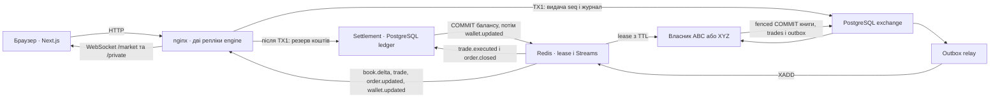

# Mini Exchange

Навчальна біржа за [технічним завданням](ЗАВДАННЯ.md). Користувачі подають лімітні заявки на
інструменти `ABC` і `XYZ` з котируванням у USD. Matching engine зіставляє їх за price-time
priority, а окремий сервіс розрахунків переносить кошти за кожною угодою рівно один раз.

Поточний підтримуваний режим — ізольована навчальна демонстрація із синтетичними даними,
довіреними тестувальниками та окремим профілем браузера. Локальні порти прив’язані до loopback;
remote-профіль використовуйте лише за VPN або мережевим allowlist. Node20 і Next14 збережено
для сумісності зі starter. Для публічного сервісу, недовірених користувачів або цінних даних
спершу потрібне окреме рішення щодо [залишкових обмежень](#залишкові-обмеження-демонстрації).

| Компонент | Роль |
|---|---|
| `apps/matching-engine-service` (NestJS, дві репліки) | Автентифікація, прийом і скасування заявок, зіставлення, self-trade prevention, WebSocket `/market`, `/private` і застарілий `/` |
| `apps/settlement-service` (NestJS) | Резерви коштів, розрахунок угод із Redis Streams, `wallet.updated`, DLQ, звірка з engine |
| `apps/frontend` (Next.js App Router) | Торговий термінал із книгою, угодами, заявками й балансами наживо та панель «Стан системи» |
| PostgreSQL 16 | Журнал команд і книга (БД `exchange`), ledger (БД `ledger`) |
| Redis 7 | Lease власника інструмента, Redis Streams, лічильники лімітів |
| nginx (`engine-lb`) | Балансування реплік engine, ingress frontend, ліміти запитів |

Ingress використовує stable nginx 1.30.6; Compose закріплює digest образу. Під час оновлення
перевіряйте [офіційні advisories](https://nginx.org/en/security_advisories.html), обидва listener
engine, frontend, WebSocket upgrade, CORS і квоти запитів.

Ключові рішення:

- кожен інструмент має одного writer: Redis lease з TTL і renewal та fencing епохою в PostgreSQL;
- порядок задає `seq` з PostgreSQL, і кожна команда комітиться синхронно;
- transactional outbox публікує події в Redis Streams, а settlement ідемпотентний за `tradeId`;
- клієнт помічає розрив за `seq` і heartbeat та бере повний snapshot.

## Зміст

- [Відповідність ТЗ](#відповідність-тз)
- [Швидкий старт](#швидкий-старт)
- [Архітектура](#архітектура)
- [Модель узгодженості order book](#модель-узгодженості-order-book)
- [Вибір брокера й координатора](#вибір-брокера-й-координатора)
- [Володіння інструментом і failover](#володіння-інструментом-і-failover)
- [Розрахунок угод](#розрахунок-угод)
- [Real-time і resync](#real-time-і-resync)
- [Торговий термінал](#торговий-термінал)
- [Знайдені проблеми](#знайдені-проблеми)
- [Системні тести: concurrency і chaos](#системні-тести-concurrency-і-chaos)
- [Тести](#тести)
- [API і зміни контрактів](#api-і-зміни-контрактів)
- [Конфігурація](#конфігурація)
- [Безпека](#безпека)
- [Спостережуваність](#спостережуваність)
- [Експлуатація](#експлуатація)
- [Розробка](#розробка)
- [Обмеження й що зробили б інакше](#обмеження-й-що-зробили-б-інакше)

## Відповідність ТЗ

| Вимога ТЗ | Де описано |
|---|---|
| §7.2 Модель узгодженості й стратегія failover | [Модель узгодженості](#модель-узгодженості-order-book), [Failover](#володіння-інструментом-і-failover) |
| §7.2 Знайдені проблеми: що, як підтверджено, як виправлено | [Знайдені проблеми](#знайдені-проблеми) |
| §7.2 Chaos-тест: як відтворити, до і після | [Системні тести](#системні-тести-concurrency-і-chaos) |
| §7.2 Обґрунтування брокера й координатора | [Вибір брокера й координатора](#вибір-брокера-й-координатора) |
| §7.2 Інструкція запуску | [Швидкий старт](#швидкий-старт) |
| §7.2 Що не встигли або зробили б інакше | [Обмеження](#обмеження-й-що-зробили-б-інакше) |
| §4.1 Максимальний простій інструмента | [Простій після збою](#простій-після-збою) |
| §4.2 Гарантії порядку брокера | [Вибір брокера й координатора](#вибір-брокера-й-координатора) |
| §5 Діаграма шляху даних | [Архітектура](#архітектура) |
| §5 Ідемпотентність на межі settlement | [Розрахунок і DLQ](#розрахунок-і-dlq) |
| §5 Індекси для звірки й перевірок доступу | [Індекси й плани запитів](#індекси-й-плани-запитів) |
| §6 Тести | [Тести](#тести) |
| §7.3 `.env.example` для кожного сервісу | [Конфігурація](#конфігурація) |
| §7.5 Swagger | [API і зміни контрактів](#api-і-зміни-контрактів) |
| §7.6 CI | [Розробка](#розробка), [Системні тести](#системні-тести-concurrency-і-chaos) |

## Швидкий старт

Потрібні Docker Engine **28.0.0 або новіший** і Docker Compose **2.40 або новіший**. На старіших
Docker Engine хости того самого сегмента мережі можуть дістатися до портів, опублікованих на
`127.0.0.1` ([документація Docker](https://docs.docker.com/engine/network/port-publishing/#publishing-ports)).
Версію сервера показує `docker version --format '{{.Server.Version}}'`.

```bash
docker compose up --build
```

Те саме робить `docker-compose up --build`, якщо встановлено alias. Для запуску у фоні з
очікуванням усіх healthcheck використовуйте `docker compose up -d --build --wait`.

Якщо оновлюєте стек зі збереженими даними Redis, спершу виконайте
[перенесення даних Redis](#перенесення-даних-redis-зі-старого-тому).

### Адреси

| Сервіс | Адреса |
|---|---|
| Термінал (frontend) | http://localhost:3000 |
| Engine через nginx (`engine-lb`) | http://localhost:3001; Swagger доступний лише у внутрішній мережі |
| Settlement | http://localhost:3002, Swagger — http://localhost:3002/docs |
| PostgreSQL | `127.0.0.1:5433` |
| Redis | лише в мережі Compose (`redis:6379`); перевірка — `docker compose exec -T redis redis-cli PING` |

Усі порти опубліковано лише на `127.0.0.1`. Окрему репліку engine діагностуйте через
`docker compose exec`.

### Демо

- Торгівля: [кроки з двома акаунтами](#демо-з-двома-акаунтами).
- Адмін: увійдіть як `admin@demo.local` з `ADMIN_PASSWORD` з
  `apps/matching-engine-service/.env.example` і відкрийте http://localhost:3000/admin/status.

### Перевірки стану

- `GET /health` обох backend повертає 200 `{"status":"ok"}`: HTTP-процес живий.
- `GET /ready` обох backend перевіряє PostgreSQL із застосованими міграціями та Redis з
  `maxmemory-policy=noeviction`. Перевірка міграцій лише читає таблицю `migrations`. Engine
  додатково перевіряє відставання WebSocket. Standby може бути ready без власного lease.
- PostgreSQL і Redis мають власні healthcheck.
- `engine-lb` здоровий, поки відповідає хоча б одна репліка engine. Без обох він стає
  `unhealthy` після 10 невдалих перевірок, тобто приблизно за 50 с.
- Healthcheck frontend перевіряє лише його процес. Без engine сторінки показують помилку
  запиту, а не падають, тож стан engine видно на `engine-lb`.
- Redis пише AOF у том `redis-data`. Поки Redis відтворює AOF, невдалі healthcheck не
  рахуються протягом `REDIS_HEALTH_START_PERIOD` (типово `120s`). Для більшого набору даних
  збільште значення, наприклад до `10m`, і відповідно `--wait-timeout`.

### Зупинка й очищення

```bash
docker compose down
```

Команда зупиняє стек і зберігає томи. `docker compose down -v` видаляє томи проєкту разом із
заявками й балансами, тож виконуйте її лише для демоданих, які можна втратити.

Стандартний стек вмикає резерви коштів, тому для нового демо беріть чисті томи. Том starter із
заявками без резервів потребує окремого відновлення: див.
[Резерви на історії без резервів](#резерви-на-історії-без-резервів).

## Архітектура



Обидві репліки приймають HTTP і роздають WebSocket. Matching кожного інструмента має
одного writer. Redis lease забезпечує швидке перехоплення, а епоха PostgreSQL обмежує
право коміту. Redis Streams зберігає окремий потік на інструмент і consumer group
settlement. Після збою доставка повторюється. Унікальний `tradeId` і одна транзакція
settlement забезпечують один ефект у ledger.

## Модель узгодженості order book

Кожен інструмент має один журнал команд у PostgreSQL і одного writer. З цього випливають
порядок, відсутність втрат і повторів та відновлення після збою.

1. **Порядок надходження.** Прийом видає номер `seq` інструмента в тій самій транзакції, що
   записує команду: `instruments.next_seq` збільшується під row lock. Submit і cancel одного
   інструмента беруть номер з одного лічильника, тож мають єдиний порядок. «Надходження»
   означає видачу `seq` під row lock у TX1, до звернення до settlement. Порядок між репліками
   визначає черга блокування PostgreSQL; порядок TCP-пакетів на різних репліках не гарантується.
2. **Один writer.** Команди застосовує лише власник lease інструмента, строго наступний `seq` без
   пропусків. Інші репліки приймають HTTP і пишуть у журнал, але книги не змінюють.
3. **Fencing.** Кожна транзакція застосування блокує `instrument_state`, перевіряє епоху
   власника й умовно просуває `last_applied_seq`. Колишній власник не закомітить, навіть якщо
   ще вважає себе власником.
4. **Персистенція.** Книга живе в пам'яті власника. Кожна команда синхронно комітить зміни
   заявок, угоди й outbox до зміни пам'яті. ТЗ допускає періодичну персистенцію, але тоді після
   збою частину прийнятого довелося б відтворювати з брокера. Синхронний коміт лишає прийняте в
   PostgreSQL, а пам'ять відновлюється з БД.
5. **Детермінізм.** Результат команди залежить лише від книги й самої команди. Пріоритет на
   однаковій ціні задає `prioritySeq`, тобто номер submit-команди.

### Прийом команд

`POST /orders` повертає `{order, trades}`, де `trades` — угоди цієї заявки.

| Код | Значення |
|---|---|
| 201 | Команду застосовано |
| 202 | Заявка ще `pending`, бо `ORDER_SYNC_WAIT_MS` минув раніше. Перечитайте `GET /orders/:id` або `GET /orders?status=active` |
| 200 | Повтор із тим самим `Idempotency-Key`: поточний стан тієї самої заявки |
| 409 `IDEMPOTENCY_KEY_REUSED` | Той самий ключ з іншим нормалізованим тілом |
| 409 `REQUEST_EXPIRED` | Резерв не завершено вчасно; повтор простроченого запиту тим самим ключем |
| 422 | Недостатньо коштів; команда займає `seq`, але не змінює книгу |
| 503 | Недоступна залежність, дедлайн резерву або черга прийому; повторіть запит із тим самим `Idempotency-Key`, щоб перевірити результат |

Ключ — 1–64 латинські літери, цифри, `_` або `-`, і належить користувачу. Без ключа кожен запит
створює нову заявку. Ключі й журнал команд не видаляються (див.
[обмеження](#обмеження-й-що-зробили-б-інакше)). Заявка та її угоди читаються в одному snapshot
`REPEATABLE READ READ ONLY`, щоб одночасний fill не змішав два стани в одній відповіді.

До TX1 виконуються валідація, перевірка ідемпотентності, rate limit і перевірки доступності нового
прийому. TX1 створює `order_requests`, збільшує `instruments.next_seq` і вставляє команду. Row lock
лічильника серіалізує прийом з усіх реплік. Помилка або дубль відкочують інкремент разом із командою,
тому номерів без команд немає. Після TX1 резервується актив, а TX2 створює заявку `pending` з уже
виданим `prioritySeq`. Повільніший резерв не дозволяє пізнішій команді обігнати попередню.

`accepted_at` і `createdAt` заявки — час PostgreSQL після блокування лічильника. `executedAt` —
окремий час застосування команди. Відхилений чи прострочений резерв теж займає свій `seq`: worker
застосовує порожню команду з `tradeCount: 0` і порожньою `book.delta`.

Головна команда в `reserving` чекає до `RESERVATION_WAIT_MS` (типово 3000 мс від видачі `seq`). Це
HOL-компроміс: cancel і наступні submit цього інструмента чекають за нею до дедлайну плюс час
планування worker та БД. Після дедлайну запит переходить у `releasing`, пізній резерв не приймається,
а кошти звільняє сапер. Circuit breaker на репліці після збою резерву відхиляє нові submit до TX1
на 1 с, далі подвоює паузу до 30 с; один інцидент збільшує її один раз, успішний резерв скидає.

Дедлайн абсолютний від `accepted_at`: COMMIT TX1 і черга PG теж витрачають бюджет HTTP-резерву.
Перед остаточним прийняттям TX2 блокує рядок запиту й перевіряє дедлайн за годинником PostgreSQL
після очікування блокування. Прострочення переводить `reserving` у `releasing` навіть без worker;
вчасно прийнятий конкурентним повтором результат зберігається.

Після 503/500 або обриву HTTP спершу повторіть запит із тим самим `Idempotency-Key`. Прийом може
ще тривати, а за невідомого результату COMMIT заявка може вже бути прийнята. Повтор зі старим
ключем завершує той самий прийом або повертає його збережений результат. Новий ключ для цієї
спроби використовуйте лише після явного 409 `REQUEST_EXPIRED`, щоб не створити другу заявку.

### Застосування команд

Worker власника бере строго наступний `seq`. Кожна команда комітиться до підтвердження клієнту й
до зміни книги в пам'яті. Після невдалого COMMIT або COMMIT з невідомим результатом пам'ять
відновлюється з БД через recovery. Перевірка `version` не дає перезаписати неочікувано змінену
заявку.

Для всіх змін однієї apply-транзакції береться один `clock_timestamp()` PostgreSQL після
fencing-lock, з точністю до мілісекунд. Він задає `trades.executed_at`, `executedAt` у подіях,
`outbox.created_at` (тобто `occurredAt`), `orders.updated_at` і `order_commands.applied_at`.
Після failover угода має час виконання новим власником, а не час попереднього прийому. Replay
використовує збережений час apply. Час UTC PostgreSQL потрібно синхронізувати й на HA-репліках;
канонічний порядок завжди задає `seq`, а не настінний годинник.

Poison-команда не зупиняє чергу. Для неї зберігаються `rejected_internal`, скасована заявка з
причиною `rejected`, `book.delta` фактично змінених рівнів (порожня для відхиленого submit) і
`order.closed` із сумою release в outbox. Relay публікує збережені події в Redis Streams.

LISTEN/NOTIFY лише пришвидшує роботу. Polling кожні `COMMAND_POLL_INTERVAL_MS` читає PostgreSQL,
а HTTP після сигналу або таймауту читає committed стан, тож втрачений NOTIFY не губить команду.
NOTIFY, що прийшов під час проходу worker, запускає ще один прохід одразу після нього. Одна заявка
може мати кілька waiter для різних submit і cancel `seq`. LISTEN-клієнт перепідключається після
розриву.

Обидві репліки Compose мають `ENGINE_WORKER_ENABLED=true`. Кожна приймає HTTP, але matching
виконує лише власник lease. Значення `false` вимикає matching на окремому екземплярі для
діагностики. REST і початковий legacy WS snapshot читають один committed стан PostgreSQL на owner
і standby. PostgreSQL сортує рівні й застосовує `depth`. Публічні читання книги обмежені трьома
одночасними запитами на репліку (черга до 200 і не довше 2 с, далі 503 `BOOK_BUSY`), щоб не
відбирати з'єднання у worker.

### Скасування

`DELETE /orders/:id` створює не більше однієї cancel-команди. Вона стає в той самий порядок `seq`,
що й submit. Якщо заявка вже термінальна або попередня команда встигла її виконати, відповідь —
409 `ORDER_ALREADY_FILLED` чи `ORDER_ALREADY_CANCELLED` з фінальним `{order}`. Для вже термінальної
заявки ця відповідь приходить і тоді, коли інструмент зупинено: worker для неї не потрібен.

Cancel працює й за відмови Redis, а новий submit тоді отримує 503. Відмова PostgreSQL чи таймаут
блокування також дають 503. Ключ ідемпотентності дозволяє перевірити результат submit; новий ключ
потрібен лише після явного 409 `REQUEST_EXPIRED`.

### Зіставлення заявок

Заявки виконуються за найкращою сумісною ціною заявки, що вже в книзі.
За рівної ціни першість визначає `prioritySeq`: номер submit-команди. Часткове
виконання не змінює пріоритет. Адаптер `matchOrder` зберігає підтримку старих фікстур без номерів.
Коли наступною сумісною є заявка того самого власника, залишок нової заявки
отримує статус `cancelled`. Уже виконані угоди зберігаються у відповіді на
`POST /orders`, а `GET /orders` показує скасований статус. У `remainingQuantity`
такої заявки лишається скасований залишок, тож виконаний обсяг — це
`quantity - remainingQuantity` (заявка на 2, що виконала 1 і скасувала решту, має
`remainingQuantity` 1; якщо угод не було, то 2). Скасування через `DELETE /orders/:id`
також зберігає скасований залишок і вже виконаний обсяг.

Знімок книги для зіставлення або повністю з номерами надходження, або повністю без
них. Змішаний знімок відхиляється помилкою: порядок за номером і за часом створення
не узгоджується.

`POST /orders` приймає `price` (0.01–1 000 000, до 2 знаків після крапки) і `quantity`
(0.00000001–1 000 000, до 8 знаків) як JSON-числа або як десяткові рядки (`"100.25"`).
Значення за межами діапазону або з надлишковою точністю повертають HTTP 400. Для
JSON-чисел перевіряється запис із тіла запиту, а не округлене `number`: наприклад,
`1000000.00000000001` відхиляється, хоча JavaScript перетворив би його на `1000000`.
Експоненційний запис (`1e-8`) розгортається без округлення. Зіставлення оперує
цілими тиками та лотами, а ціни й кількості угод повертаються як десяткові рядки.

## Вибір брокера й координатора

| Задача | Вибір | Чому | Що відкинуто |
|---|---|---|---|
| Черга подій | Redis Streams | Redis уже потрібен для lease. Окремий stream на інструмент (`exchange:market:{I}`, `exchange:settlement:{I}`) зберігає порядок у його межах. Consumer group, PEL і `XAUTOCLAIM` повторюють доставку після збою. Лічильники `XINFO STREAM` дозволяють помітити обрізані записи | Kafka з партицією за інструментом дала б ті самі гарантії, але потребує окремого кластера для двох інструментів. RabbitMQ не зберігає порядок черги при повторній доставці кільком consumer і не дає replay історії |
| Власник інструмента | Redis lease + епоха в PostgreSQL | Lease з TTL і renewal швидко обирає кандидата. Правильність тримає PostgreSQL: кожен коміт перевіряє епоху власника в тій самій БД, куди пише | etcd або ZooKeeper дали б консенсусне блокування, але ще один кластер. Блокування без fencing, зокрема Redlock, не захищає від паузи процесу між перевіркою lease і записом |

Гарантії порядку:

- Порядок обробки заявок задає `seq` з PostgreSQL, а не брокер. Брокер переносить уже
  впорядковані результати.
- Outbox пишеться в транзакції застосування команди. Relay один на розгортання (advisory
  lock) і публікує рядки в порядку `id`. Lua-скрипт звіряє позицію для пари «stream,
  інструмент» і відхиляє запізнілий `XADD`, тож події інструмента йдуть у порядку `seq`.
- Доставка at-least-once. Якщо relay упав між `XADD` і позначкою публікації, запис
  повториться з тим самим `eventId`. WebSocket відкидає повтор за `eventId` і `seq`,
  settlement — за `tradeId` (первинний ключ у ledger).
- Settlement не залежить від порядку між записами: усі операції з резервом комутативні.
- Розгортання розраховане на один Redis без Cluster з AOF і `noeviction`. Втрачений хвіст
  stream автоматично відтворюється з committed outbox; redrive лишається операторським повтором.

## Володіння інструментом і failover

| Питання | Відповідь |
|---|---|
| Хто виявляє падіння власника | Резервна репліка. Вона намагається взяти lease кожні 1000 мс і отримує його, коли TTL старого власника спливає без renewal |
| Скільки триває перехоплення | Після SIGKILL виміряно 3,9–5,8 с ([результати](#результати-після-виправлення)), розрахунковий орієнтир близько 7 с, вимога ≤ 10 с. Після SIGTERM — менше 1 с. Якщо власник тихо втратив PostgreSQL, drain віддає lease після 6,5 с без прогресу (див. [простій](#простій-після-збою)) |
| Чи можлива втрата заявок | Ні. Прийнята заявка вже має `seq` у журналі PostgreSQL, і новий власник застосовує журнал з `last_applied_seq + 1` |
| Чи можливий дубль | Ні. Застосування і просування `last_applied_seq` — одна транзакція з перевіркою епохи. Повтор HTTP з тим самим `Idempotency-Key` повертає ту саму заявку |
| Split-brain | Колишній власник може ще вважати lease своїм, але його коміт не пройде: новий власник збільшив `owner_epoch`, а кожна транзакція перевіряє епоху під row lock |

### Lease і fencing

Ключ `lease:instrument:{ABC}` містить унікальний токен екземпляра. TTL — 5000 мс, renew — кожні
1500 мс, запас до step down — 500 мс. Власник відмовляється від lease за монотонним дедлайном,
навіть якщо запізніла відповідь renew каже «успіх». Redis-клієнт не накопичує offline-команди, а
команда й початкове підключення обмежені 1000 мс. Старий токен не може продовжити чи видалити
lease нового власника.

Lease лише визначає кандидата. Право запису дає PostgreSQL:

- takeover збільшує `owner_epoch`;
- кожна транзакція matching блокує `instrument_state`, перевіряє епоху й завершується умовним
  UPDATE з тією самою епохою та попереднім `last_applied_seq`;
- помилка відкочує orders, trades і outbox разом, а пам'ять оновлюється лише після COMMIT.

Сесії engine мають `idle_in_transaction_session_timeout=2s` і `statement_timeout=5s`, а захоплення
рядка — `lock_timeout=3s`. Тож процес, призупинений усередині транзакції, не блокує takeover
безкінечно.

### Простій після збою

Орієнтир простою після crash — близько 7 с: TTL, спроби acquire кожні 1000 мс з jitter 0–300 мс і
recovery. Ця оцінка діє, поки резервній репліці доступні Redis і PostgreSQL, книга має до 10 000
resting-заявок на інструмент, а годинник Redis не стрибає. System-тест вимагає ≤ 10 с після
SIGKILL і ≤ 2 с після SIGTERM. Виміряно **SIGTERM 840 мс, SIGKILL 4883 мс**, в останньому прогоні
902 і 4939 мс.

Інший випадок — власник втратив мережу до PostgreSQL без TCP reset. Тоді запит висить, а renew у
Redis триває. Після 6,5 с без прогресу drain віддає lease, пише `alert=engine_worker_stalled`
і 5 с не намагається повернути lease. Легітимний довгий drain зберігає lease, поки виконує
команди. Recovery має окремий бюджет 30 с для завантаження великої книги.
System-тест `ownership:blackhole` вимагає ≤ 10 с до перехоплення здоровою реплікою.
Запити на відрізану репліку отримують 503 або 504 і повторюються.

Простій міряють дві величини, обидві з міток одного PostgreSQL:

- `takeoverMs` — `recovered_at` нової епохи мінус останній `applied_at` старої. Це верхня межа часу
  до відновлення книги новим власником.
- `resumeMs` — від того самого `applied_at` до застосування новим власником першої команди, що
  чекала під час перехоплення, тобто фактичний простій для заявок. Його міряють лише тоді, коли
  така команда була, інакше в журналі `n/a`.

Chaos-тест обмежує обидва значення 10 с.

### Навантаження на worker і прийом

- Захоплення lease не залежить від drain: poll планується до початку обходу, а завантаження
  одного інструмента не блокує інші.
- Один прохід drain обмежений 1 с і 100 командами. Решту забирає наступний poll, тож resume і
  shutdown не чекають довгий backlog.
- Команда на десятки тисяч заявок може тривати довше 30 с, але кожна заявка рахується як прогрес
  для сторожового таймера.
- Intake серіалізується з halt на рядку лічильника інструмента і не блокує `instrument_state`, тому
  потік заявок не зупиняє worker.
- Кроки подачі й скасування, що працюють із БД, обмежені п'ятьма одночасними на репліку (черга до
  500 і не довше 5 с, далі 503 `ORDERS_BUSY`), щоб решта пулу лишалася worker.
- HTTP-резерв має окрему межу на п'ять одночасних викликів (черга до 500, очікування до 5 с).
  Вона стоїть після TX1. Слот PG під час HTTP вільний. Загальний дедлайн резерву 3 с включає
  очікування цього слота: великий сплеск може прострочити резерв ще в черзі.

`ORDERS_BUSY` до TX1 означає, що номер не видано. Після TX1 команда вже має `seq`: PG-відмова може
лишити запит у `reserving`, а невідомий результат COMMIT — уже прийняту заявку. Після помилки
перевіряйте стан повтором зі старим ключем; новий потрібен лише після явного `REQUEST_EXPIRED`.
Якщо заявку вже прийнято, а читання результату не вдалося, відповідь — 202 і `pending`.

### Діагностика власника

`GET /admin/instruments` повертає власника, епоху, TTL, `lastAppliedSeq`, `maxSeq`, backlog,
best bid/ask, кількість рівнів і resting-заявок та `outboxBacklog`. Збій Redis не ховає решту
полів: `leaseTtlMs` тоді `null`.

`/metrics` містить лічильники mismatch, fenced writes, помилок renew і стан halted. Лічильники
належать одній репліці. Через публічний `:3001` шлях `/metrics` повертає 404, тож читайте його з
кожної репліки:

```bash
docker compose exec -T matching-engine-1 wget -qO- http://127.0.0.1:3001/metrics
docker compose exec -T matching-engine-2 wget -qO- http://127.0.0.1:3001/metrics
```

Запити для розбору halted:

```sql
SELECT instrument,status,owner_instance,owner_epoch,last_applied_seq,
       resting_bid_count,resting_ask_count,resting_bid_lots,resting_ask_lots
FROM instrument_state;
SELECT instrument,side,count(*),sum(remaining_quantity) * 100000000 AS lots
FROM orders WHERE status IN ('open','partially_filled') GROUP BY instrument,side;
SELECT instrument,seq,type,order_id,applied_at,result FROM order_commands ORDER BY instrument,seq;
```

Ті самі дані з кореня локального Compose-проєкту:

```bash
docker compose logs --no-color --tail=200 matching-engine-1 matching-engine-2
docker compose exec -T exchange-db psql -U engine -d exchange -c 'SELECT * FROM instrument_state;'
docker compose exec -T exchange-db psql -U engine -d exchange -c 'SELECT instrument,seq,type,order_id,applied_at,result FROM order_commands ORDER BY instrument,seq;'
```

Виправляйте дані лише після звірки з авторитетним журналом. Після виправлення викличте resume і
перевірте, що backlog зменшується в порядку `seq`. Після resume worker одразу застосовує
накопичене й те, що прийшло під час resume, без очікування наступного poll.

### Recovery і зупинений інструмент

Recovery сортує заявки за ціною й `prioritySeq` і перевіряє:

- загальну кількість заявок і суму lots, а також окремо для bids і asks (лічильники кожної сторони
  зберігаються в `instrument_state`);
- відсутність перехрещення книги.

Розбіжність recovery або gap довше `SEQ_GAP_ALERT_MS` ставить `instrument_state.status=halted`.
Стан переживає restart. Submit і cancel незакритої заявки (`pending`, `open`, `partially_filled`)
повертають 503 `INSTRUMENT_HALTED`, нові команди не приймаються й не застосовуються. Логи містять `alert=engine_recovery_mismatch` або
`alert=engine_seq_gap`. Автоматичного resume немає: спершу порівняйте журнал, лічильники й
фактичні resting-заявки.

Gap перевіряється й на хвості журналу. Якщо `next_seq` уже видано, а очікуваного рядка немає, після
`SEQ_GAP_ALERT_MS` інструмент переходить у halted без нової заявки. Команда й виданий лічильник
читаються одним SQL snapshot, тому конкурентний COMMIT не створює хибного gap. Якщо запис
applied-команди не оновився, вся транзакція matching відкочується, і `last_applied_seq` не
просувається.

**Resume.** `POST /admin/instruments/ABC/resume` з access-токеном admin передає запит поточному
власнику через NOTIFY, незалежно від репліки HTTP. Власник під fenced row lock повторює recovery і
перевіряє суцільний журнал від 1 до `next_seq`: застосований префікс до `last_applied_seq`,
незастосований суфікс і узгодженість обох лічильників. Невиправлена прогалина чи хибний
`applied_at` блокують resume і подальший intake.

| Відповідь | Коли |
|---|---|
| 200 `{status:"active"}` | Перевірки збіглися |
| 409 `RECOVERY_MISMATCH` | Розбіжність, а також завжди для непідтвердженого legacy стану (`legacy_verified=false`); `force` немає |
| 400 | Невідомий інструмент |
| 503 | Немає власника, втрачено NOTIFY або recovery впав, зокрема коли втрачено відповідь на COMMIT. Власник тоді відпускає lease, наступний poll читає фактичний статус із БД, і запит можна повторити |
| 403 / 401 | Звичайний користувач / без токена |

Власник підтверджує запит одразу. Без підтвердження 503 приходить через 3 с, після нього результат
чекається до 12 с: lock 3 с і перевірка журналу до 10 с. Дедлайн підтвердження рахується від
виклику й охоплює чергу публікацій: прострочений запит власнику не надсилається. Публікація NOTIFY
обмежена 2 с, зависле з'єднання розривається й перепідключається. Повтор перевіряє дані знову.

Таймаути recovery більші за звичайні, бо читання й сортування великої книги довше за 5 с і 2 с
простою. Запит журналу й recovery-транзакція мають `statement_timeout=10s`, а recovery ще й
`idle_in_transaction_session_timeout=10s`. Решта сесій лишається на 5 с і 2 с. Очікування вільного
з'єднання пулу — до 10 с.

Для довгого recovery healthcheck має початкове вікно 120 с і 10 спроб через 5 с. Прогін на 10 000
resting-заявках перевіряє, що навіть десятикратний виміряний старт вкладається в це вікно. Для
довільного обсягу тестові дані такої межі не доводять, тож перед збільшенням навантаження
виміряйте recovery на своїй БД. Знімків книги для прискорення старту немає.

Повтор завершеного ідемпотентного запиту перевіряє hash і читає збережений результат до Redis і до
перевірок нового прийому. Під час відмови Redis accepted повертає 200, rejected — збережену 422,
інше тіло — 409, а новий прийом — 503.

### Оновлення БД зі старого engine

Оновлення БД із заявками попереднього engine виконуйте із зупиненим старим writer:

```bash
docker compose down --remove-orphans
docker compose up -d --build --wait --wait-timeout 240
```

Старі записи БД не є авторитетною книгою: попередній matcher міг виконати maker у пам'яті, не
оновивши його в БД. Тому:

- імпортовані раніше записи `imported_snapshot` позначаються `unverified_snapshot`;
- інструмент отримує `legacy_verified=false` і `halted`;
- пріоритети, sequence й лічильники імпорту зберігаються лише як діагностичні дані;
- loader не публікує й не застосовує таку книгу, навіть якщо вручну змінити status на active;
- публічна глибина повертає 503 `INSTRUMENT_HALTED`, а не достовірний на вигляд порожній snapshot.

Потрібні авторитетний знімок старої книги та явна звірка. Автоматичне підтвердження legacy-даних і
їхній resume не реалізовані, а зміна одного прапорця не є звіркою. Нова чиста БД працює без цього
обмеження. Down міграції не відновлює matching: позначки unverified і halted зберігаються. Перед
оновленням збережіть резервну копію БД.

## Розрахунок угод

### Резерви та гаманці

Стандартний стек запускається з увімкненими резервами (`RESERVATIONS_ENABLED=true`), а settlement
споживає угоди й закриття заявок з Redis Streams.

**Резерв після видачі номера.** Engine резервує актив після TX1, до створення заявки `pending`:
для купівлі це лімітна ціна × кількість у USD, для продажу — кількість базового активу.
Резерв не змінює вже виданий порядок команд.

| Результат резерву | Відповідь `POST /orders` |
|---|---|
| Недостатній баланс | 422; виданий `seq` застосовується порожньою командою |
| Збій мережі, 5xx або 429 | Повтори в межах загального дедлайну 3 с, потім 503 і звільнення резерву |
| Інша відповідь settlement, наприклад 401 через різні `RESERVATION_API_TOKEN` | 500 без повтору; `reservation_request_refused` у журналі, запит переходить у звільнення |
| Резерв запізнився або запит уже звільняється | 409 `REQUEST_EXPIRED` |

Після 503 чи 500 повтор старого ключа перевіряє результат. Якщо повернувся `REQUEST_EXPIRED`,
нова спроба потребує нового ключа. Breaker може повернути 503 до видачі номера.

**Сапер.** Кожна репліка engine підбирає прострочені запити невеликими пачками. Рядок переходить у
`releasing` до HTTP-виклику, після збоїв release повторюється, а після підтвердження рядок стає
`expired`. Settlement застосовує звільнення один раз. Для невідомого ID зберігається tombstone, який
відхиляє запізнілий reserve. Метрика `reservation_release_failures_total` зростає за кожної невдалої
спроби сапера. Якщо резерв прострочено більше ніж на 10 хв, перевірте логи engine за
`reservation_release_stuck` і доступність settlement.

**Гаманці.** `GET /wallets` потребує access JWT і повертає лише гаманці власника токена:
`[{asset, available, reserved, version}]`, де `version` — десяткове ціле в рядку, те саме, що несе
`wallet.updated`.

- Резерви, звільнення й розрахунок угоди записують збалансовані проводки та баланси однією
  транзакцією. Шкали ABC і XYZ — 8 знаків, USD — 10.
- Початкові демобаланси з `DEMO_INITIAL_BALANCES` проводяться один раз при першому зверненні до
  гаманця. Блокування рахунків бере лише звернення, яке створює відсутні рахунки. Далі
  `GET /wallets` читає закомічений стан одним запитом без блокувань і не чекає на розрахунок угоди з
  тими самими рахунками.
- Резерви та звільнення також публікують `wallet.updated` після коміту, коли Redis доступний. Для
  актуального балансу перечитайте `GET /wallets`. Термінал робить це сам після подій власних заявок
  і раз на 10 с (див. [`/private`](#private-власник)).

**Ручний розрахунок.** Основний шлях описано в розділі [«Розрахунок і DLQ»](#розрахунок-і-dlq).
Внутрішній `POST /trades/settle` з `x-internal-token` розраховує угоду тим самим кодом. Він приймає ID
угоди й обох заявок, ID покупця й продавця, інструмент, обидва активи, ціну й кількість десятковими
рядками, ліміт покупця та `executedAt`. Settlement звіряє інструмент і ліміти зі збереженими умовами
обох резервів.

- Успіх — `status: applied` та `entryId`.
- Повтор тих самих даних — `duplicate` з тим самим ID.
- Інший вміст з тим самим `tradeId` — 409.

### Події й доставка

Engine записує outbox у тій самій PostgreSQL-транзакції, що й зміни заявок, угоди та
`last_applied_seq`. Скасування й відхилення теж споживають `seq`.

| Stream | Події |
|---|---|
| `exchange:market:{I}` | Одна `book.delta` на команду, навіть порожня, і одна `trade.public` на угоду. Публічна угода містить ті самі поля, що й REST-стрічка, плюс інструмент. |
| `exchange:settlement:{I}` | `trade.executed` на угоду, `order.closed` за додатної суми release. |
| `exchange:user-events` | `order.updated` на кожну змінену заявку з її версією і власником. |

Redis-запис містить `eventId`, `type`, `version`, `instrument`, `seq`, `traceparent`
і `envelope`. JSON у `envelope` має версію 1, `occurredAt` з outbox, `producer` та
`payload`. `seq` — цілий рядок. `price` і `quantity` — десяткові рядки.
`seq` угоди — номер команди taker; `fillIndex` — позиція fill від нуля в цій команді.
`price` — ціна maker, `takerSide` — напрям taker. `quoteAmount` у внутрішній події — ціле
price ticks × quantity lots, одиниця 1e-10 USD; settlement обчислює суму з ціни й кількості.
`quoteAmount` і `releasedAmount` — рядки цілих мінімальних одиниць відповідного
активу (10 знаків шкали для USD, 8 для базового активу).

**Relay.** Кожна репліка запускає relay, але PostgreSQL advisory lock дозволяє публікувати лише
одному relay одночасно. Relay бере найстаріший неопублікований рядок, виконує `XADD`, позначає
`published_at` і комітить.

- Lua в Redis атомарно звіряє позицію outbox для пари «stream, інструмент» і виконує `XADD`. Так
  Redis відхиляє запізнілий запит зі старішою позицією після того, як інша репліка просунула stream.
- Одна подія на транзакцію зберігає порядок при повторі після `XADD`. Якщо relay упав у цьому вікні,
  наступна спроба може додати другий Redis-запис з тим самим `eventId` і `seq`.
- Для нових команд `book.delta` покриває всі послідовні `seq` інструмента. Інші типи можуть
  пропускати або повторювати `seq`. Рядки outbox зі старої версії relay публікує як збережено.
- `OUTBOX_POLL_INTERVAL_MS` (100 мс) задає паузу при порожній черзі, зайнятому lock або збої. Поки є
  backlog, relay бере наступний рядок одразу після COMMIT.
- `STREAM_MAXLEN` (1 000 000) задає приблизну межу довжини кожного stream, зокрема stream
  settlement. Relay обрізає його без урахування того, що consumer ще не прочитав (див.
  [«Обмеження»](#обмеження-й-що-зробили-б-інакше)).
- Якщо Redis недоступний, неопубліковані рядки лишаються в PostgreSQL, і relay підбирає їх після
  відновлення. Обрізані чи втрачені записи Redis можна відтворити з outbox.
- Службовий hash `exchange:outbox:positions:<DATABASE_NAME>` зберігає останні позиції. PostgreSQL і
  Redis цього розгортання мають спільну історію outbox.

Для діагностики перевірте `outboxBacklog` у `GET /admin/instruments`, помилки
`outbox_publish_failed` у логах engine і записи всередині Compose:

```bash
docker compose logs matching-engine-1 matching-engine-2
docker compose exec -T redis redis-cli XRANGE 'exchange:market:{ABC}' - + COUNT 10
```

Якщо PostgreSQL відновлено з резервної копії окремо від Redis, нові рядки outbox отримують `id`,
менші за позиції в hash, і relay зупиняється на першому ж рядку. Ознаки: `outboxBacklog` росте,
а лог engine щоразу повторює `alert=outbox_position_rejected` з тим самим `stream` та `id`
(поодинокий такий запис — гонка двох relay, він минає сам). Зупиніть обидві репліки engine,
видаліть hash позицій і запустіть їх знову:

```bash
docker compose stop matching-engine-1 matching-engine-2
docker compose exec -T redis redis-cli DEL 'exchange:outbox:positions:exchange'
docker compose start matching-engine-1 matching-engine-2
```

`exchange` тут — значення `DATABASE_NAME`. Після запуску relay публікує неопубліковані рядки
від найстарішого. Streams при цьому ще містять події історії, якої в PostgreSQL уже немає, тож
після такого відновлення запустіть звірку.

### Розрахунок і DLQ

Settlement читає `exchange:settlement:{ABC}` і `exchange:settlement:{XYZ}` через consumer group
`settlement` з ім'ям `CONSUMER_NAME`. Група створюється з початку stream, тож consumer бачить усю
історію. Порядок записів settlement не потрібен: усі операції з резервом комутативні.

**Ідемпотентність.** Угода розраховується однією транзакцією ledger, а `tradeId` — первинний ключ
розрахованих угод. Тому повторна доставка тієї самої угоди йде шляхом `duplicate` і не створює
другого набору проводок.

- Запис підтверджується (`XACK`) лише після коміту транзакції ledger і публікації `wallet.updated`
  для покупця й продавця в обох активах. Повторна доставка теж публікує поточний стан, тож збій між
  комітом і `XADD` не губить сповіщення. Термінал відкидає `wallet.updated`, якщо `version` не
  більша за відому версію цього гаманця.
- `order.closed` звільняє залишок резерву, і `release` ідемпотентний. Запис так само
  підтверджується лише після публікації `wallet.updated` звільненого гаманця, а повторна доставка
  публікує його стан ще раз.
- Сповіщення HTTP-резервів лишаються best effort: термінал звіряє баланс через `GET /wallets` (див.
  [`/private`](#private-власник)).

**Повтори.** Цикл забирає прострочені записи через `XAUTOCLAIM` (`CONSUMER_CLAIM_IDLE_MS`) і читає
нові через `XREADGROUP`. Запис стає доступним для reclaim лише після цього простою, тож PEL
сканується одразу на старті й далі не частіше ніж раз на половину `CONSUMER_CLAIM_IDLE_MS`, а не перед
кожною пачкою. Збій запису повторюється не раніше ніж через `CONSUMER_CLAIM_IDLE_MS`. Межа
орієнтовна: до 1,5 × `CONSUMER_CLAIM_IDLE_MS`, плюс до 1 с очікування `XREADGROUP` і час обробки
поточної пачки, бо reclaim перевіряється лише між читаннями. За 1000 мс повтор може початися
приблизно через 2 с.

| Збій | Поведінка |
|---|---|
| Невалідний envelope, невідома версія, дані угоди, що не проходять перевірку, інший вміст за тим самим `tradeId`, від'ємний баланс (23514) | Одразу DLQ |
| Збій PostgreSQL чи Redis (з'єднання, тайм-аут, deadlock, serialization) | Без `XACK`, повтор через reclaim. У DLQ не йде за жодної кількості доставок |
| Інша помилка (наприклад, резерв не відповідає угоді) | Повтор, після `CONSUMER_MAX_DELIVERIES` доставок DLQ |

DLQ — stream `exchange:dlq` і рядок у `settlement_failures` (`stream`, `message_id`, `trade_id`, `reason`).
Рядок пишеться першим і ідемпотентний, а `XADD` у DLQ з `XACK` виконує один Lua-скрипт.
Якщо `tradeId` не має канонічної форми UUID, поле `trade_id` у журналі дорівнює `NULL`.
Оригінальний ідентифікатор лишається в payload. Дані, які не приймає `jsonb`, зберігаються як base64.
Обрізання не змінює PEL: `XAUTOCLAIM` у Redis 7 знаходить такі записи вже видаленими й прибирає їх
з PEL, а їх payload втрачено. Лічильник `settlement_trimmed_pending_total` зростає, consumer
продовжує, а звірка покаже угоду як `missing`.
Якщо stream видалено, цикл перестворює групу й іде далі.

`GET /admin/queue` (admin) показує довжину, `pending`, `lag` кожного stream, довжину DLQ і кількість
`settlement_failures`. `GET /metrics` settlement віддає `settlement_trades_total{result}`,
`settlement_dlq_total`, `settlement_trimmed_pending_total`, `settlement_pending`, `settlement_stream_lag`.
Стан черги збирається через `prom-client`. Лічильники процесу лишаються доступними при збої Redis.
Redis повертає `lag` групи як `null`, коли не може його порахувати (наприклад, після видалення
недоставленого запису). `/admin/queue` показує тоді `null`, а `settlement_stream_lag` — NaN, а не 0.

Метрики settlement зникають разом із ним, тож engine теж читає чергу: `GET /metrics` кожної
репліки engine віддає `engine_settlement_stream_length`, `engine_settlement_group_pending` і
`engine_settlement_group_lag` з міткою `stream`. Значення беруться з `XLEN` і `XINFO GROUPS` під час
кожного scrape, через клієнт Redis outbox relay (таймаут команди 1 с, без черги офлайн), тож
недоступний Redis не затримує `/metrics`. NaN означає «невідомо»: Redis не відповів, групи
`settlement` немає (settlement жодного разу не запускався) або Redis не може порахувати lag. Обидві
репліки читають той самий Redis, тож правила беруть `max`. Порівняння з NaN не спрацьовує, тому
невідомий стан ловить окреме правило (`x != x` істинне лише для NaN). Правила лежать у
[`deploy/prometheus/settlement-alerts.yml`](deploy/prometheus/settlement-alerts.yml):

| Алерт | Умова |
|---|---|
| `SettlementBehind` | `max` lag понад 1000 протягом 5 хв |
| `SettlementLagging` | lag не падав до нуля 10 хв (`for: 10m`; короткий backlog після старту не будить) |
| `SettlementQueueUnknown` | lag NaN на якійсь репліці або метрик engine немає, 5 хв |

Поведінку правил перевіряють тести `promtool` поряд (`settlement-alerts.test.yml`), CI запускає їх
у job «Compose smoke»:

```bash
docker run --rm -v "$PWD/deploy/prometheus:/rules:ro" -w /rules --entrypoint promtool \
  prom/prometheus:v3.5.0 test rules settlement-alerts.test.yml
```

Межа 1000 — приклад: це близько 0,1 % `STREAM_MAXLEN`, далеко до обрізання непрочитаних подій.

### Звірка

```bash
curl -fsS -X POST -H "Authorization: Bearer $ADMIN_TOKEN" \
  'http://localhost:3002/admin/reconciliation?from=2026-01-01T00:00:00.000Z&to=2026-12-31T00:00:00.000Z&instrument=ABC'
docker compose exec -T settlement-service node dist/reconcile --from 2026-01-01T00:00:00.000Z
```

Токен адміністратора видає `POST /auth/login` engine. Settlement перевіряє підпис і через
внутрішній API engine перевіряє, що сесія активна. HTTP-звірку запускає `POST`; `GET` повертає 404.
Період `[from, to)` рахується за `executed_at` з точністю до мілісекунди. Без `from` і `to`
береться вся історія до зараз. Команда `reconcile` не запускає consumer. Код виходу: 0 — розбіжностей немає,
1 — є розбіжність, 2 — engine чи БД недоступні.

Settlement читає угоди engine сторінками по 1000 через внутрішній `GET /internal/trades`
і питає про стан заявок активних резервів через `POST /internal/orders/terminal`
(`x-internal-token`, лише через `engine-lb:8080`; публічний `:3001` повертає 404). Кожна сторінка
читається в `REPEATABLE READ READ ONLY`. Обидві сторони зливаються в порядку `(executed_at, trade_id)`,
тож пам'ять не залежить від кількості угод. Для кожної угоди очікувані проводки обчислюються з даних
engine й порівнюються з фактичними.

| Клас | Значення |
|---|---|
| `pending` | Немає в ledger, свіжіша за `SETTLEMENT_GRACE_MS`. Не робить звіт невдалим |
| `missing` | Немає в ledger й старша за grace |
| `failed` | Немає в ledger, є в `settlement_failures` |
| `orphan` | Є в ledger, немає в engine |
| `amount_mismatch` | Проводки відрізняються від очікуваних |
| `duplicate` | Кожна очікувана проводка записана двічі |
| `payload_conflict` | Інструмент або хеш збереженої угоди не збігається з даними engine. Із фільтром `instrument` такий запис ledger видно як `missing` в одному інструменті й `orphan` в іншому |
| `reservation_leak` | Баланс `reserved` користувача в активі не дорівнює сумі залишків активних резервів |
| `stuck_reservation` | Резерв лишається `active`, хоча заявка в engine `filled` або `cancelled` і перейшла в цей стан раніше за `SETTLEMENT_GRACE_MS`: `order.closed` не дійшов |

Звіт містить `perInstrument` (кількість, Σ кількості, Σ суми котирування з обох боків) та `perAsset`
(Σ debit, Σ credit, Σ балансів, число рахунків, чий баланс не збігається з replay проводок).
`ok` дорівнює `false` за будь-якої розбіжності, крім `pending`, або порушеного балансу активу.
`reservation_leak` і `stuck_reservation` перевіряються на момент звірки, а не за період; `instrument`
звужує лише другу. Для `stuck_reservation` settlement проходить активні резерви сторінками по 1000 за
`reservation_id` в одному snapshot і питає engine, які з їхніх заявок термінальні: до engine йдуть лише ID
активних резервів, а не вся історія заявок. Недоступний engine дає 502 (код виходу 2), а не чисту звірку.
Список `discrepancies` обмежено 1000 елементами; `counts` точні, `truncated` показує обрізання.
Звірка читає всі проводки й рахунки, тож її варто запускати за потреби, а не за таймером. Одночасно
виконується одна звірка: другий виклик HTTP-маршруту отримує 409 `RECONCILIATION_RUNNING`. Транзакція
звірки має власні ліміти (600 с на запит, 120 с простою), решта settlement лишається на 15 с і 10 с.

#### Індекси й плани запитів

На PostgreSQL 16 після `ANALYZE` перевірено по 20 000 синтетичних рядків у
`settled_trades`, `orders` і `accounts`, для гаманців — 120 000 рахунків (20 000 користувачів,
три активи, `available` і `reserved`). Planner використав відповідний індекс у
кожному запиті. Тип сканування залежить від селективності й розподілу рядків.

| Операція | Вузол `EXPLAIN (ANALYZE, BUFFERS)` | Рядків у відповіді |
|---|---|---:|
| Звірка за періодом та інструментом | `Bitmap Index Scan on settled_trades_instrument_executed_idx` | 30 |
| Звірка за періодом | `Index Scan using settled_trades_executed_idx` | 60 |
| `GET /orders?status=filled` | `Bitmap Index Scan on orders_owner_status_idx` | 50 |
| `GET /orders?status=cancelled&limit=100`, перша сторінка і з курсором (окрема перевірка: 300 000 заявок 500 власників) | `Index Scan using orders_owner_status_idx`, з курсором `Bitmap Index Scan` | 100 |
| Пошук наявного рахунку під час запису в ledger | `Index Scan using accounts_user_id_asset_kind_key` | 1 |
| Гаманці користувача для `GET /wallets` | `Bitmap Index Scan on accounts_user_id_asset_kind_key` | 6 |

У своїй тестовій БД підставте період з угодами та ідентифікатор наявного користувача.
Запит заявок виконується в `exchange`, решта в `ledger`.

```sql
EXPLAIN (ANALYZE, BUFFERS)
SELECT trade_id, instrument, executed_at, payload_hash
FROM settled_trades
WHERE executed_at >= '2026-11-10 00:10+00' AND executed_at < '2026-11-10 00:11+00'
  AND instrument = 'ABC'
ORDER BY executed_at, trade_id LIMIT 1000;

EXPLAIN (ANALYZE, BUFFERS)
SELECT trade_id, instrument, executed_at, payload_hash
FROM settled_trades
WHERE executed_at >= '2026-11-10 00:10+00' AND executed_at < '2026-11-10 00:11+00'
ORDER BY executed_at, trade_id LIMIT 1000;

EXPLAIN (ANALYZE, BUFFERS)
SELECT * FROM orders
WHERE owner_id = '00000000-0000-4000-8000-000000000001' AND status = 'filled'
ORDER BY created_at DESC, id DESC LIMIT 50;

EXPLAIN (ANALYZE, BUFFERS)
SELECT id FROM accounts
WHERE user_id = '7164af7f-c1fc-8f92-2570-cdd3f20ec5e8' AND asset = 'USD' AND kind = 'available';

EXPLAIN (ANALYZE, BUFFERS)
SELECT a.user_id, a.asset, a.kind, a.balance, a.version
FROM accounts a
JOIN unnest(ARRAY['7164af7f-c1fc-8f92-2570-cdd3f20ec5e8', '7164af7f-c1fc-8f92-2570-cdd3f20ec5e8',
                  '7164af7f-c1fc-8f92-2570-cdd3f20ec5e8']::uuid[],
            ARRAY['ABC', 'USD', 'XYZ']::text[]) AS w(user_id, asset)
  ON a.user_id = w.user_id AND a.asset = w.asset
WHERE a.kind IN ('available', 'reserved');
```

### Відновлення після втрати stream

Outbox у PostgreSQL — джерело правди; stream можна відтворити. Якщо звірка показала `missing`,
повторіть публікацію подій цих угод:

```bash
curl -fsS -X POST -H "Authorization: Bearer $ADMIN_TOKEN" -H 'Content-Type: application/json' \
  -d '{"tradeIds":["<tradeId>"]}' http://localhost:3001/admin/outbox/redrive
```

Для втраченого `order.closed` (резерв скасованої чи частково виконаної заявки лишився активним)
передайте `{"orderIds":["<orderId>"]}`; можна поєднати з `tradeIds`. Поле можна пропустити,
а `null` відхиляється з HTTP 400. Engine повертає події
`trade.executed` і `order.closed` у хвіст outbox із новою позицією relay (до 1000 ID кожного списку
за запит), relay публікує їх знову, а settlement ідемпотентно обробляє. Позиція durable recovery
settlement (`settlement_position`) лишається попередньою, тож курсор settlement redrive не обходить. Зайвий redrive безпечний. Redrive чекає
на COMMIT поточної транзакції relay, а не завершується deadlock. Поки він чекає на блокування
таблиці, вставки власника стоять за ним, тому одне очікування триває до 500 мс. Redrive робить
до 6 спроб із паузою 100 мс, далі повертає помилку, і запит можна повторити. Для `failed`
спершу виправте причину з `settlement_failures`, потім повторіть redrive. `stuck_reservation` називає
`reservationId`, він дорівнює `orderId`. Що передати, залежить від стану заявки в engine:

- `cancelled` без виконання (`filledQuantity` = 0): резерв закриває `order.closed`, тож передайте `reservationId` в `orderIds`;
- `cancelled` із частковим виконанням (`filledQuantity` > 0): `order.closed` звільняє лише невиконаний залишок, а виконану
  частину закриває `trade.executed`. Якщо подію угоди втрачено, а `order.closed` вже оброблено, повтор лише за `orderIds`
  відповість `requeued: 1`, але нічого не змінить: проводка `release:<id>` уже існує, і резерв лишиться активним. Передайте
  `orderIds` разом із `tradeIds` усіх угод заявки (запит нижче);
- `filled` (залишок нуль): `order.closed` для неї не пишеться, резерв закриває `trade.executed`. Redrive за
  `orderIds` поверне `requeued: 0`. Передайте в `tradeIds` угоди заявки.

Угоди заявки знайдіть у базі engine:

```bash
docker compose exec -T exchange-db psql -U engine -d exchange -Atc \
  "SELECT trade_id FROM trades WHERE buyer_order_id = '<orderId>' OR seller_order_id = '<orderId>'"
```

Після redrive запустіть звірку ще раз: `stuck_reservation` має зникнути. Якщо ні, перевірте стан заявки й повторіть з усіма її угодами.

Redrive вибирає події за ID, а не за датою, тож угода поза періодом звірки теж знаходиться. Якщо
`requeued` усе ще нуль, події немає в outbox: перевірте, що заявка справді термінальна, і не змінюйте ledger вручну.
Витік резерву (`reservation_leak`) redrive не виправляє: знайдіть резерв за користувачем і активом, перевірте
`settlement_failures` та лог release.

## Real-time і resync

Усі namespace працюють лише через WebSocket (`transports: ['websocket']`) і не потребують sticky
sessions. Дані беруться із закомічених рядків PostgreSQL і з Redis Streams; пам'ять власника
інструмента WebSocket не читає. Socket.IO Redis adapter і connection state recovery не
використовуються: стан відновлює snapshot.

Кожна репліка читає `exchange:market:{I}` та `exchange:user-events` однією командою `XREAD` зі
збереженим `lastId`, починаючи з хвоста stream на старті. Relay після збою між `XADD` і позначкою
публікації може повторити запис з тим самим `eventId`; репліка відкидає такий повтор (пам'ятає
останні 4096 ID). Клієнт усе одно відкидає delta за `seq`, бо після рестарту репліки повтор міг би
дійти вдруге.

### `/market` (публічний)

| Подія | Напрям | Зміст |
|---|---|---|
| `book.subscribe {instrument}` | клієнт → сервер | ack `{ok, instance, snapshot}`, де `snapshot` = `{instrument, seq, bids, asks}`; помилка `{ok:false, error}` з кодом `UNKNOWN_INSTRUMENT`, `INSTRUMENT_HALTED`, `BOOK_BUSY` (ліміт одночасних читань snapshot), `TOO_MANY_REQUESTS` (більше чотирьох підписок чи відписок одного сокета на інструмент у черзі) або `BOOK_UNAVAILABLE` |
| `book.unsubscribe {instrument}` | клієнт → сервер | ack `{ok}` |
| `book.delta` | сервер → клієнт | `{instrument, seq, changes, tradeCount}`; рівно одна на команду (може бути порожньою), `seq` дорівнює номеру команди |
| `trade` | сервер → клієнт | `{instrument, tradeId, seq, fillIndex, price, quantity, takerSide, executedAt}` |
| `book.heartbeat` | сервер → клієнт | `{instrument, seq}` кожні 2 с; `seq` = `last_applied_seq` з PostgreSQL |
| `book.resync` | сервер → клієнт | `{instrument}` після виявленого пропуску запису в market stream; термінал перечитує snapshot та останні угоди |

Протокол не містить ідентифікаторів користувачів і заявок.

**Snapshot і delta.** `changes` містить абсолютні `quantity` і `orders` рівня; `quantity: "0"`
означає, що рівень зник. Snapshot містить 50 найкращих рівнів на сторону, і клієнт тримає саме
стільки. Коли найкращий рівень зникає, `changes` містить і рівень, що ввійшов у вікно з-за межі 50.
Після кожної delta клієнт відкидає найгірші рівні понад 50 на сторону, тож рівні поза вікном у
`changes` нічого не ламають.

Snapshot читається в `REPEATABLE READ READ ONLY`, тому будь-яка репліка віддає однаковий стан для
одного `seq`. Сервер приєднує сокет до кімнати інструмента ще до читання snapshot. Тому команда,
закомічена після snapshot, публікується вже після приєднання, і клієнт не втрачає delta між
snapshot і першою подією. Delta з `seq`, більшим за snapshot, можуть дійти до ack, тож клієнт
буферизує їх від моменту підписки й відкидає ті, чий `seq` не більший за snapshot.

Підписки на один інструмент ділять читання snapshot: одночасно йде не більше одного, а підписки, що
прийшли під час читання, чекають наступного й отримують його спільно. Пачка закривається, коли
читання отримало слот, а snapshot PostgreSQL береться вже після цього, тож він ніколи не старіший
за вхід сокета в кімнату. Підписка, що прийшла, поки читання ще чекає слот, отримує саме його. Ліміт на сокет цього не
тримав: потік підписок із багатьох сокетів чи адрес займав усі три слоти читання книги, і
REST-читання отримували 503 `BOOK_BUSY`. Тепер підписки `/market` займають не більше одного слоту на
інструмент.

**Виявлення розриву.** Термінал одразу просить новий snapshot, якщо:

- у delta пропущено `seq`;
- heartbeat двічі поспіль випереджає останню отриману delta;
- прийшов `book.resync`, навіть якщо `seq` книги вже актуальний (одна команда може мати окремі
  записи stream для delta й угод);
- heartbeat показує `seq`, менший за книгу на екрані.

Останнє означає скидання історії (`docker compose down -v`, відновлення з резервної копії).
Snapshot читається з PostgreSQL після кожної delta, яку клієнт застосував, тож snapshot із меншим
`seq` за екранний інакше не виникає, і клієнт приймає його як нову книгу. Так скидання видно лише,
поки нова історія не наздогнала стару. Тому PostgreSQL відновлюють при зупинених репліках engine
(див. [відновлення після втрати stream](#відновлення-після-втрати-stream)): після їхнього запуску
сокети перепідключаються й беруть новий snapshot. Поки snapshot не прийшов, delta буферизуються
незалежно від `seq` книги на екрані. Якщо під час читання приходить ще один сигнал, термінал бере
ще один snapshot перед поверненням у `live`.

**Історія угод.** Історія з REST і події `trade` зливаються за `tradeId`. `book.delta.tradeCount`
задає кількість угод команди, а `trade.fillIndex` дозволяє рахувати унікальні fill. Якщо до наступної
delta або за 1 с прийшло менше угод, термінал одразу перечитує REST-історію. Повтори fill не
маскують пропуск. Старі delta без `tradeCount` не перевіряються цим способом. Поки приходять heartbeat
інструмента, термінал раз на 10 с звіряє останні 50 угод із REST (`trade-history.ts`). Так
відновлюється угода, втрачена в хвості Redis, навіть коли `seq` книги лишився актуальним і
лічильники stream не показали прогалини. Одночасно йде одне читання історії з таймаутом 3 с.

- Після таймауту, збою мережі, HTTP 408, 429 або 5xx heartbeat повторює читання з паузою 2, 4, 8,
  далі 10 с, щоб збій не множив запити під спільним лімітом IP.
- Інша помилка 4xx чи некоректна відповідь лишається у стрічці до наступного snapshot.
- Новий snapshot починає читання історії знову.

**Повтор підписки.** Після невдалої підписки термінал повторює її зі зростаючою затримкою
250–2000 мс. Socket.IO видаляє очікування ack через 3 с, і запізніла відповідь стан не змінює.
Після вичерпання спроб термінал показує помилку. Якщо на поточному з'єднанні книга ще не стала
`live`, термінал повторює запит через 10 с після кожної невдалої спроби, бо сокет може бути поза
кімнатою heartbeat. Після невдалої повторної підписки сокет лишається в кімнаті, і термінал
повторює запит після валідного heartbeat. Нове з'єднання починає підписку знову. Сервер обмежує
одночасні читання snapshot і відповідає `BOOK_BUSY`.

### Завислі репліки

Завислий `XREAD`-цикл не видно за самими delta. Тому heartbeat бере `seq` з PostgreSQL ще до
будь-яких звернень до Redis, а не з останньої розданої цією реплікою події. Крім того, репліка
стежить, чи просувається вона за кожним stream (market інструментів і події користувачів):
позиція читача порівнюється з ID останнього запису, а не з `seq`, бо угода й delta однієї команди
мають однаковий `seq`.

Якщо репліка відстає й не просувається довше `WS_REPLICA_MAX_LAG_MS` (типово 5000, допустимо
1–60000):

- `/ready` повертає 503;
- сокети репліки розриваються, а upgrade до неї отримує HTTP 503, поки вона не наздожене stream;
- `engine-lb` повторює такий запит на іншій репліці (`proxy_next_upstream ... http_503`) і на
  `fail_timeout` виводить завислу з ротації. `/socket.io/` іде в окремий upstream `engines_ws` зі
  своїм станом збоїв, тож 503 на upgrade не знімає репліку з ротації для REST, який на ній
  лишається коректним;
- відмову в middleware namespace (`REPLICA_UNAVAILABLE`) бачить лише клієнт, чия репліка зависла
  між upgrade і підключенням до namespace. Прямий клієнт без балансувальника на 503 має повторити
  спробу з затримкою.

Перевірка йде раз на 2 с і починає відлік на першому тіку з відставанням, тож реакція займає до
`WS_REPLICA_MAX_LAG_MS` плюс 4 с (близько 8 с для 5000). Зупинка relay репліки не знімає: у stream
тоді немає нових записів, а клієнти самі позначають книгу `stale` за heartbeat.

Перевірка stream не залежить від PostgreSQL, а heartbeat не залежить від Redis, тож збій одного не
зупиняє другого.

- Результат проби Redis чинний `max(WS_REPLICA_MAX_LAG_MS, 4 с)` після останньої успішної. Якщо
  Redis недоступний довше, репліка вважається завислою, навіть коли наздогнала stream: `/ready` і
  upgrade повертають 503, наявні сокети розриваються. Реакція займає до цього строку плюс тік
  (близько 7 с для 5000). Після першої успішної проби репліка повертається; біля межі вікна
  можливі повторні переходи між станами.
- Якщо недоступний лише PostgreSQL, `/ready` повертає 503, і heartbeat припиняються. Після 8 с без
  heartbeat термінал позначає книгу `stale`, навіть за відкритого сокета, і ще через 2 с
  перепідключається: нове з'єднання може потрапити на здорову репліку. Якщо snapshot п'ять разів
  поспіль не вдався, книга лишається видимою зі статусом помилки. Для книги, що вже була live,
  heartbeat відновлює її одразу, інакше через 10 с термінал перепідключається. На новому з'єднанні
  без першого snapshot heartbeat ще не приходить: після двох повільних спроб по 10 с термінал
  перепідключається. Кожне нове з'єднання після цього робить одну спробу на вікно ліміту підписок.

Метрика `ws_replica_lag_seq{instrument}` показує різницю між `last_applied_seq` у PostgreSQL і
розданим `seq`.

### `/private` (власник)

| Подія | Зміст |
|---|---|
| `order.updated` | `{orderId, instrument, version, status, remainingQuantity, filledQuantity, cancelReason?}` |
| `wallet.updated` | `{asset, available, reserved, version}`. Settlement публікує перед Redis ACK; HTTP-резерв і release сапера публікують best effort. Для втраченого stream термінал звіряє гаманці з REST. |

**Автентифікація.** Токен передається в handshake:
`io(url + '/private', { transports: ['websocket'], auth: { token } })`. Браузер отримує через
`POST /api/auth/ws-token` окремий JWT (`typ=ws`, `aud=private`) строком до 60 с. Він не працює в
HTTP API, а access JWT лишається в HttpOnly cookie. Прямі API-клієнти можуть передати в handshake
і access JWT. Обидва мають HS256, UUID `sub` і чинний `sid`. Без токена, з refresh-токеном,
простроченим чи підробленим підключення завершується `connect_error` з повідомленням
`UNAUTHORIZED`. Кімнату `user:<sub>` визначає сервер.

**Відкликання сесії.** Строк WS JWT перевіряється під час handshake. Уже відкритий сокет живе до
`accessExp` вихідного access JWT, а новий WS JWT клієнт отримує після reconnect. Окрім того, кожна
репліка раз на 3 с одним запитом звіряє `sub` і `sid` своїх сокетів з активними сесіями й розриває
сокети відкликаних: після виходу, повторного використання refresh чи нового входу. Звірка читає
PostgreSQL, тож неважливо, яка репліка прийняла logout.

- Коли PostgreSQL відповідає, сокет закривається на першій звірці після відкликання: до 3 с плюс
  час запиту.
- Запит звірки має дедлайн 2 с. Після нього репліка скасовує запит і закриває його з'єднання пулу,
  а наступна звірка йде за розкладом, тож завислий TCP не зупиняє перевірки.
- Якщо звірка падає, у журналі з'являється `private_session_check_failed`, а сокети лишаються,
  щоб короткий збій не розривав усіх. Сокет, сесію якого не вдалося підтвердити 10 с (помилка,
  завислий запит чи черга пулу), репліка закриває на наступному тіку.

Отже, відкликана сесія тримає відкритий сокет не довше 13 с за будь-якого стану БД. Монітор
свіжості тут не допомагає: збій PostgreSQL не робить репліку `stale`, поки Redis stream
просувається. Під час довшого збою PostgreSQL закриваються всі приватні сокети репліки, а нове
підключення відхиляється з `UNAUTHORIZED`, бо handshake теж перевіряє сесію в БД. Клієнт повторює
спроби з backoff.

**Синхронізація після підключення.** Приватні події не мають `seq` і під час розриву губляться.
Тому після кожного (пере)підключення клієнт:

1. підписується на `/private` і буферизує події;
2. читає **всі** активні заявки сторінками `GET /orders?status=active&limit=100`, а наступну сторінку
   бере за `cursor` останньої отриманої заявки (див. [«Читання заявок і угод»](#читання-заявок-і-угод)),
   поки сторінка не порожня. Одного запиту мало: типовий ліміт 50, тож 51-ша заявка інакше
   загубилася б;
3. для кожної заявки, яку клієнт знає (з буфера чи з попереднього стану), але якої немає серед
   активних, читає `GET /orders/:id`. `active` не віддає `filled` і `cancelled`, тож лише цей запит
   покаже її кінцевий стан, а буферизована подія `open` не відновить заявку, яка вже `filled` у
   базі. Термінал читає ці заявки не більше ніж по 8 одночасно;
4. читає `GET /wallets`.

Якщо читання кроків 2–4 отримало 429 від ліміту, термінал один раз показує помилку й повторює лише
цей запит через випадкові 1–2 с, тож термінали, що отримали 429 разом, не повторюють разом. Уже
прочитане зберігається, і знімок завершується, навіть якщо потребує понад 100 читань. Якщо спроба
знімка впала з іншої причини, її решта запитів скасовується до повтору.

Події з буфера й нові застосовуються, лише якщо їхня `version` більша за `version` відповідного
запису з REST (заявка за `orderId`, гаманець за `asset`). Гаманцеві `version` порівнюються як цілі
числа, а не як рядки. Так запізніла подія не відкотить баланс, який REST уже показав новішим.
Сценарій `orders:sync` виконує ці кроки з 60 активними заявками й заявкою, що стала `filled` між
подією та читанням.

**Звірка балансу на живому з'єднанні.** HTTP-резерв і release сапера публікують `wallet.updated`
best effort, тож подія може загубитися без розриву з'єднання. Тому термінал перечитує
`GET /wallets` і на живому з'єднанні (`wallet-refresh.ts`):

- через 500 мс після `order.updated` власної заявки (резерв комітиться до прийому заявки, тож
  читання після події вже бачить новий баланс);
- після першого snapshot — раз на 10 с.

Пачка подій дає одне читання, а подія під час читання — ще одне після нього. Одночасно йде одне
читання, очікування обмежене 3 с. Збій мережі чи некоректна відповідь не показуються: наступна
звірка читає знову. Хибні записи у відповіді відкидаються, валідні гаманці застосовуються.
Відповідь зливається з подіями за `version`, тож запізніле читання не поверне старий баланс. Розрив
з'єднання зупиняє звірку разом із читанням, яке ще триває.

Баланс змінюється, коли відповідь застосовано, тобто після завершення запиту. Тому за справного REST
втрачене сповіщення резерву затримує баланс так:

| Випадок | Затримка |
|---|---|
| Читання не йде | до 3,5 с після події заявки: 0,5 с паузи й до 3 с запиту |
| Читання вже йде | до 6,5 с: до 3 с на його завершення, 0,5 с паузи й до 3 с нового запиту |
| Release сапера (події заявки немає) | до 16 с після першого snapshot: до 3 с поточного читання, 10 с періоду й до 3 с наступного; на практиці близько 10 с |

Зазвичай запит триває мілісекунди, і баланс оновлюється приблизно за 0,5 с. Кожна вкладка робить
один `GET /wallets` на 10 с і не частіше ніж одне читання на ~0,5 с під потоком подій. Settlement
не повторює втрачену публікацію. Outbox для HTTP-резервів дав би гарантію доставки, але це
міграція, relay і failover лише заради відображення: БД, книга й перевірка коштів від втрати не
залежать.

**Прогалини в stream.** Кожна репліка читає весь stream `exchange:user-events` і віддає кожному
сокету події його власника. Якщо `STREAM_MAXLEN` обрізав записи раніше, ніж репліка їх прочитала,
`XREAD` просто повертає перший наявний і прогалини не показує. Тому репліка після кожної пачки
звіряє прочитане з лічильниками `XINFO STREAM` (`entries-added`, `length`; потрібен Redis 7.0+, у
Compose `redis:7`). Коли між прочитаним і найстаршим наявним записом були записи, яких уже немає,
репліка:

- логує `realtime_stream_gap` і ставить курсор на хвіст stream;
- розриває сокети `/private`, як при `exp`: клієнт підключається знову й перечитує REST;
- для прогалини в market stream надсилає `book.resync` лише в кімнату відповідного інструмента.

Stream без нових записів звіряється з лічильниками раз на 2 с, тож зникнення непрочитаного (`DEL`,
відновлення старішої копії) теж виявляється. Перестворення stream видно лише тоді, коли лічильники
йому суперечать; збіг випадково таких самих лічильників відрізнити неможливо. Хибна тривога
можлива, коли вікно stream зсунулося за щойно прочитану пачку, але це лише розрив і повторне
читання REST, а не втрата даних. Без Redis 7.0 перевірка вимикається.

Інші збої читання теж ведуть до перечитування REST:

- якщо подію не вдалося віддати сокетам користувача (виняток при відправці), сервер логує
  `private_event_failed` і розриває сокети цього користувача;
- запис, який не вдалося прочитати (наприклад, `wallet.updated` без `version`), пропускається, але
  вважається розривом: `/private` закривається, а легасі-книга пушиться заново.

Репліка читає всі stream однією командою `XREAD`, тож Redis Cluster, який розкладає ключі
`exchange:market:{I}` і `exchange:user-events` по різних слотах, не підтримується: розгортання
розраховане на один Redis. Читач перевіряє це на старті (`INFO cluster`). На вузлі кластера репліка
лишається не готовою, `/ready` і upgrade повертають 503, а причина йде в журнал.

### Застарілий namespace `/`

Namespace deprecated, нові клієнти використовують `/market`. `subscribe` повертає `book` з
полями `{instrument, seq, bids, asks}`. Після кожної зміни книги сервер надсилає нову `book`, не
частіше ніж раз на 100 мс на інструмент і лише за наявності підписників. У starter сервер після
першої книги нічого не надсилав, і клієнт не міг відрізнити її від актуальної.

- Якщо читання для розсилки не вдалося (`BOOK_BUSY`, помилка PostgreSQL), сервер повторює його
  через 100, 400 і 1600 мс. Коли й це не допомогло, він розриває з'єднання клієнтів цього
  інструмента, і вони підключаються та підписуються знову. Інакше за тихого ринку клієнт лишився б
  на застарілій книзі.
- Підписки різних сокетів, що чекають на книгу, ділять читання PostgreSQL на інструмент. Один сокет
  може мати одну незавершену підписку. Повторний виклик до її завершення одразу отримує
  `{ok:false, error:"Підписка вже виконується"}` в ack. Успіх підтверджує подія `book`.

Кожні 2 с кімната отримує `book.heartbeat {instrument, seq}` з PostgreSQL. Клієнт порівнює його з
останньою книгою й при відставанні повторює підписку. Сервер теж планує push, якщо heartbeat
випереджає останню розсилку, тож втрачена подія відновлюється й без нової заявки. Повні книги
можуть пропускати номери команд через об'єднання розсилок; їхній `seq` не зменшується в межах
однієї історії. Менший heartbeat означає скидання історії: клієнт бере новий snapshot.

### Транспорт і точність публічної книги

Socket.IO працює лише через WebSocket. Клієнтам потрібно явно задати
`io(url, { transports: ['websocket'] })`; HTTP polling повертає 400 `Transport unknown`.
Це дозволяє балансувати з’єднання між репліками без sticky sessions. Після reconnect
клієнт повторює `subscribe`, щоб отримати committed snapshot. Frontend уже задає цей
транспорт. System-перевірка перевіряє підключення, повторне підключення та snapshot
через публічний і внутрішній listener nginx, а також явне відхилення polling.

Обсяг цінового рівня — точна сума залишків із 8 десятковими знаками у рядку.
Він може перевищувати максимальний обсяг однієї заявки: перевірка 10 000 заявок
по 1 000 000 і ще одного lot перевіряє REST та WebSocket без переповнення агрегату.

## Торговий термінал

### Демо з двома акаунтами

Запустіть локальний стек з кореня репозиторію:

```bash
docker compose up -d --build --wait --wait-timeout 240
curl -fsS http://localhost:3000/api/config
```

Відкрийте `http://localhost:3000/register` і створіть два локальні акаунти, `seller@example.test` і
`buyer@example.test`, в окремих профілях браузера або у звичайному й приватному вікнах. Пароль
`local-trader-1234` використовуйте лише для цього локального прикладу. На порожній книзі `ABC/USD`:

1. Від продавця подайте продаж `2` за `100.00`. Книга покаже рівень продажу, заявка з'явиться у
   вкладці «Активні», а резерв продавця збільшиться на `2 ABC`.
2. Від покупця подайте купівлю `1` за `100.00`. Заявка покупця з'явиться у «Виконані», в обох
   вікнах з'явиться угода, а баланс покупця збільшиться на `1 ABC`.
3. Від продавця скасуйте залишок. Рівень продажу зникне, а невиконаний `1 ABC` повернеться з
   резерву.
4. Введіть ціну `100.005` і натисніть «Подати заявку». Під полем з'явиться помилка, і заявку не буде
   подано. Форма перевіряє поля під час подання, а редагування поля прибирає його помилку.

Коли нова заявка перетинає вашу власну, форма повідомляє, що нову заявку або її залишок скасовано
через захист від угоди із собою. Повідомлення оновлюється й після початкової відповіді `202`, коли
остаточний статус надходить через `order.updated`.

### Форма й історія заявок

- Клік по рівню книги підставляє його ціну й сторону: рівень продажу відкриває купівлю, рівень
  купівлі — продаж.
- Поля приймають кому як десятковий роздільник і пробіли по краях. Поля ціни й кількості без
  `maxLength` відхиляють задовге вставлення, а не мовчки обрізають його. Нова чернетка під час
  запиту не очищується.
- Під полями видно суму заявки й доступний баланс активу, який вона витрачає.
- Перемикання між `ABC` і `XYZ` лишає шапку, баланси, заявки й приватне з'єднання на місці (вони
  живуть у `app/exchange/layout.tsx`), а книга й угоди завантажуються заново. Приватне з'єднання
  відкривається й на невідомому символі (`/exchange/FOO`), бо layout не знає символу; сторінка при
  цьому показує лише «Інструмент не знайдено».
- Історію термінал бере після кожного (пере)підключення з `GET /orders?status=filled&limit=100` і
  `GET /orders?status=cancelled&limit=100`. «Виконані» і «Скасовані» показують до 100 останніх
  заявок свого статусу всіх інструментів, скільки б новіших заявок інших статусів не було.
- Відповідь `202` на заявку без повного стану сприймається як прийняття: форма показує заявку як
  `pending` і чекає `order.updated`.
- Якщо початкове читання приватного стану дає помилку, воно повторюється на тому самому з'єднанні з
  паузою від 250 мс до 2 с. Так само повторюється `GET /orders/:id` для `order.updated` невідомої
  заявки, тож вона з'являється без нових подій і перепідключення. Після перепідключення за ID
  читаються лише заявки, чий кінцевий стан ще невідомий.
- Конфігурацію й список інструментів термінал читає при відкритті. Після 429 він повторює це
  читання через 1–2 с, після інших помилок показує кнопку перезавантаження.

`/orders` та `/orderbook` переспрямовують на `/exchange/ABC`, а без сесії — на `/login`.

### Сесія в браузері

- Будь-який запит із відповіддю `401` після завершення сесії переспрямовує на `/login`.
- Для запитів `/api` middleware оновлює access-токен за 30 с до `exp`, тож запит не доходить до
  backend із токеном, що встиг прострочитись. Збій такого раннього оновлення не відбирає ще чинний
  токен.
- Сторінка сама до backend не ходить, тому оновлює лише вже прострочений токен: навігацію браузер
  обриває частіше за fetch, а обрив після ротації лишає в cookie старий refresh.
- Якщо токен прострочено, а refresh тимчасово не вдався (503, 429, мережа), сторінка й `/api`
  отримують цю помилку, а не перехід на `/login`: новий вхід відкликав би сесію в інших вкладках і
  пристроях.
- Оновлення ротує refresh-токен, а нові cookie приходять із відповіддю. Тому читання, які термінал
  може обірвати (історія угод, стан рахунку, `ws-token`), надсилають заголовок `x-defer-refresh`, і
  middleware під час них сесію не оновлює. Якщо таке читання отримало `401`, термінал оновлює сесію
  окремим `POST /api/auth/refresh` без обриву (один запит на всі одночасні читання) і повторює
  читання. На `/login` він переходить лише тоді, коли й цей запит повернув `401`.
- Access-токен містить `sid`. Вихід відкликає його для нових HTTP-запитів і WebSocket-handshake,
  навіть якщо відповідь refresh прийшла із запізненням. Уже відкриту приватну namespace сервер
  розриває не пізніше ніж через 13 с після відкликання (див. [`/private`](#private-власник)), а під
  час виходу frontend закриває свій сокет одразу. Access-токени старого формату оновлюються через
  чинний refresh-токен або повторний вхід.
- Вкладки одного браузера ділять cookie. Тому кожна вкладка запам'ятовує користувача з відповіді
  `POST /api/auth/ws-token` і додає його як `x-session-user` до запитів `/api/engine` та
  `/api/settlement`. Якщо cookie вже належать іншому користувачеві, проксі відповідає `409`
  `session_changed` (для мутацій заголовок обов'язковий), і вкладка перезавантажується. Вхід і
  вихід також повідомляють інші вкладки через `localStorage`.
- Форми входу й заявки мають `method="post"`, а кнопка входу неактивна до гідратації, тож без
  JavaScript пароль не потрапляє в URL.

Залишковий ризик ротації: якщо браузер обірве саме той запит, що отримав нову пару, сесія
завершиться при наступному оновленні після `REFRESH_REUSE_GRACE_MS`, і потрібен повторний вхід. Це
плата за виявлення повторного використання refresh; послаблювати його ми не стали.

### Стан системи

Демо-адмін `admin@demo.local` з паролем `demo-admin-local-only` може відкрити
`http://localhost:3000/admin/status` у локальному стеку. Стан інструментів і черга оновлюються
кожні 2 с після завершення попереднього запиту.

Сторінка запускає звірку через `POST /api/settlement/admin/reconciliation` із перевіркою `Origin`
та користувача вкладки й показує її результат. Звірка може тривати хвилини: nginx на `:3000` чекає
на неї 310 с (типові 60 с обривали її відповіддю `504`), а Node-клієнт frontend сам обмежує
очікування 300 с. Закриття сторінки звірку на сервері не зупиняє, а одночасно виконується лише
одна. Тому повторне відкриття під час довгої звірки показує «Звірка вже виконується» як стан, а не
як помилку; результат з'явиться після її завершення.

### Перепідключення й стани книги

Відкрийте вкладку термінала з отриманою книгою і зупиніть nginx:

```bash
docker compose stop engine-lb
```

Бейдж переходить у «Перепідключення», попередня книга лишається видимою. Запустіть nginx знову:

```bash
docker compose start engine-lb
```

Клієнт переходить через «Завантаження» до «Наживо» після нового snapshot. Після приватного
handshake він перечитує заявки й баланси, а версії подій порівнюються з версією REST. Стрічка
об'єднує до 50 угод і відкидає дублікати за `tradeId`.

Решту станів показують тести frontend (`(cd apps/frontend && npm test)`):

| Стан | Як відтворити |
|---|---|
| `loading` | Тест reconnect утримує ack після підключення |
| `empty` | Відкрийте `XYZ/USD` на новому стеку з порожньою книгою |
| `live` | Тест послідовних delta застосовує snapshot 10 і delta 11 та 12 |
| `stale` | Тест пропуску подає delta 13 після snapshot 10; попередня книга лишається видимою |
| `error` | Тест `BOOK_BUSY` відхиляє початковий snapshot-запит і п'ять повторів з паузами 250, 500, 1000, 2000 та 2000 мс |
| `reconnecting` | Зупиніть nginx за командою вище або запустіть тест reconnect |

## Знайдені проблеми

У стартовому коді знайдено одинадцять проблем. Кожну підтверджено тестом або командою на тезі
`starter-baseline`. Для дефектів коду тест закомічено окремо від виправлення: на коміті тесту з
другого стовпця він падає, на коміті виправлення з третього — проходить. Unit- та
інтеграційні тести engine запускаються `npx jest <файл>` у `apps/matching-engine-service`, e2e —
`npm run test:e2e -- <файл>` з оточенням із розділу [«Engine і settlement e2e»](#engine-і-settlement-e2e).

| Симптом | Перевірка в engine або команда на `starter-baseline` | Виправлення |
|---|---|---|
| Збірка або запуск Docker падають, а CI не знаходить lockfiles для npm-кешу | `docker compose build`, `docker compose run --rm --no-deps --build matching-engine-service`, `npm ci` у кожному пакеті | Lockfiles, налаштування збірки Nest, `varchar` для refresh-хешу, виправлення JSX і `.dockerignore`. Compose smoke в CI. `a50df97` |
| Тест self-trade проходить навіть без захисту від власної угоди | `test/self-trade.spec.ts`, `a4a0da8` | Тест перевіряє угоди, incoming і книгу. Мутація з no-op має впасти. `82a0efc` |
| Після часткового виконання власні bid і ask лишаються на однаковій ціні | `test/unit/regression/stp-crossed-book.spec.ts`, `fde18f7` | Угода зі стороннім maker проходить, залишок incoming скасовується. `82a0efc`, `7f92e88` |
| Можна скасувати чужу або виконану заявку | `test/e2e/regression/cancel-access.e2e-spec.ts`, `70e626c` | Пошук за ID і власником, перевірка термінального статусу, cancel-команда в порядку `seq`. `42bb8f0`, `8f530d0` |
| Глибина розкриває ID і власників та показує початковий обсяг | `test/e2e/regression/depth-leak.e2e-spec.ts`, `c1ea456` | HTTP і WebSocket повертають агреговані залишки за ціною. `5a327c2` |
| Некоректні параметри заявок приймаються або дають HTTP 500 | `test/e2e/regression/order-validation.e2e-spec.ts`, `2afabbf` | Межі й точність сум, перелік інструментів, перевірка UUID і відхилення зайвих полів. `fa55a97`, `86dffa6` |
| Паралельні заявки гублять рівні книги, повторно виконують lot або конфліктують із cancel | `test/e2e/regression/concurrent-orders.e2e-spec.ts` і `cancel-remainder.e2e-spec.ts`, `a5ab06d`, `0b246ca` | Один worker на інструмент, спільний порядок submit/cancel, збереження виконаного обсягу й залишку. `04276b9`, `8f530d0` |
| Зачеплена resting-заявка лишається в старому стані в БД | `test/e2e/regression/resting-persistence.e2e-spec.ts`, `0c79c28` | Одна транзакція записує всі зміни заявок і trades. `7bd263f` |
| Після рестарту книга порожня | `test/e2e/regression/book-restore.e2e-spec.ts`, `035c4eb` | Recovery читає committed resting-заявки й звіряє лічильники. `a540f76` |
| Після падіння власника Redis lock лишається назавжди | `test/integration/redis-lock.spec.ts`, `88e28a3` | `SET NX PX`, атомарні Lua renew/release і перевірка SIGKILL власника. `5b5cc7c` |
| Підписаний WebSocket-клієнт лишається на першій книзі | `test/e2e/regression/silent-stale.e2e-spec.ts` | Legacy `/` розсилає snapshots. `/market` додає `seq`, delta і heartbeat. `f28e46b`, `063913f` |

## Системні тести: concurrency і chaos

З кореня репозиторію запустіть:

```bash
bash tests/system/run-fresh.sh
bash tests/system/run-baseline.sh
```

- `run-fresh.sh` піднімає окремі чисті томи для кожного сценарію. Можна передати лише потрібні
  сценарії, наприклад `bash tests/system/run-fresh.sh concurrency chaos:kill chaos:pause ws:resync`.
- `run-baseline.sh` створює тимчасовий worktree з `starter-baseline`, застосовує build-only patch до
  engine і запускає engine, PostgreSQL та Redis у приватній мережі. Обидва `RedisLockService`
  запускаються зі збірок відповідних engine.

Сценарії не публікують портів. Runner керує контейнерами через Docker socket. Для діагностики
скрипти друкують `ps` і журнали перед прибиранням.

GitHub Actions запускає пакетні перевірки на PR і push до `main` чи `solution`. Системний job іде на
PR і push до `solution`, проганяє всі сценарії цього розділу й зберігає діагностику перед видаленням
тестових томів.

### Що перевіряють concurrency і chaos

**Concurrency** подає 400 заявок одночасно від 20 користувачів із перевіреними genesis-балансами.
Ціни й кількості відтворюються з seed `20261105`. Порядок надходження задає `seq`, тож replay
перевіряє той самий журнал. Частина сплеску може отримати 503 через ліміт прийому чи бюджет
резерву або 409 `REQUEST_EXPIRED`. Тест повторює ці відмови: спершу перевіряє старий ключ, а новий
створює лише після підтвердженого `REQUEST_EXPIRED` (до трьох замін). Додаткові прострочені команди
перевіряються як порожні, а їхні резерви — як звільнені. Кількість `ORDERS_BUSY` першої спроби та
прострочених команд видно в журналі прогону.

**Chaos** подає той самий набір чотирма хвилями по 100 і повторює тим самим ключем після обриву або
502/503/504; новий ключ створює лише після підтвердженого `REQUEST_EXPIRED`. Хуки engine перед
SIGKILL чи паузою синхронно пишуть `chaos hook reached point=… seq=…`,
і сценарій перевіряє, що спрацював саме цей хук на очікуваному `seq`. У сценарії зовнішнього
SIGKILL після перших 200 заявок наступні дві хвилі чекають підтвердження `exited:137` від Docker.
Старий власник має завершити рівно `seq=200`, а решта 200 заявок надходить після kill, під час
failover. Тож затримка Docker чи читання PostgreSQL не дає навантаженню випередити збій.
`cd tests/system && npm ci && npm test` перевіряє цей бар'єр із негайним і затриманим
спостереженням та відмовою Docker.

Успіх обох сценаріїв означає:

- 400 прийнятих заявок з тими власником, стороною, ціною й кількістю, що надіслав клієнт, та
  суцільний журнал усіх команд, включно з порожніми командами прострочених спроб;
- збіг книги й угод з незалежним replay;
- збіг розрахованих угод і проводок, нульову суму балансів ABC і USD та звірку `ok`;
- збіг рахунків ledger із балансами кожного користувача, виведеними з replay без коду settlement
  (genesis, угоди за ціною виконання, резерв лише під залишки заявок у книзі). Це потрібно, бо
  проводки й звірка рахують суми спільним `PostingBuilder`.

**WebSocket** (`ws:resync`). Runner імпортує `book-session.ts` із frontend і перевіряє розрив
транспорту з 50 заявками під час відключення, kill репліки, втрату останньої delta й заморожений
читач із 20 заявками. Пропуск кадру імітується перед передаванням у клієнтський автомат. У кожному
сценарії фінальні рівні й `seq` збігаються з REST. Далі 20 заявок приходять до клієнта лише як
delta, без нового snapshot, і зібрана з них книга теж має збігтися з REST. Наостанок губиться delta
посередині: наступна вже прийшла, тож клієнт бачить розрив раніше за другий heartbeat і бере рівно
один snapshot.

**Межі покриття.** Зовнішній kill, `ownership:kill`, `chaos:sigterm` і `ownership:blackhole` зупиняють
власника між командами, а kill посеред застосування доводять хуки до й після COMMIT. Під час паузи
PostgreSQL завершує транзакцію старого власника, а після неї в нього немає lease, тож відмову запису
зі старою епохою на рівні PostgreSQL у system-тесті не видно. Її перевіряє інтеграційний
`fencing.spec.ts`: застаріла епоха отримує `FencedOutError`, стан не змінюється. Те, що прийом через
обидві репліки видає `seq` без пропусків і дублів, доводить інтеграційний тест 200 HTTP-заявок через
два intake-процеси; system-concurrency іде через nginx.

### Результати до виправлення

`run-baseline.sh` запускає starter із тим самим навантаженням. Starter зберіг у PostgreSQL
20 із 20 одночасно прийнятих заявок, але показав у книзі 2. Його lease з `TTL=-1` пережив
1 130 невдалих спроб перехоплення за 60 014 мс: після падіння власника інструмент зависав.

### Результати після виправлення

Виправлений `RedisLockService` у тій самій мережі: власник поновлює lease раз на 1,5 с і тримає
його довше за TTL, а після SIGKILL претендент, що вже опитував lock, отримав його за 4 484 і
4 781 мс (два прогони) при TTL 5 000 мс.
У прогоні concurrency прийнято 400/400 заявок, без 422. Незалежний replay
підтвердив угоди, а settlement завершив зі звіркою `ok` і `lag=0`. У кожному chaos-сценарії
теж прийнято 400/400, книга й угоди збіглися з replay, проводок рівно по одному набору на угоду.
Повтор усіх 400 ключів повернув ті самі ID заявок без збільшення `seq`. Отже, жодна заявка
не загубилась і не оброблена двічі. Кількість угод між прогонами різна: порядок прийому
залежить від конкуренції, а replay звіряє фактичний журнал `seq`.

| Збій | `takeoverMs`, прогін 1 | Прогін 2 | Прогін 3 |
|---|---:|---:|---:|
| SIGKILL до COMMIT matching | 4 538 | 4 444 | 5 335 |
| SIGKILL після COMMIT до оновлення пам’яті | 4 137 | 5 804 | 4 835 |
| SIGKILL relay після `XADD` | 4 603 | 5 266 | 4 893 |
| Зовнішній SIGKILL на `seq=200` | 3 853 | 4 020 | 5 016 |
| Пауза власника на 8 с усередині транзакції | 5 272 | 4 471 | 4 766 |

Усі значення в межах вимоги ≤ 10 с. У двох пізніших прогонах тих самих сценаріїв `resumeMs`
становив 4 116–5 262 мс, на 4–7 мс більше за `takeoverMs` того ж прогону: першу команду, що
чекала, новий власник застосовує одразу після відновлення книги. У сценарії падіння settlement
епоха engine збереглася.
Після рестарту consumer забрав запис із PEL, повторно опублікував чотири `wallet.updated` і
зберіг один набір проводок. Під час паузи PostgreSQL завершив відкриту транзакцію старого
власника. Після втрати останньої delta клієнт перейшов у `stale` за 2 447 мс і запитав один
snapshot. При замороженому читачі перехід у `stale` зайняв 3 579 мс, після чого клієнт
відновився на іншій репліці.

### Повний набір сценаріїв CI

Ці сценарії працюють на одному стеку з test-overlay. Runner має Docker CLI і socket для керування
контейнерами свого Compose-проєкту й вибирає їх за project/service labels. PostgreSQL advisory lock
не дозволяє два ownership-сценарії одночасно на одній БД. На старті runner відновлює зупинені
репліки, тож повтор після переривання між kill і restore не потребує ручного start.

```bash
(
  set -eu
  export COMPOSE_PROJECT_NAME="exchange-system-$(openssl rand -hex 6)"
  export COMPOSE_FILE=docker-compose.yml:docker-compose.test.yml
  cleanup() {
    result=$?
    if [ "$result" -ne 0 ]; then
      docker compose ps -a || true
      docker compose logs --no-color --tail=200 || true
    fi
    docker compose --profile test down -v --remove-orphans || true
    exit "$result"
  }
  trap cleanup EXIT
  printf 'Compose project: %s\n' "$COMPOSE_PROJECT_NAME"
  docker compose build system-tests
  docker compose run --rm --no-deps system-tests sh -ec 'npm run format:check && npm run typecheck'
  SYSTEM_AUTH_RATE_LIMIT=10 SYSTEM_LOGIN_EMAIL_RATE_LIMIT=10 \
    docker compose up -d --build --wait --wait-timeout 240
  docker compose run --rm --no-deps system-tests npm run rate-limit
  docker compose up -d --wait --wait-timeout 240 matching-engine-1 matching-engine-2
  docker compose up -d --wait --force-recreate --no-deps engine-lb
  docker compose run --rm --no-deps system-tests npm run trace
  docker compose run --rm --no-deps system-tests npm run session:revocation
  docker compose run --rm --no-deps system-tests npm run frontend:admin
  docker compose run --rm system-tests npm run realtime:transport
  docker compose run --rm system-tests npm run chaos:sigterm
  docker compose run --rm system-tests npm run ownership:kill
  docker compose run --rm system-tests npm run ownership:hooks
  docker compose run --rm system-tests npm run ownership:blackhole
  docker compose run --rm system-tests npm run settlement:redrive
  docker compose run --rm system-tests npm run wallet:push
  docker compose run --rm system-tests npm run orders:sync
  docker compose run --rm system-tests npm run orders:read-flood
  docker compose run --rm system-tests npm run orders:write-flood
  docker compose run --rm system-tests npm run ingress:client-limits
  docker compose run --rm system-tests npm run engine-lb:errors
)
```

Якщо весь shell вбито через SIGKILL, trap не виконається, і стек із томами лишиться. Прибрати їх
можна командою
`docker compose -p НАДРУКОВАНИЙ_ПРОЄКТ -f docker-compose.yml -f docker-compose.test.yml --profile test down -v`.
Вона видаляє лише тестові томи вибраного проєкту.

**Test-overlay.**

- Усі довгоживучі сервіси основного стеку мають `restart: unless-stopped`: впала репліка
  повертається як резерв, а nginx, PostgreSQL і Redis піднімаються після збою чи рестарту Docker.
  Test-overlay натомість ставить `restart: "no"`, не публікує host-портів і використовує окремі
  томи.
- TTL лишається production-значенням. Overlay ставить `SETTLEMENT_GRACE_MS=1000`.
- Збережені команди перевіряються незалежним matcher; будь-яка розбіжність, дубль чи перевищення
  takeover завершує runner кодом 1.
- При обриві, 502/503/504 або таймауті запит повторюється з тим самим `Idempotency-Key` до 30 с, з
  backoff 250–2000 мс. Підтверджений `REQUEST_EXPIRED` дозволяє system-клієнту почати нову спробу
  іншим ключем; усі прострочені спроби теж перевіряються в журналі та ledger. nginx не повторює
  POST на іншу репліку. GET, що вже чекав на з'єднання з
  убитою реплікою, теж може отримати 504: коли її ім'я зникає з DNS Docker, nginx перебудовує
  upstream і цей запит на іншу репліку не переносить. Термінал і тести повторюють такі читання.

**Chaos-хуки.** `CHAOS_ENABLED=false` у звичайному стеку, і маршруту `/admin/chaos` тоді немає.
Значення читається після завантаження конфігурації, тож `.env` діє так само, як змінна середовища
процесу. Test-overlay вмикає його для seeded admin.

- Хуки `after_writes_before_commit` і `after_commit_before_memory` завершують процес через SIGKILL,
  а `stall_before_commit` чекає `CHAOS_STALL_BEFORE_COMMIT_MS`. `fromSeq` та `requireTrades`
  обмежують спрацювання.
- Репліки мають `init: true`: Node не є PID 1, тому self-SIGKILL справді завершує процес, а init
  ще й збирає дочірні процеси.
- Інтеграційний тест таймауту сесії (`fencing.spec.ts`) відтворює зависання сирим
  `pg`-з'єднанням із тими самими опціями сесії, а не хуком у worker. Після стоп-хука власник із
  чинним lease сам відновився б, тож failover хук не перевіряє.
- `POST /admin/chaos` з `{"point":"freeze_stream_reader"}` зупиняє читання stream на репліці, а
  `unfreeze_stream_reader` відновлює його.

### Що перевіряють окремі сценарії

| Сценарій | Що перевіряє |
|---|---|
| `settlement:redrive` | Видаляє Redis stream для окремої угоди, закриття та часткового виконання із закриттям. У кожному випадку вимагає автоматичного recovery з committed outbox, а ручний повтор має зберегти чисту звірку та код CLI 0. |
| `wallet:push` | Покупець, продавець і сторонній користувач підключені до `/private` через `engine-lb`. Після угоди перші двоє отримують `wallet.updated` для base і quote зі зростаючою `version`, остання подія збігається з `GET /wallets`, а сторонній не отримує нічого |
| `orders:sync` | Процедура синхронізації `/private` з цього README: 60 активних заявок читаються сторінками за курсором тим самим `apps/frontend/lib/active-orders.ts`, що й термінал, а заявка, що стала `filled` під час розриву, береться за `GET /orders/:id` і не воскресає з буфера |
| `realtime-replicas.spec.ts` (інтеграційний) | Заморожує читач однієї з двох реплік. Клієнт замороженої репліки бачить розбіжність у heartbeat, `/ready` стає 503, сокети розірвано, нові підключення відхилено, а друга репліка весь час `live`. Також порівнює послідовності двох клієнтів на різних репліках і 100 snapshot, зроблених під час 150 команд, з незалежним replay |

**`orders:read-flood`.** Спершу перевіряє ліміт на токен окремо від ліміту на адресу: 150
одночасних читань одним токеном частково відхиляються, ті самі 150 на три токени проходять усі, а
жодна форма заголовка, яку приймає engine, не дає пройти понад квоту токена. Далі окремий процес
відкриває 300 з'єднань, що читають `GET /orders` і `GET /orders/:id` через `:3001` і `:8080`:
спершу одним справжнім токеном, потім підробленими токенами й без токена. Тим часом інший
користувач подає 30 заявок по черзі. У кожній фазі:

- усі заявки прийнято з медіаною до 200 мс і p95 до 600 мс;
- більшість читань отримала 429;
- через 1,5 с після фази читання знову дає 200, зокрема з токеном нового користувача.

У першій фазі той самий користувач ще подає й скасовує власну заявку, `/health` і `/orders/book`
дають 200, а внутрішня перевірка сесії відповідає 401 без внутрішнього токена, а не 429. Відмова для
дозволеного origin має той самий `Access-Control-Allow-Origin`, що й відповідь engine, а для чужого
origin заголовка немає в обох.

**`orders:write-flood`.** Спершу один користувач одночасно скасовує сто власних заявок: усі мають
пройти. Далі фази потоку:

1. 300 з'єднань через `:3001` і `:8080` шлють `DELETE /orders/<випадковий id>`;
2. повтор завершеної заявки тим самим `Idempotency-Key`;
3. скасування від 20 акаунтів з однієї адреси на 1500 з'єднаннях, щоб заповнити адресний запас
   nginx;
4. один імпульс із 1000 запитів.

У кожній фазі інший користувач з іншої адреси подає 30 заявок з медіаною до 200 мс і p95 до
600 мс. У безперервних фазах більшість запитів потоку має отримати 429. Через 6 с той самий
користувач знову подає й скасовує заявку. На `solution` без лімітів перша фаза дала медіану
378 мс; з лімітами — 22–26 мс, p95 28–34 мс.

**`ingress:client-limits`.** Використовує дві адреси клієнта: harness у backend-мережі й у мережі
frontend.

1. Клієнт A відкриває 64 з'єднання з неповним тілом `POST` на `:3001`, тримає власні 16 слотів і
   отримує 429 на `/instruments`. Клієнт B у цей час отримує 200 на `/instruments` через `:3001` і
   `:8080`, 201 на реєстрацію й вхід та 204 на вхід через BFF.
2. Клієнт A шле через `:3000` потік зі 100 з'єднань: читання гаманців зі своїм cookie, анонімні
   `GET /api/config` і запити відсутніх файлів `/_next/static/`. Заміри починаються, коли кожне
   з'єднання потоку вже отримало відповідь. Клієнт B подає 30 заявок через BFF з медіаною до
   200 мс і p95 до 600 мс, а більшість запитів потоку має отримати 429.
3. Ліміт на токен для гаманців на `:8080`: 150 одночасних читань з одним токеном і різними
   адресами дають щонайменше 30 відмов, а з трьома токенами всі 150 проходять.

Зі старим спільним лічильником з'єднань клієнт B отримував 429 на всіх п'яти перевірках. Заявка
клієнта B через BFF під потоком із 300 з'єднань (медіана / p95):

| Потік | Без ліміту | З лімітом |
|---|---|---|
| Читання гаманців | 840 / 1011 мс | 30 / 54 мс |
| `GET /api/config` | — | 29 / 35 мс |
| Відсутні файли `/_next/static/` (усі 404 від Next) | 760 / 1565 мс | 30 / 155 мс |

## Тести

```bash
(cd apps/matching-engine-service && npm ci && npm run format:check && npm run lint:check && npm run typecheck && npm test)
(cd apps/settlement-service && npm ci && npm run format:check && npm run lint:check && npm run typecheck && npm test)
(cd apps/frontend && npm ci && npm run format:check && npm run lint && npm run typecheck && npm run build && npm test)
docker compose up -d --build --wait --wait-timeout 240
curl -fsS http://localhost:3001/health
curl -fsS http://localhost:3002/health
curl -fsS http://localhost:3000/orderbook > /dev/null
```

Тести matching engine потребують Node.js 20.12 або новішого (`util.parseEnv`). Jest у matching
engine запускає файли `*.spec.ts` поза `test/e2e/` і `test/integration/`.

| Вимога ТЗ §6 | Де перевірено |
|---|---|
| Matching: price-time, часткове виконання, self-trade prevention | `test/unit/engine.spec.ts`, `test/matcher.spec.ts`, `test/self-trade.spec.ts`; `test/unit/matching-properties.spec.ts` звіряє 500 послідовностей по 50 команд із незалежним еталоном |
| Ідемпотентний розрахунок | `settlement-service/test/integration/settlement.spec.ts` (дві конкурентні доставки однієї угоди), `test/e2e/ledger.e2e-spec.ts` (повтор і конфлікт вмісту), `test/integration/settlement-consumer.spec.ts` |
| Конкурентна подача | `test/e2e/regression/concurrent-orders.e2e-spec.ts`, `test/integration/sequenced-intake.spec.ts`, system `concurrency` на 400 заявок |
| Chaos і failover | system `chaos:kill`, `chaos:pause` і ownership-сценарії; `test/integration/fencing.spec.ts`, `single-owner.spec.ts` |
| Проблеми starter | `test/e2e/regression/`, `test/integration/redis-lock.spec.ts`, `test/self-trade.spec.ts` (див. [«Знайдені проблеми»](#знайдені-проблеми)) |
| Reconnect і resync клієнта | `apps/frontend/tests/book-session.test.ts`, `trade-history.test.ts`, `private-state.test.ts`, system `ws:resync` |

Тест starter `test/matcher.spec.ts` не змінено. `test/self-trade.spec.ts` посилено, бо він
проходив без захисту від угоди з собою. Решту змін наявних тестів описано
[нижче](#зміни-наявних-тестів).

### Engine і settlement e2e

Запустіть з кореня репозиторію після `npm ci` в обох backend-пакетах. Кожен запуск створює окремий
Compose-проєкт зі своїми томами й динамічними портами на loopback. Тестова роль PostgreSQL створює
окрему БД для кожного набору, а після тестів її видаляє. Перед запуском застосунку тестовий хелпер
виконує міграції в цій БД.

```bash
(
  set -eu
  project="exchange-e2e-$(openssl rand -hex 6)"
  e2e() {
    docker compose -p "$project" -f docker-compose.yml -f docker-compose.e2e.yml "$@"
  }
  cleanup() {
    result=$?
    if [ "$result" -ne 0 ]; then
      e2e ps -a || true
      e2e logs --no-color --tail=200 || true
    fi
    e2e down -v --remove-orphans || true
    exit "$result"
  }
  trap cleanup EXIT
  printf 'Compose project: %s\n' "$project"
  e2e up -d --wait --wait-timeout 240 exchange-db redis
  e2e run --rm --no-deps postgres-bootstrap
  pg_address=$(e2e port exchange-db 5432)
  redis_address=$(e2e port redis 6379)
  export DATABASE_HOST=127.0.0.1 DATABASE_PORT=${pg_address##*:}
  export DATABASE_USER=exchange DATABASE_PASSWORD=exchange DATABASE_NAME=postgres
  export LEDGER_DATABASE_HOST=127.0.0.1 LEDGER_DATABASE_PORT=${pg_address##*:}
  export LEDGER_DATABASE_USER=exchange LEDGER_DATABASE_PASSWORD=exchange LEDGER_DATABASE_NAME=ledger
  export REDIS_HOST=127.0.0.1 REDIS_PORT=${redis_address##*:}
  export REDIS_PASSWORD=${REDIS_PASSWORD:-exchange-redis-local-only}
  (cd apps/matching-engine-service && npm run test:e2e)
  (cd apps/settlement-service && npm run test:e2e)
)
```

Після `SIGKILL` повторний запуск отримає інший проєкт і порти. Ресурси перерваного тесту прибирає
`docker compose -p ІМʼЯ_ПРОЄКТУ -f docker-compose.yml -f docker-compose.e2e.yml down -v` з кореня
репозиторію, з надрукованою назвою проєкту.

### Зміни наявних тестів

ТЗ вимагає обґрунтувати кожну зміну наявного тесту. Нижче — усі такі зміни, згруповані за пакетом.

- Видача номера перед резервом: `worker-contracts` і `reservation-recovery` тепер враховують
  `seq` відхиленої команди; `orders-limit` перевіряє окрему межу HTTP-резерву після TX1.
  Мок `worker-stall` віддає стан резерву й час БД для apply. Нові сценарії перевіряють повільний
  резерв першої заявки, submit перед cancel і обмеження очікування завислого резерву.
- Replay у `sequenced-intake`, `realtime-replicas` і system-хелпері порівнює угоди з часом
  `applied_at`, бо `accepted_at` більше не означає час виконання. Адаптер starter `matchOrder`
  зберігає попередню поведінку: переданий `createdAt` лишається часом його синхронного matching.
- System-клієнт після підтвердженого `REQUEST_EXPIRED` створює новий ключ (до трьох замін).
  Усі 400 логічних заявок мають бути прийняті, а додаткові прострочені команди — порожніми
  елементами суцільного журналу без заявок і угод, лише з порожньою delta. Їхні резерви мають
  бути закриті або tombstone; replay, точні баланси й звірка перевіряються як раніше.
  Старий assertion «кожна 503 ORDERS_BUSY не має команди» замінено цими перевірками, бо після TX1
  номер уже видано. Повтор прийнятої заявки перевіряє той самий кінцевий ключ і той самий order ID.
- Legacy WS assertions у `single-owner`, `market-volume`, `market-depth`, `silent-stale` і system `realtime-transport` включають `instrument` і `seq`.
  `market-websocket`, `order-query-isolation` та outbox-тести враховують `tradeCount` і `fillIndex`, щоб перевіряти повноту
  публічної стрічки без розкриття внутрішніх полів.
Якщо не сказано інше, наявні assertions збережено.

**Matching engine: unit**

- `self-trade.spec.ts` посилено: тест проходив без захисту від угоди з собою. Тепер він перевіряє
  угоди, incoming і книгу, а мутація з no-op має впасти.
- У тесті сервісу заявок перевірка STP читає внутрішній знімок книги напряму, щоб зберегти
  перевірку конкретної resting-заявки після зміни публічної глибини. У HTTP-тесті точності
  використано дійсний символ `ABC`. Рядок і вкладене число, які перевіряють виділення JSON-чисел
  верхнього рівня, лишаються в полі `note` тестової фікстури.
- Тест JWT без ідентифікатора власника підписує токен із новим полем `typ`, щоб перевірка й далі
  стосувалася відсутнього `sub`.
- Unit-тест обробки сум підміняє репозиторій інструментів, бо каталог читається з БД.
- Тести HTTP-лексем підміняють intake, але викликають справжню нормалізацію сум. Перевірки STP, які
  в starter викликали HTTP-сервіс із фейковим репозиторієм, тепер проходять через HTTP, worker і
  реальний PostgreSQL у `worker-contracts.e2e-spec.ts`, з тими самими сумами та сильнішими
  перевірками `filledQuantity`. Unit перевіряє нормалізацію перед прийомом.
- Копію книги в пам'яті (`OrderBookService`) прибрано, бо її не читав жоден шлях. Два unit-тести її
  кешу видалено, а unit-тести worker не передають її в конструктор.
- Unit-тест входу підміняє пошук email через query builder, бо пошук тепер не залежить від регістру.
  Перевірки bcrypt для відомого й невідомого акаунта збережено.
- Тест конфігурації chaos запускає процес без активації резервів, бо перевіряє завантаження
  `CHAOS_ENABLED` з файлу. Фейк конфігурації chaos-тесту отримав рядок `INGRESS_TOKEN`; його
  перевірки DTO й kill збережено.
- Тест конфігурації nginx «applies the address, token and listener read limits on both engine
  listeners» чекає ще два рядки лімітів записів у тому самому `location /`. Перевірки трьох лімітів
  читань і їхнього порядку не змінено.
- `engine-lb-read-limits.spec.ts` очікує обробник 429 не лише на `:3001` і `:8080`, а й на `:3000`,
  бо ingress frontend отримав власні ліміти. Решта перевірок тесту не змінилась.

**Matching engine: integration і e2e**

- Тест міграцій застосовує, відкочує й повторно застосовує всі дев'ять міграцій. Він перевіряє
  таблицю й тригер режиму резервів, чисту схему, constraints та індекс строку повтору release.
- Тест оновлення legacy-схеми перевіряє, що карантинний інструмент не віддає книга з PostgreSQL (той
  самий 503), бо кеш книги в пам'яті прибрано.
- Інтеграційний сценарій 200 HTTP-заявок запускає worker на обох репліках: lease має обрати єдиного
  writer. Тест має окремий клієнтський timeout 15 с для повільного CI. `waitFor` отримав опційний
  інтервал 50 мс для TTL-тесту; дефолтні 10 мс збережено.
- Тести відхиленого submit і cancel фільтрують outbox за `seq` перевірюваної команди, бо звичайні
  команди теж створюють події. Перевірки фактичної delta та release збережено.
- Спільний e2e-хелпер вимикає реальні резерви для наявних тестів matching. Після кожного тесту він
  видаляє market-stream і stream подій користувачів: номери команд починаються з одиниці після
  `TRUNCATE`, а читачі WebSocket беруть хвіст stream за точку відліку.
- HTTP-helper e2e моделює довірений ingress і додає маркер. Окремий тест сирим HTTP перевіряє, що
  непідписаний forwarded IP ігнорується.
- Тест глибини перевіряє додане поле `seq`.
- Тести auth і звірки використовують актуальний формат JWT із `sid`. Сценарії відмови Redis
  підміняють операцію лічильника, яку викликає intake, і зберігають перевірки завершеного повтору й
  скасування.
- Тести резервів підключають HTTP-двійник і перевіряють відновлення після SIGKILL. Сценарій резервів
  після ввімкнення чекає відмову репліки з `false`, бо спільний прапорець забороняє таке змішування.
  Cleanup ізольованої тестової БД скидає цей прапорець після закриття app.
- Інтеграційні тести relay вбивають його до та після `XADD` і звіряють усі рядки outbox з Redis після
  рестарту. Окремий сценарій запускає два relay на 1000 застосованих командах.
- Інтеграційні тести admin seed викликають `onModuleInit`, бо seed і перевірка пароля тепер
  завершуються до активації резервів. Перевірки паралельного seed і колізій адрес збережено.
- EXPLAIN-перевірка живих заявок використовує три сторінки й перевіряє новий частковий індекс за `id`.
- `realtime-replicas`: тест завислої репліки перевіряє відмову на рівні upgrade (клієнт бачить
  `websocket error`); відмову namespace перевіряє окремий unit-тест `replica-guard`.
- `realtime-replicas`, «shows clients on different replicas the same gap-free sequence of deltas and
  trades»: після 30 delta тест ще чекає, доки обидва клієнти отримають усі угоди з
  `GET /instruments/ABC/trades`. Delta й угода однієї команди можуть бути окремими записами stream,
  тож остання угода могла прийти вже після перевірки. Перевірки рівності не змінились, а ліміт тесту
  зріс із 30 до 45 с, бо очікувань тепер два.
- «limits authentication independently by client IP and normalized login email» розділено. Частина
  про IP лишилась тестом «limits authentication by client IP» з тими самими assertions. Друга
  частина чекала 429 на 11-й невдалий вхід з 11 різних адрес для одного email — це й була вада: так
  будь-хто блокував вхід власника. Її замінили тести меж на пару email + IP і загальної межі на
  email.
- «limits websocket token issuance before session validation and keeps another address available»
  замінено тестами ліміту на користувача: квота тікетів тепер належить користувачу, а не адресі, тож
  перевірка «інша адреса» стала перевіркою «інший користувач з тієї ж адреси». Перевірки 120
  дозволених запитів, 429 з `Retry-After` і доступності для іншого клієнта збережено.

**Settlement**

- Тести звірки надсилають `POST` замість `GET` із тими самими параметрами й перевірками результату.
- Тести звірки підміняють `EngineOrdersClient` разом з `EngineTradesClient`: без engine питання про
  термінальні заявки не має відповіді. Фейки звірки відповідають і на `/internal/orders/live`; вони
  перевіряють новий клас розбіжностей.

**Frontend**

- Новий клієнт використовує `/market`. Десять попередніх тестів сесії збережено за поведінкою. Їхня
  заглушка сокета підтверджує книгу через ack `book.subscribe`, бо стару сторінку замінило
  переспрямування. Перевірки запускаються через `node:test`.
- Тест сесії книги «rejects an older recovery snapshot and keeps retrying until the visible sequence
  is reached» замінено тестом, що приймає такий snapshot як нову книгу. Старий тест закріплював
  зависання після скидання історії: snapshot читається з PostgreSQL після кожної застосованої
  delta, тож менший `seq` інакше не виникає. Інші перевірки повторів і їхніх пауз збережено.
- Тести `ws-token` підставляють відповідь engine з WS JWT, бо access більше не повертається
  браузерному JavaScript.
- «does not rotate the refresh cookie on cross-site or same-site navigation» замінено тестом
  «refreshes cross-site navigation without rotating the refresh cookie». Перевірка, що
  refresh-cookie на такому переході не змінюється, лишилась; сторінка тепер відкривається з новим
  access замість переходу на login.
- Два unit-тести чекали `GET /orders?status=all&limit=100`, а тепер чекають `status=cancelled`, бо
  вкладку «Скасовані» наповнює окремий фільтр. Тест злиття за версією більше не повертає відкриту
  заявку з цього запиту, бо `cancelled` її не віддає; злиття за версією перевіряє та сама заявка з
  `active` і `filled`.

**System**

- Concurrency і chaos звіряють кожну команду журналу з тим, що надіслав клієнт: replay бере вхід із
  журналу, тож без цього хибно записана заявка пройшла б непоміченою. Chaos-сценарії ще й міряють
  `resumeMs`, а `ws:resync` отримав останню фазу з живими delta.
- Мок PostgreSQL у unit-тесті бар'єра зовнішнього kill відповідає на новий запит `resumeMs`
  порожнім результатом: тест перевіряє бар'єр, межі не змінено.
- `verifyReplay` веде окрему книгу для кожного інструмента, а не одну спільну: інакше команди XYZ
  зіставлялися б із заявками ABC.
- `submit` перевіряє відсутність повтору (200) для нового ключа й без повторних спроб; свідомий повтор
  передає `fresh: false`.
- Baseline поновлює lease власника виправленого lock, перевіряє, що він живе довше за TTL, запускає
  претендента ще до kill і очікує передачу після kill не пізніше TTL плюс 1 с, а не за TTL від
  захоплення.
- `realtime:transport` звіряє непорожню книгу, `session:revocation` перевіряє всі три access-токени
  сесії й закриття відкритого сокета, `settlement:redrive` вимагає звіт CLI поряд із кодом виходу, а
  `orders:sync` читає сторінки тим самим `active-orders.ts`, що й термінал.
- Прибирання сценаріїв (`cleanup` у `helpers.ts`) виконує всі кроки до кінця: сокети, з'єднання з БД,
  контейнери на паузі й власні заявки. Збій прибирання валить прогін, що інакше пройшов, а в
  червоному прогоні лише друкується, щоб не підмінити первинну помилку. Тому `wallet:push` тепер
  скасовує свої заявки, а скасування в `orders:sync` і `realtime:transport` перевіряються.
- `token()` повторює реєстрацію чи вхід після 429 не раніше за `Retry-After`, з випадковою добавкою
  до 1 с і загалом до 30 с: nginx допускає 16 одночасних запитів поза заявками з однієї адреси, а
  сценарії реєструють до 50 користувачів паралельно. Відповідь, відмінна від 429, як і раніше має
  бути 201.

## API і зміни контрактів

Обидва backend-сервіси мають OpenAPI: Swagger UI на `/docs`, JSON на `/docs-json`. Публічний
listener engine повертає 404 на ці шляхи; вони доступні лише у внутрішній мережі. WebSocket-події
описано в розділі [«Real-time і resync»](#real-time-і-resync). Нижче — відмінності від контрактів
starter.

Загальні правила:

- Зайві поля тіла чи query відхиляються глобально з 400 «Зайве поле …», зокрема на
  `/auth/register`, `/auth/login` і `DELETE /orders/:id`. У starter такі поля мовчки відкидались.
- Схема БД змінюється лише міграціями: `synchronize` TypeORM вимкнено в обох сервісах.
- Engine приймає access-токен лише як `Authorization: Bearer <JWT>`. Регістр слова `Bearer` будь-який,
  навколо нього дозволені пробіли або табуляції; інші пробільні символи, зокрема U+00A0, дають 401.

### Автентифікація

`POST /auth/register` і `POST /auth/login` повертають `{accessToken, refreshToken}`. Відповіді з
токенами мають `Cache-Control: no-store`.

**Пароль** займає від 8 символів до 72 байтів UTF-8, бо bcrypt мовчки відкидає все після 72-го
байта.

- Довший пароль у реєстрації дає 400, а у вході — 401: збережений пароль не довший за 72 байти, тож
  інший рядок не має входити. Вхід порівнює хеш і для такого пароля, тож час відповіді не залежить
  від довжини. Акаунт, створений до цієї зміни з довшим паролем, входить його початком до 72 байтів,
  якщо межа не розрізає символ. Інакше вхід потребує заміни хешу в БД: скидання пароля в API немає.
- Мінімум 8 сервер рахує в символах (`MinLength` з class-validator): emoji з однієї кодової точки —
  один символ, а складені (прапор, родина через ZWJ) — кілька. Атрибут `minLength` у формі рахує
  одиниці UTF-16, тож пароль із чотирьох простих emoji браузер пропустить, а сервер поверне 400 зі
  стандартним англійським повідомленням бібліотеки.
- Пароль із неспареною половиною UTF-16 (`\ud800` у JSON) реєстрація відхиляє з 400, а вхід — з 401:
  bcrypt отримує такий символ як U+FFFD, і різні паролі дали б один хеш. Звичайне введення у формі
  такого рядка не створює. Акаунт, зареєстрований раніше через API з таким паролем, увійти не
  зможе: вхід потребує заміни хешу в БД.

**Email** порівнюється без урахування регістру ASCII: `User@x.test` і `user@x.test` — один акаунт,
і реєстрація другого варіанта повертає 409. Нова адреса зберігається з латиницею в нижньому
регістрі, тож і дві одночасні реєстрації варіантів упираються в унікальний `users_email_key`.
Міграція з унікальним індексом за `LOWER(email)` впала б на старих томах. Акаунти, що вже
відрізняються лише регістром (створені до цієї зміни), лишаються: вхід бере точний збіг, а без
нього до кількох таких акаунтів повертає 401.

**Refresh.** `POST /auth/refresh` з тілом `{"refreshToken":"..."}` повертає HTTP 200 і нову пару.

- Ротація зберігає початковий `exp` refresh. Абсолютний строк сесії — `JWT_REFRESH_TTL` від входу
  (типово 7 днів); access після входу й ротації не переживає цю межу, далі потрібен вхід.
- Повтор попереднього refresh у межах `REFRESH_REUSE_GRACE_MS` (типово 10 с) повертає лише
  `{accessToken}`, і клієнт зберігає поточний refresh. Повтор після цього вікна або використання
  старішого refresh відкликає сесію й повертає 401.
- Необов'язкове `"rotate": false` (лише boolean, лише на refresh) повертає `{accessToken}` без
  ротації: refresh-токен і стан сесії не змінюються, а access не переживає абсолютного строку.
  Пропущене поле вмикає ротацію, явне `null` дає 400 без зміни refresh-токена. Так оновлюється
  запит, який може обірвати чужа сторінка. Виявлення викраденого refresh не слабшає: перша звичайна
  ротація робить його попереднім, і його використання після grace відкликає сесію.

**Сесії.** Engine перевіряє тип токена й підпис окремим секретом для кожного типу. Access старого
формату можна замінити через чинний refresh. Акаунт має одну refresh-сесію: новий вхід замінює
попередню, і refresh старого клієнта повертає 401, не зачіпаючи нову сесію. `POST /auth/logout` з
тим самим форматом тіла відкликає сесію й повертає 204. Вихід і відкликання завершують сесію для
нових HTTP-запитів і WS-handshake. Уже підключену приватну namespace репліка закриває не пізніше
ніж через 13 с після відкликання або на `exp`, якщо він раніше (див. [`/private`](#private-власник)).

**WS-токен.** `POST /auth/ws-token` з access JWT повертає `{token, userId}` з коротким WS JWT. Ліміт —
120 тікетів за хвилину на сесію користувача (`sub` і `sid`). Engine перевіряє підпис, тип `access` і
claims до списання, а чинність сесії звіряє в PostgreSQL після ліміту. WS-тікет і некоректні claims
дають 401 без списання. Новий вхід має окрему квоту, тому відкликаний `sid` її не витрачає. Відмова
429 не подовжує вікно.

### Адміністратори

Після міграцій engine створює admin-акаунти з `ADMIN_EMAILS`. Локально увійдіть на
`POST /auth/login` як `admin@demo.local` з `ADMIN_PASSWORD` з
`apps/matching-engine-service/.env.example`.

- Реєстрація налаштованих адрес дає 409. Якщо адреса вже належить звичайному користувачу, engine
  відхиляє старт.
- Паролі хешуються поза транзакцією, тому кількість адрес не впливає на ліміт простою сесії.
  Повторний старт зберігає пароль seed-акаунта.
- Адреси в `ADMIN_EMAILS` мають бути ASCII (IDN-домен записують у punycode), бо регістр порівнюють
  JavaScript і PostgreSQL.

Роль admin у claims access JWT лише показує, що токен видано адміну. Engine на кожному запиті
звіряє адресу з поточним `ADMIN_EMAILS`. `GET /auth/admin` з access-токеном повертає 204, якщо адреса
зараз є в `ADMIN_EMAILS`, 403 — якщо ні, і 401 — без чинної сесії. Settlement власного списку не має і
для адмін-маршрутів питає engine через внутрішній `GET /internal/auth/admin` (204, 403 або 401). Тож
після вилучення адреси з `ADMIN_EMAILS` і перезапуску engine старі токени дають 403 на адмін-маршрутах
обох сервісів, а звичайні запити тієї ж сесії працюють.

Frontend показує посилання на «Стан системи» і саму сторінку лише після `GET /auth/admin` engine
(внутрішнього токена frontend не має). Запит робиться лише для токена з роллю в claims, з дедлайном
1,5 с. На `:8080` ця перевірка має власний location з таймаутами 1 с і двома спробами, тож зависла
репліка поступається іншій у межах дедлайну.

| Відповідь `GET /auth/admin` | Що робить frontend |
|---|---|
| 204 | Показує посилання й сторінку |
| 403 | Посилання немає, сторінка пише, що доступна лише адміністратору |
| Помилка або немає відповіді | Посилання немає, сторінка відкривається з попередженням: її дані читаються з адмін-маршрутів, які самі дають 403 вилученій адресі, а під час збою engine сторінка й потрібна |
| 401 | Engine не приймає сесію, хоча JWT ще чинний (наприклад, після відкликання). Сторінка оновлює сесію тим самим `/api/auth/refresh`, що й читання API, і відкривається знову з позначкою `recovered`. Повторний 401 одразу веде на `/login`, без циклу |

Відкликана сесія так і доходить до `/login`: або одразу (оновлення відповіло 401), або другою
перевіркою, бо поки JWT далеко від `exp`, оновлення відповідає 204 і для неї. Підроблений cookie з
роллю в claims без підпису може відкрити розмітку сторінки, коли перевірка не відповіла, але не
дані: їх дають лише адмін-маршрути, що перевіряють підпис і `ADMIN_EMAILS`. Токен без ролі в claims
middleware, як і раніше, переводить зі сторінки на `/exchange/ABC`. Сценарій `frontend:admin`
перевіряє адміна й звичайного користувача, одну й обидві завислі репліки, дедлайн і відкликану
сесію на стеку.

### Інструменти й книга

- `GET /instruments` публічно повертає символи, активи, тики, лоти й межі заявок. Перелік
  читається з таблиці `instruments`; міграція додає `ABC,XYZ` з котируванням в USD. Тик, лот і межі
  кількості та ціни закріплені CHECK-обмеженнями на значення, які перевіряє парсер сум, тож
  таблиця не може оголосити інші межі. На старті engine звіряє весь перелік з обов'язковою змінною
  `INSTRUMENTS`. `PORT` та `INSTANCE_ID` також обов'язкові.
- `GET /instruments/ABC/book?depth=50` і сумісний `GET /orders/book?instrument=ABC` доступні без
  JWT. Відповідь містить `instrument`, десятковий рядок `seq`, `bids` і `asks`. Кожен рівень містить
  `price`, суму відкритих залишків `quantity` і кількість заявок `orders`; ціна й кількість — точні
  десяткові рядки. `depth` задає 1–50 рівнів на сторону, типово 50. `seq` відповідає останній
  застосованій команді книги.
- Подія `book` на публічному WebSocket повертає ті самі агреговані `bids` і `asks`. Підписка
  `subscribe` приймає символ із переліку інструментів.

### Заявки

- `POST /orders` повертає 400 для порожнього чи невідомого інструмента або зайвих полів. Ціни й
  кількості приймаються як JSON-числа й десяткові рядки (див.
  [«Зіставлення заявок»](#зіставлення-заявок)). Некоректна сума завжди повертає `message` з масивом
  українських повідомлень, незалежно від типу значення.
- Submit і replay повертають у кожному fill лише власний `buyOrderId` або `sellOrderId`. `tradeId`,
  ціна, кількість, `seq`, сторона taker і час угоди збережені.
- `DELETE /orders/:id` вимагає JWT. Чужа або відсутня заявка повертає 404, закрита — 409, некоректний
  UUID — 400. Необов'язковий `?instrument` лише звіряється зі збереженим інструментом, і незбіг дає
  400. Успішне скасування повертає 200 `{order}`, а до застосування — 202 `{orderId, cancelSeq}`.
- `POST /trades/settle` settlement вимагає внутрішнього токена. Основний шлях розрахунку — consumer
  Redis Streams.

### Читання заявок і угод

`GET /orders/:id` вимагає JWT: власна заявка — 200, чужа або відсутня — 404.

`GET /orders?status=active|filled|cancelled|all&instrument=ABC&limit=50&cursor=...` повертає масив
власних заявок.

- Типово `all` і ліміт 50; допустимі ліміти 1–100.
- `active` включає `pending`, `open` і `partially_filled`. Значення `cancelled` додано пізніше;
  клієнти, що його не надсилають, отримують ті самі відповіді, що й раніше.
- Сортування — `createdAt DESC, id DESC`. Курсор наступної сторінки — base64url від JSON
  `{"createdAt":"…","id":"…"}` останньої отриманої заявки; порожній масив означає кінець. Однаковий
  `createdAt` не створює пропусків завдяки другій частині курсора, `id`.
- Курсор передає в SQL лише `createdAt` і `id`; додаткові JSON-поля не змінюють фільтри власника чи
  інструмента.
- Заявки, імпортовані зі starter, можуть зберігати `created_at` у мікросекундах, а `createdAt` у
  відповіді й курсорі має мілісекунди. Тому межею сторінки слугує точний час заявки курсора, якщо
  вона належить користувачу й збігається з `createdAt` до мілісекунди; інакше — `createdAt` з
  курсора, як і раніше.

`GET /instruments/ABC/trades?limit=50` публічний, ліміт 1–100. Новіші `seq` і fill ідуть першими.
Поля: `tradeId`, `seq`, `price`, `quantity`, `takerSide`, `executedAt`; ID заявок і користувачів у
публічній стрічці немає. Запит угод заявки використовує індекси обох order ID; перевірка EXPLAIN на
20 000 trades підтверджує використання обох індексів без Seq Scan.

## Конфігурація

Приклади конфігурації:

- `apps/matching-engine-service/.env.example`;
- `apps/settlement-service/.env.example`;
- `apps/frontend/.env.example`;
- `docker/postgres/.env.example`.

Перевірки backend звіряють ключі прикладів із валідаторами. Локальний Compose використовує
демозначення. Для віддаленого запуску згенеруйте власні секрети й паролі за розділом
[«Віддалене розгортання»](#віддалене-розгортання).

- `CORS_ORIGINS` задає дозволені HTTP origins. У Compose це змінна оточення, типово
  `http://localhost:3000,http://127.0.0.1:3000`, спільна для engine і `engine-lb`.
- Engine: `RESERVATION_TIMEOUT_MS=2000` обмежує одну HTTP-спробу резерву;
  `RESERVATION_WAIT_MS=3000` — весь резерв від видачі `seq`, включно з чергою й повторами.
  Друга межа має бути більшою за першу. Збільшення затримує також cancel цього інструмента;
  перевірте дедлайни HTTP-клієнтів і допустимий час блокування черги перед зміною.
- Redis вимагає той самий `REDIS_PASSWORD` (щонайменше 16 символів) на сервері й усіх клієнтах.
  Compose зберігає дані в наявному AOF-томі. Після зміни пароля перестворіть Redis і обидва
  backend-сервіси однією командою `docker compose up -d --build --wait` з тим самим іменем проєкту.
- Змінні consumer settlement: `CONSUMER_NAME`, `CONSUMER_CLAIM_IDLE_MS`, `CONSUMER_MAX_DELIVERIES`,
  `SETTLEMENT_GRACE_MS`, `ENGINE_INTERNAL_URL`. Settlement розраховано на один екземпляр (див.
  [обмеження](#обмеження-й-що-зробили-б-інакше)).
- Frontend локально використовує `ws://localhost:3001`. `GET /api/config` читає
  `ENGINE_PUBLIC_WS_URL` у runtime. Для зміни адреси передайте нове значення через оточення або
  файл `.env` біля `docker-compose.yml` і перезапустіть frontend. Локальний Compose також приймає
  застаріле ім'я `NEXT_PUBLIC_WS_URL` як fallback.
- Спани OpenTelemetry за замовчуванням лишаються локальними. Щоб надсилати їх колектору, задайте
  `OTEL_TRACES_EXPORTER=otlp` і `OTEL_EXPORTER_OTLP_ENDPOINT` у середовищі backend.

## Безпека

### Доступ і валідація

- Власні заявки й гаманці фільтруються за ідентифікатором автентифікованого користувача, тож IDOR
  дає 404 на чужу заявку і лише власні гаманці.
- Суми й межі перевіряють форма, DTO і PostgreSQL (CHECK-обмеження).
- Frontend перевіряє `Origin` для мутацій, передає лише дозволені маршрути й встановлює CSP,
  `X-Frame-Options`, `X-Content-Type-Options` і `Referrer-Policy`.
- nginx перезаписує клієнтську адресу на публічному вході й довіряє зовнішньому TLS-проксі лише з
  однієї налаштованої IP.
- Реєстрація зберігає 409 для зайнятого email: це дозволяє визначити наявність акаунта, але під
  IP-лімітом. Підтвердження email у цьому демо немає. Bcrypt cost 10 збережено для сумісності зі
  старими хешами й однакової роботи порівняння для відомого й невідомого email.

### Ліміти запитів

| Що | Де | Ліміт |
|---|---|---|
| Нові заявки | engine | 10 за секунду і 300 за хвилину на користувача |
| Подання й скасування (POST/DELETE заявок) | engine | `ORDER_WRITE_RATE_LIMIT=120` за `ORDER_WRITE_RATE_TTL_MS=1000` на сесію (`sub` і `sid`) |
| Вхід і реєстрація | engine | 10 за хвилину на IP |
| Невдалі паролі | engine | за 15 хв: 10 на пару «email + IP» і 100 на email з усіх адрес |
| WS-токени | engine | 120 за хвилину на сесію |
| Публічні читання | engine | 120 за хвилину на IP |
| `book.subscribe` | engine | 20 спроб за 10 с на сокет; одне спільне читання snapshot на інструмент; кадр понад 16 КіБ розриває з'єднання |
| WebSocket-з'єднання | nginx | 64 на IP |
| HTTP-маршрути engine поза заявками, книгою й перевірками стану | nginx | 16 одночасних на адресу на кожному listener і 64 разом на обидва listener |
| Читання власних заявок | nginx | 20/с із запасом 100 на токен, 100/с із запасом 500 на адресу, стеля 200/с із запасом 200 на listener |
| Подання й скасування | nginx | 20/с із запасом 100 на токен, 100/с із запасом 1000 на адресу (`delay=200`) |
| Читання гаманців (`/settlement/wallets` на `:8080`) | nginx | 20/с із запасом 100 на токен, 100/с із запасом 500 на адресу |
| Сторінки й BFF на `:3000` | nginx | 50/с із запасом 200 на адресу |
| Статичні файли `/_next/static/` на `:3000` | nginx | 50/с із запасом 300 на адресу |

HTTP-ліміти engine спільні для реплік (лічильники в Redis), а відповідь 429 від engine містить
`Retry-After` у секундах. Ліміти nginx живуть у пам'яті `engine-lb`. nginx відповідає на відмову 429
з `Retry-After: 1` і JSON `{"statusCode":429,"message":"Забагато запитів"}` на всіх трьох listener,
зокрема для `limit_conn` на HTTP-маршрутах і `/socket.io/`. Відмови видно в access log, рядків error
log на кожну немає. На `:8080` адресою клієнта вважається адреса з `X-Forwarded-For`, яку передає
frontend. Заявки, скасування, `/health` і внутрішня перевірка сесії `:8080` під ліміти
читань не потрапляють.

**Вхід.** Спроба списується до bcrypt, тож паралельні запити не обходять межу. Вона повертається
після успішного входу або збою не через пароль. Вікно починається з першої спроби, а відхилені 429
не рахуються й вікна не подовжують. Повернення порівнює точний строк завершення ключа в Redis, тож
запізнілий успіх не стирає невдач із наступного вікна. Тому чужі невдалі спроби з однієї іншої
адреси не блокують власника акаунта. Блок до кінця вікна лишається у двох випадках: невдалі спроби
з тієї ж адреси (наприклад, за спільним NAT) і розподілений перебір із багатьох адрес. Друге —
свідома ціна межі на email (`LOGIN_EMAIL_RATE_LIMIT`, `LOGIN_EMAIL_TOTAL_RATE_LIMIT`): без неї перебір
з багатьох адрес не обмежений. Refresh під цей ліміт не потрапляє: користувачі за одним NAT
вичерпували б його звичайними оновленнями сесії, а підписаний refresh-токен не підібрати перебором.

**Нові заявки.** Завершений повтор із тим самим `Idempotency-Key` читається з PostgreSQL до Redis.
Скасування й завершений повтор ліміту нових заявок не витрачають; їх обмежують nginx і ліміт записів
engine.

**Ліміт записів engine.** Діє на всі POST/DELETE заявок після перевірки підпису, типу й claims
access JWT, але до звірки сесії в PostgreSQL. Усі репліки й усі access JWT однієї сесії ділять одну
квоту, а новий вхід отримує окрему. Коли вичерпано квоту відкликаної сесії, engine повертає 429 ще
до перевірки відкликання. Відмова 429 не подовжує фіксоване вікно.

- Якщо Redis недоступний, цей додатковий ліміт пропускає запит після дедлайну Redis до 1 с:
  скасування й завершений повтор лишаються доступними. Кожен пропуск рахує
  `rate_limit_bypassed_total{scope="orders_write"}`, а журнал пише попередження не частіше разу на
  хвилину.
- Відповідь Redis з помилкою (наприклад, `NOPERM` після помилки в ACL) пропуском не вважається й
  дає 503: інакше зламана конфігурація тихо вимкнула б ліміт.
- Нові заявки, як і раніше, потребують обов'язкового ліміту intake, а ingress продовжує обмежувати
  всі записи.

**З'єднання з engine поза заявками.** Раніше діяв лише спільний лічильник 64: 64 анонімні з'єднання
з неповним тілом `POST` з однієї адреси давали 429 на вхід, реєстрацію, refresh, ws-token і
`/instruments` усім користувачам. Тепер така адреса вичерпує лише власні 16 слотів. Межа на адресу
вища за 6 з'єднань браузера на хост, а engine і так пропускає з адреси лише 10 входів і реєстрацій
за хвилину. Стеля лишилась тією самою межею з тим самим ключем: одночасних запитів поза заявками до
engine, як і раніше, не більше 64 на обидва listener разом. Межа на адресу змінює лише те, хто з
клієнтів займає ці 64 слоти.

**Читання власних заявок.** Ліміти діють на `GET`/`HEAD` до `/orders` і `/orders/:id` (крім
публічного `/orders/book`) на обох listener.

- Ліміт на токен потрібен, бо без перевірки підпису nginx не може довіряти `sub`. Ключ — підпис
  HS256 з рядка у формі JWT, тож регістр слова `Bearer` і пробіли нового ключа не дають, а всі
  ключі однакової довжини. Engine розбирає `Authorization` тим самим виразом
  (`src/auth/bearer-token.ts`; збіг із map перевіряє unit-тест), тож заголовок, якого nginx не
  розпізнав би як токен (наприклад, з U+00A0), отримує 401.
- Ліміт на адресу тримає запити без токена, з підробленим токеном і з новими токенами після
  refresh, кожен з яких мав би власний ключ першого ліміту. nginx перевіряє адресу першою, тож
  відхилений нею запит не займає місця в зоні токенів.
- Стеля на listener потрібна, бо потік із багатьох адрес і токенів обходить обидва ліміти вище:
  300 з'єднань з випадковими адресами й 100 токенами (у сценарії CI — 50 токенів) отримували ~900
  читань за секунду, і медіана заявки іншого користувача росла з ~20 до ~400 мс.

Стелю підібрано виміром на локальному стеку, де потік обмежувала лише вона:

| Пропущено читань за секунду | Медіана заявки | p95 |
|---|---|---|
| 222 | 29 мс | 43 мс |
| 441 | 35 мс | 72 мс |
| 640 | 61 мс | 206 мс |
| 847 | 89 мс | 283 мс |

Обидва listener на стелі пропускають ~440 читань за секунду. Окремий лічильник на listener тримає
потік на публічний `:3001` подалі від терміналу, що читає через `:8080`, і навпаки. Ціна стелі:
під таким потоком читання заявок усіх користувачів цього listener отримують 429 (термінал повторює
їх через 1–2 с), а подання й скасування працюють.

Ліміт на адресу — 100 за секунду, половина стелі: під потоком з однієї адреси користувачі з інших
адрес отримали 95 % читань, а з лімітом 200 — лише 6 % (без ліміту — 13 %). Запас адреси (500) на
практиці обмежено запасом стелі (200), спільним для всіх терміналів на `:8080`: після failover
масове перечитування отримає частину 429, і термінал повторить ці читання через випадкові 1–2 с.
Без лімітів 300 з'єднань читань від одного клієнта піднімали медіану заявки іншого користувача з
~40 мс до ~450 мс. Сценарій `orders:read-flood` перевіряє потік з однієї адреси, з багатьох адрес
(через `X-Forwarded-For` на `:8080`) і що інші адреси читають під потоком однієї; unit-тест engine
перевіряє, що обидва listener мають усі три ліміти.

**Подання й скасування в nginx.** Власні зони, окремо від читань, на обох listener; ліміт на токен
використовує той самий ключ, що й для читань.

- Запас токена пропускає одночасне скасування сотні власних заявок.
- Запас адреси не відмовляє сплеску 400 заявок 20 користувачів, але лише 200 понад поточний ліміт
  пропускає одразу (`delay=200`), а решту видає по 100 за секунду. Так повторювані імпульси не
  займають усі слоти PostgreSQL.
- Refresh змінює access JWT і ключ ліміту токена, а спільний ліміт адреси зберігається.
- Стелі на listener для записів немає: потік із багатьох адрес сповільнює чужі заявки, але не
  відмовляє їм.

Без цих лімітів ~950 скасувань неіснуючих заявок за секунду від одного користувача піднімали
медіану заявки іншого з ~40 мс до ~1,2 с, а повтори завершеної заявки — з ~36 до ~680 мс.

**Ingress frontend `:3000`.** Next BFF — один процес на всіх: без ліміту одна адреса з ~360
читаннями гаманців за секунду піднімала медіану заявки іншого користувача через BFF з ~40 мс до
~840 мс. Ліміт стоїть на рівні server, тож діє на сторінки й усі маршрути BFF, зокрема додані
пізніше. Запас 200 покриває відкриття терміналу й перечитування після перепідключення одного
клієнта.

Статичні файли `/_next/static/` мають окрему квоту, бо холодне відкриття сторінки тягне їх
десятками. Уся збірка frontend має 25 статичних файлів, тож запас 300 покриває 12 одночасних
холодних відкриттів з однієї адреси, а далі ще два щосекунди. Без квоти префікс був би обходом
ліміту, бо на відсутній файл Next рендерить HTML-сторінку 404. Разом одна адреса може слати до Next
до 100 запитів за секунду з запасом 500.

Після 429 термінал сам повторює через 1–2 с читання знімка приватного стану (заявки й гаманці) і
конфігурації терміналу. Решта читань повторюється за власними правилами (див.
[`/market`](#market-публічний) і [`/private`](#private-власник)).

**Читання гаманців.** Settlement власного ліміту на `GET /wallets` не має, а термінал читає гаманці
раз на 10 с і не частіше ніж раз на ~0,5 с під потоком подій. Тому nginx обмежує їх на `:8080` так
само, як читання заявок, за адресою й токеном. Без цього потік з багатьох адрес з одним токеном
навантажував би settlement.

**Межа з'єднань воркера nginx.** `deploy/nginx/nginx.conf` задає 8192 з'єднання на воркер замість
типових 1024. Межа ділиться між клієнтськими й upstream-з'єднаннями, а `delay` ліміту записів
тримає до 800 запитів однієї адреси всередині nginx. З типовою межею кількох таких клієнтів
вистачало, щоб воркер відмовляв усім. `orders:write-flood` перевіряє, що в error log nginx немає
`worker_connections are not enough`.

### Відповіді nginx

Відповіді, які на `:3001` формує сам nginx, мають JSON у формі помилок engine (`statusCode`,
`message`, `error`) і ті самі CORS-заголовки, що й engine для того ж origin:

| Код | Коли |
|---|---|
| 429 | Ліміт запитів чи з'єднань |
| 502 | Жодна репліка не приймає з'єднання |
| 504 | Репліки не відповіли за `proxy_read_timeout` |
| 413 | Тіло понад 1 МБ |
| 400 | Заголовок понад 8 КБ |
| 404 | `/internal/*` і `/metrics` |

- Compose передає `engine-lb` той самий `CORS_ORIGINS`, що й engine. Для origin зі списку nginx
  додає `Access-Control-Allow-Origin` і відкриває `Retry-After`. Збіг списків перевіряє
  `scripts/ci/check-compose-bindings.sh`. nginx порівнює origin як текст, тож записуйте їх у
  канонічній формі, як їх надсилає браузер: без порту за замовчуванням і з IDN у punycode.
- Відповіді engine з тими самими кодами nginx не змінює (`proxy_intercept_errors` вимкнено), тож
  `Access-Control-Allow-Origin` у них один.
- Дві межі: 414 (рядок запиту понад 8 КБ) не має `Access-Control-Allow-Origin`, бо nginx відхиляє
  запит раніше, ніж читає заголовки; так само 400, якщо задовгий заголовок стоїть перед `Origin`.
  Браузер у цих випадках бачить мережеву помилку; маршрути engine таких адрес не потребують.
- Preflight (`OPTIONS`) відповідає engine. Коли обидві репліки недоступні, браузер не надішле запит
  з `Authorization` і теж побачить мережеву помилку, а не 502.

Це перевіряє сценарій `engine-lb:errors`. Для 504 він ставить репліки на паузу, а для 502 зупиняє
їх і ставить на їхні імена контейнер без слухача. Самої зупинки мало: для імені без жодного
контейнера DNS Compose на Linux відповідає помилкою, nginx лишає стару адресу, і замість 502
виходить 504.

### Межі довіри

- **Мережі.** Frontend має окрему мережу з nginx. Engine, PostgreSQL, Redis і settlement у ній не
  доступні ні за service names, ні за IP: мережа `internal`, без шлюзу й виходу назовні. Без цього
  Docker пропускав з frontend з'єднання на IP контейнерів з опублікованими портами (PostgreSQL і
  settlement). `scripts/ci/check-frontend-isolation.sh` перевіряє адреси всіх backend-мереж
  напряму, а не лише імена.
- **Маркери проксі.** `FRONTEND_PROXY_TOKEN` знають лише frontend і nginx: лише з ним внутрішній
  listener приймає переданий IP клієнта, інакше використовує адресу TCP-відправника. `INGRESS_TOKEN`
  знають лише nginx і engine: без нього engine ігнорує forwarded заголовки. Обидва маркери
  перезаписуються, не повертаються клієнту й приховані в журналах. Remote frontend вимагає
  `FRONTEND_PROXY_TOKEN` під час старту.
- **Внутрішні маршрути.** Swagger і `/metrics` доступні напряму лише у backend-мережі; nginx не
  проксіює їх на `:8080`. Сценарій `realtime:transport` перевіряє 404 на обох listener і доступність
  метрик напряму з репліки. Frontend звертається до settlement лише через три дозволені маршрути
  внутрішнього nginx: wallets, admin queue і reconciliation. Маркери ingress до settlement не
  передаються.
- **Redis ACL.** Redis має різні users `engine` і `settlement` з різними паролями. Engine працює з
  lease, лічильниками та своїми streams. Settlement читає й підтверджує settlement streams, а пише
  лише DLQ і `exchange:wallet-events`, тож підробити upstream `order.closed` або `trade.executed` цими
  правами не можна. Обидва users не мають `FLUSHALL`, `CONFIG SET` чи `ACL`. Окремий admin-пароль
  `REDIS_PASSWORD` лишається лише в Redis і операторських перевірках; його значення не зберігається
  в `requirepass`, ACL містить SHA-256 хеші. У remote engine і settlement відхиляють
  `REDIS_USERNAME=default` під час старту. Перезапуск прибирає тимчасові ACL-файли, що лишилися після
  аварійної зупинки, і публікує новий ACL атомарно; AOF зберігається.
- **Резерви.** `order.closed` звіряє user і asset з резервом перед release. Звірка також порівнює
  живі заявки engine (`/internal/orders/live`) з активними резервами й журналом. `unreserved_order`
  позначає живу заявку з відсутнім або передчасно звільненим резервом, включно з частковим release.
  Settlement використовує зі stream лише eventId: payload читається з committed outbox engine через окремий credential. Сам запис у Redis не дозволяє провести іншу фінансову операцію. Engine, PostgreSQL і host лишаються довіреною межею.

### Frontend: заголовки й сесія

- CSP використовує окремий nonce для кожної HTML-відповіді за
  [документацією Next 14](https://nextjs.org/docs/14/app/building-your-application/configuring/content-security-policy).
  Inline JavaScript без nonce заборонено, HTML рендериться динамічно.
- `Permissions-Policy` вимикає camera, microphone і geolocation; `x-powered-by` вимкнено.
- Межа тіла на frontend ingress — 64 КіБ, відповідь 413 має JSON. Не-JSON 5xx upstream BFF замінює
  на 503 JSON.
- На GET/HEAD з `Sec-Fetch-Site: same-origin`, `none` або без заголовка refresh ротує токени, як
  завжди. Перехід cross-site або same-site (посилання з пошти чи іншого сайту) отримує лише новий
  access через `"rotate": false`, а refresh-cookie не змінюється. Чужа сторінка може обірвати такий
  перехід, але обрив нічого не ламає: старий refresh лишається чинним. Раніше такий перехід вів на
  login, а новий вхід відкликав сесії на інших пристроях.

## Спостережуваність

- **Журнали.** Pino пише структуровані журнали з `trace_id` і `span_id`. Значення заголовків із
  токенами, cookies і паролі приховані. Помилки recovery, затримки й втрати в черзі видно в логах
  рівня error (`level: 50`) з полем `alert`.
- **Трасування.** Одна W3C-траса пов'язує заявку, matching, угоду, outbox, Redis Stream і проводку в
  ledger. Як надсилати спани колектору, описано в [«Конфігурації»](#конфігурація).
- **Метрики.** `/metrics` кожної репліки engine і settlement (див.
  [діагностику власника](#діагностика-власника) і [Розрахунок і DLQ](#розрахунок-і-dlq)). Правила
  алертів лежать у `deploy/prometheus/settlement-alerts.yml`.
- **Панель.** `/admin/status` показує стан інструментів, черги й останню звірку (див.
  [«Стан системи»](#стан-системи)).

## Експлуатація

### Схеми PostgreSQL і міграції

Після готовності PostgreSQL сервіс `postgres-bootstrap` створює БД `exchange` і `ledger` та ролі
`engine` та `ledger`. Кожна роль має доступ до своєї БД. Після bootstrap запускаються
`engine-migrate` і `settlement-migrate`, а після їхнього успішного завершення — застосунки.
При збої збережіть вивід `docker compose ps -a` і
`docker compose logs postgres-bootstrap engine-migrate settlement-migrate`. Повторний
`docker compose up -d --build --wait` продовжить bootstrap на тому самому томі.
Повторний запуск застосує лише відсутні міграції. Паралельні запуски на одній БД
виконують міграції по черзі під блокуванням PostgreSQL. Очікування блокування обмежено
60 с, а один SQL-оператор міграції — 300 с. Якщо інша міграція тримає блокування довше,
`engine-migrate` завершується з помилкою `Timed out … migrations lock`, а engine не
стартує. Тоді перевірте активні сесії в `pg_stat_activity` і запустіть міграції знову.

Для запуску engine поза Compose задайте реквізити чистої PostgreSQL 16 через
`DATABASE_*` або `apps/matching-engine-service/.env`. У каталозі пакета після
`npm ci` виконайте `npm run migration:run` перед `npm run start:dev`.
`npm run migration:revert` відкочує одну міграцію. Перевіряйте відкат на окремій
тестовій БД, бо відкат початкової міграції видаляє таблиці та їхні дані.

Для settlement поза Compose задайте `LEDGER_DATABASE_*`, адресу Redis і `REDIS_PASSWORD`,
`JWT_ACCESS_SECRET`, три різні внутрішні ключі `RESERVATION_API_TOKEN`, `RECONCILIATION_TOKEN`
і `OUTBOX_READ_TOKEN` та початкові демобаланси за прикладом
`apps/settlement-service/.env.example`. У каталозі settlement виконайте
`npm ci` і `npm run migration:run` перед `npm run start:dev`. У конфігурації engine
вкажіть доступний `SETTLEMENT_URL` і ті самі три ключі. Для доступу до
`GET /wallets` settlement має використовувати секрет access-токена від engine і звертатися
до його внутрішнього listener через `ENGINE_INTERNAL_URL`.

Для оновлення з попереднього стеку збережіть резервну копію PostgreSQL. Зупиніть
застосунки командою `docker compose stop matching-engine-1 matching-engine-2 settlement-service`
і запустіть `docker compose up -d --build --wait` з тим самим іменем проєкту.
Bootstrap використовує чинну адміністративну роль `exchange`. Він передає таблиці
і послідовності бази `exchange` ролі `engine` і зберігає дані. Використайте поточний
пароль адміністратора. Для віддаленого стеку передайте його як `POSTGRES_PASSWORD`.

### Віддалене розгортання

Локальний Compose публікує всі порти лише на `127.0.0.1`, а `.env.example` містить публічні
демо-секрети JWT для цього режиму. Для доступу з інших хостів використовуйте
`docker-compose.remote.yml` з TLS-проксі на тому самому хості.

Override зберігає прив'язку портів Compose до loopback і вимагає власні `JWT_ACCESS_SECRET`,
`JWT_REFRESH_SECRET`, `ADMIN_EMAILS`, `ADMIN_PASSWORD`, `RESERVATION_API_TOKEN`, `RECONCILIATION_TOKEN`, `OUTBOX_READ_TOKEN`, `POSTGRES_PASSWORD`,
`ENGINE_DB_PASSWORD`, `LEDGER_DB_PASSWORD`, `REDIS_PASSWORD`, `CORS_ORIGINS` та адресу WebSocket,
доступну браузеру. Він передає секрети реплікам, settlement і службам запуску за їхніми ролями.
Використовуйте окремий Compose-проєкт із власними томами й адресою адміністратора, щоб віддалений
стек мав окремі БД і власні облікові дані.

```bash
export COMPOSE_FILE=docker-compose.yml:docker-compose.remote.yml
export JWT_ACCESS_SECRET="$(openssl rand -hex 32)"
export JWT_REFRESH_SECRET="$(openssl rand -hex 32)"
export ADMIN_EMAILS=admin@exchange.example.com
export ADMIN_PASSWORD="$(openssl rand -hex 24)"
export RESERVATION_API_TOKEN="$(openssl rand -hex 32)"
export RECONCILIATION_TOKEN="$(openssl rand -hex 32)"
export OUTBOX_READ_TOKEN="$(openssl rand -hex 32)"
export POSTGRES_PASSWORD="$(openssl rand -hex 32)"
export ENGINE_DB_PASSWORD="$(openssl rand -hex 32)"
export LEDGER_DB_PASSWORD="$(openssl rand -hex 32)"
export REDIS_PASSWORD="$(openssl rand -hex 32)"
export REDIS_ENGINE_PASSWORD="$(openssl rand -hex 32)"
export REDIS_SETTLEMENT_PASSWORD="$(openssl rand -hex 32)"
export INGRESS_TOKEN="$(openssl rand -hex 32)"
export FRONTEND_PROXY_TOKEN="$(openssl rand -hex 32)"
export PUBLIC_ORIGIN=https://exchange.example.com
export CORS_ORIGINS=https://exchange.example.com
export ENGINE_PUBLIC_WS_URL=wss://exchange.example.com
export TRUSTED_TLS_PROXY_IP='<IP-адреса TLS-проксі, яку бачить nginx у Compose>'
docker compose -p mini-exchange-remote up -d --build --wait --wait-timeout 240
```

**Секрети.** Збережіть їх у захищеному сховищі. Три різні ключі `RESERVATION_API_TOKEN`,
`RECONCILIATION_TOKEN`, `OUTBOX_READ_TOKEN` мають містити 32–1024 видимих
ASCII-символів без пробілів. Зміна JWT-секретів робить видані токени недійсними. Remote відхиляє
секрети з `local-only` і локальний пароль PostgreSQL `exchange`. Для повторного запуску з тим самим
томом використовуйте чинний `POSTGRES_PASSWORD`: змінюйте пароль адміністратора в PostgreSQL перед
оновленням змінної.

**Admin-акаунти.** `ADMIN_PASSWORD` задає початковий пароль нових admin-акаунтів, а seeded admin
повинен мати пароль, що йому відповідає. Зміна env не замінює старий хеш: використовуйте окремий
свіжий remote-том або заздалегідь змініть пароль у БД контрольованою процедурою. Під час розширення
`ADMIN_EMAILS` remote engine перевіряє наявні хеші до створення нових акаунтів, а невдала перевірка
лишає попередні облікові записи без змін.

**Мережа.** Settlement лишається на loopback. Репліки engine доступні лише через nginx, а їхні
порти не публікуються. Публічний listener `:3001` блокує `/internal/` і `/metrics` (також `/Metrics`
і `/metrics/`) та перезаписує `X-Forwarded-For`. Внутрішній `:8080` не публікується; frontend
звертається до нього через `MATCHING_ENGINE_URL=http://engine-lb:8080`.

**TLS-проксі** передає HTTPS до `127.0.0.1:3000` і WSS upgrade до `127.0.0.1:3001`. На обох
маршрутах він зберігає публічний `Host` і перезаписує `X-Forwarded-For` IP-адресою клієнта.

- `TRUSTED_TLS_PROXY_IP` — одна адреса TCP-відправника з боку nginx. Для проксі на хості за Docker
  NAT це адреса шлюзу, а не публічна адреса проксі. nginx бере адресу клієнта із заголовка лише
  для цього відправника, а в інших з'єднаннях — адресу сокета. Доступ до loopback на цьому хості є
  частиною довіреної межі.
- Override вмикає `Secure` і префікс `__Host-` для cookies. Після оновлення старі remote-cookie не
  використовуються, тож користувачі входять повторно.
- Frontend надсилає HSTS `max-age=31536000`. Налаштуйте такий самий заголовок на TLS-проксі для
  відповідей, які він формує сам.

**Origins.** `PUBLIC_ORIGIN` — один HTTPS origin без шляху, query чи завершального `/`. BFF і nginx
зводять регістр схеми й хоста до нижнього та прибирають порт за замовчуванням
(`HTTPS://EXCHANGE.EXAMPLE.COM:443` стає `https://exchange.example.com`). BFF звіряє Origin і Host, а
nginx відхиляє невідомий Host кодом 421.

- Локально дозволено `localhost:3000` і `127.0.0.1:3000`. Для локального Compose можна задати
  `PUBLIC_ORIGINS` через кому в оточенні або кореневому `.env`; цей список отримують nginx і
  frontend. Додайте ті самі origin до `CORS_ORIGINS`, щоб engine приймав прямі API-запити й
  WebSocket-з'єднання з цих сторінок.
- Локальний BFF звіряє схему запиту з Origin. Якщо TLS завершується на зовнішньому проксі, задайте
  один `PUBLIC_ORIGIN` з його HTTPS-адресою. Явний `PUBLIC_ORIGIN` має пріоритет над списком.
- nginx об'єднує дублікати хоста, зберігаючи окремі нестандартні порти. Якщо
  `ENGINE_PUBLIC_WS_URL` має окремий хост, nginx дозволяє його лише на `:3001` і використовує
  числовий порт без початкових нулів. Адреси IPv6 в обох списках Host стискаються до браузерного
  запису.

**Демобаланси.** Це демо й у remote: `DEMO_INITIAL_BALANCES` типово видає новому акаунту 100000 USD і
по 1000 ABC та XYZ. Ці суми не є внесеними коштами, а API поповнення немає. Для нульових стартових
сум задайте `DEMO_INITIAL_BALANCES=USD:0,ABC:0,XYZ:0`; тоді новий акаунт не зможе торгувати без
фінансування.

### Перенесення даних Redis зі старого тому

Перед першим запуском оновленого стеку призупиніть записи в Redis і збережіть RDB зі
старого контейнера. Використовуйте ту саму назву проєкту Compose під час усієї процедури.

```bash
backup_dir=$(mktemp -d "${HOME}/redis-upgrade.XXXXXX")
(
  set -eu
  redis_container=$(docker compose ps -q redis)
  test -n "$redis_container"
  test "$(docker compose exec -T redis redis-cli --raw SAVE)" = OK
  docker inspect --format '{{range .Mounts}}{{if eq .Destination "/data"}}{{.Name}}{{end}}{{end}}' \
    "$redis_container" > "$backup_dir/source-volume"
  docker cp "$redis_container:/data/dump.rdb" "$backup_dir/dump.rdb"
  docker compose stop redis
  printf 'Redis backup: %s\n' "$backup_dir/dump.rdb"
)
```

З оновленою конфігурацією імпортуйте копію в порожній том `redis-data`. Процедура
завантажує RDB в ізольований Redis, створює AOF і переносить його в робочий каталог тому
після успішного завершення запису. [Перехід Redis із RDB на
AOF](https://redis.io/docs/latest/operate/oss_and_stack/management/persistence/#how-i-can-switch-to-aof-if-im-currently-using-dumprdb-snapshots)

```bash
sh scripts/migrate-redis-volume.sh "$backup_dir/dump.rdb" &&
  docker compose up -d --wait redis
```

Порівняйте кількість ключів за базами командою `docker compose exec -T redis redis-cli INFO keyspace`
і перевірте значення та TTL відомих ключів. Збережіть резервну копію і старий том до завершення перевірки.
`docker compose down -v` видаляє томи і підходить лише для одноразових тестових даних.

Якщо оновлення вже запустило Redis, використайте збережений `dump.rdb` або скопіюйте
його з точно ідентифікованого старого тому, змонтованого лише для читання. Для зайнятого
`redis-data` виберіть новий том через окремий файл Compose з таким вмістом.

```yaml
volumes:
  redis-data:
    name: exchange-redis-recovered
```

Після зупинки поточного Redis задайте `COMPOSE_FILE=docker-compose.yml:redis-recovery.yml`
для імпорту та подальших запусків, якщо додатковий файл має назву `redis-recovery.yml`.
Для віддаленого розгортання додайте його після `docker-compose.remote.yml`.

Скрипт імпорту блокує том на час роботи, тому другий паралельний запуск для того самого тому
завершується помилкою. Якщо попередній імпорт перервався до публікації AOF, наприклад через
`SIGKILL` або аварійну зупинку Docker, у томі лишається лише `.redis-import`. Повторний запуск
видаляє цей каталог і виконує імпорт заново.

### Резерви на історії без резервів

Резерви можна вмикати лише на історії, де кожна жива або виконана заявка має резерв. Заявки й
угоди з часів вимкнених резервів не потрапляють у ledger, тож engine з `RESERVATIONS_ENABLED=true`
відмовляється стартувати, якщо знаходить такі заявки. Колонка `order_requests.reserved` позначає
заявки, прийняті з реальним резервом.

**Активація.** Вона відбувається після startup-перевірок каталогу й admin-акаунтів, готовності Redis
і settlement та перевірки внутрішнього токена. Engine чекає готовність settlement до 60 с поза
транзакцією активації, а worker стартує після активації. Аварія до коміту зберігає попередній
режим. Якщо кілька реплік стартують разом, після коміту першої решта пропускають сканування історії.

**Після ввімкнення** `engine_settings.reservations_required` лишається `true` для цієї БД:

- нова репліка з `false` відмовляється стартувати, а вже запущена відхиляє нові submit з 503;
- під час переходу кожна транзакція прийняття чекає на блокування рядка режиму до 3 с, таймаут
  дає 503. Обидві транзакції прийняття перевіряють режим під row lock, тому старий запит, що чекав
  резервування під час переходу, теж не створить незабезпеченої заявки. Скасування й читання не
  блокуються;
- тригер PostgreSQL відхиляє INSERT незабезпеченої заявки. Це захищає від старого процесу, який ще
  не знає про перевірку в intake, тож міграцію застосовуйте до запуску реплік.

Режим `RESERVATIONS_ENABLED=false` призначено для тестів і старих інсталяцій. Для повернення до
`false` використовуйте окрему чисту БД.

**Якщо engine не стартує через заявки без резерву:**

- живу заявку без резерву скасуйте, поки `RESERVATIONS_ENABLED=false`;
- якщо лишилися виконані заявки без резерву, пересоздайте том БД: `docker compose down -v`. Це
  видаляє дані;
- якщо резерви працювали й до появи колонки `reserved` (власний запуск), заявки не мають позначки.
  Коли ви певні, що кожна прийнята заявка мала резерв, позначте їх до старту engine (пароль ролі
  `engine` — з `docker/postgres/.env.example`). Без цієї певності пересоздайте том.

```bash
docker compose exec -T exchange-db psql -U engine -d exchange -c "UPDATE order_requests SET reserved = true WHERE status = 'accepted'"
```

## Розробка

**Коміти й PR.** Формат — [Conventional Commits](https://www.conventionalcommits.org/uk/v1.0.0/):
`type(scope): description`. Тип — `feat`, `fix`, `refactor`, `test`, `docs`, `build`, `ci`,
`chore`, `perf`, `style` або `revert`; scope — зі списку в `commitlint.config.cjs`. Заголовок
пишеться англійською, наказовим способом, з малої літери, без крапки, до 72 символів;
несумісна зміна позначається `!` і footer-ом `BREAKING CHANGE:`. Назва PR має той самий
формат, бо стає темою merge-коміту. PR мержиться merge-комітом, щоб пара «тест відтворює
дефект» і «виправлення» лишалася в історії окремими комітами.

```bash
npx --yes -p @commitlint/cli@19.8.1 commitlint --config commitlint.config.cjs --from origin/solution
```

**Стиль.** Форматує Prettier за єдиним `.prettierrc.json`, відступи й кінці рядків
задає `.editorconfig`. У кожному пакеті: `npm run format` виправляє файли,
`npm run format:check` лише перевіряє (так само в CI). Щоб `git blame` пропускав
одноразове форматування:

```bash
git config blame.ignoreRevsFile .git-blame-ignore-revs
```

**Перед PR** виконайте команди з розділу «Тести». CI повторює їх і додатково збирає стек
у Compose. Скрипти перевірок Compose лежать у `scripts/ci/` і запускаються локально так
само, як у CI.

## Обмеження й що зробили б інакше

### Компоненти, відмова яких зупиняє торгівлю

Дві репліки engine захищають від падіння одного writer. Стандартний Compose має спільні
залежності в одному екземплярі. Підтримуваний режим — демонстрація із синтетичними коштами;
доступність після втрати цих залежностей не гарантується.

| Компонент на шляху submit | Наслідок і наявний захист | Як прибрати точку відмови |
|---|---|---|
| PostgreSQL `exchange-db`, спільний контейнер для exchange і ledger | Немає журналу, видачі `seq`, резервів і matching; транзакції та fencing зберігають узгодженість після відновлення диска | Синхронна репліка з Patroni або керована HA-БД, єдина адреса writer і fencing старого primary. Підтверджені коміти та епохи мають зберігатися після promotion; перевірити failover і restore обох БД |
| Redis | Ліміти нових заявок fail-closed дають 503; після втрати lease matching зупиняється. Relay і WS не доставляють оновлення; durable recovery settlement з PostgreSQL може продовжувати розрахунок уже committed угод | Sentinel/керований Redis з репліками; для lease можна окремо використати etcd. Fencing у PostgreSQL лишається обов'язковим. Для rate limit — обмежений локальний fallback із загальним бюджетом на всі репліки та захистом ingress |
| `settlement-service`, одна репліка | Новий submit потребує синхронного резерву й отримує 503; breaker обмежує повтори. Уже зарезервовані команди можуть застосовуватися, cancel не викликає reserve | Щонайменше дві HTTP-репліки за LB: резерв ідемпотентний за `reservation_id`. До масштабування всього сервісу перевірити durable consumer/progress, імена consumer та recovery. Інший варіант — risk-ledger резервів усередині engine з окремим протоколом узгодження |
| `engine-lb`, один nginx | Публічний вхід до обох engine недоступний; збережений backlog продовжує оброблятися | Два ingress за VIP або керованим LB, healthcheck і перевірений перенос WS-з'єднань через reconnect |
| Рядок `instruments.next_seq` | Гарячий lock затримує один інструмент, а не весь ринок. `lock_timeout` 3 с перериває очікування; rollback не лишає номера без команди | Тримати TX1 короткою, без HTTP, спостерігати lock wait. За потреби вищої пропускної здатності — окремий sequencer на інструмент зі стійким журналом |

Новий компроміс порядку: завислий reserve у голові журналу тримає інструмент до
`RESERVATION_WAIT_MS` (типово 3 с) плюс час worker/БД. Після дедлайну команда стає порожньою,
а release із tombstone відхиляє запізнілий резерв. Breaker зменшує частоту таких зупинок;
великий сплеск може вичерпати бюджет ще в черзі слотів резерву.

HA тут описано як наступний крок: воно потребує додаткових вузлів, моніторингу й перевірок promotion,
а для демонстраційного середовища ця вартість перевищує користь. Умова повернення до реалізації —
публічна торгівля, цінні дані або вимога доступності за відмови залежності. Перед таким запуском
потрібно реалізувати HA, перевірити втрату primary і мережевий поділ, узгодити RPO/RTO та restore.

### Дані й масштаб

- `order_commands`, `order_requests` і `outbox` ростуть із кількістю команд і подій. Вони потрібні
  для replay, ідемпотентності та redrive. Архівування за межами вікна звірки потребує окремої
  політики збереження.
- Worker на кожну заявку копіює й упорядковує протилежну сторону книги, тож час команди росте
  лінійно з кількістю resting-заявок інструмента. Для глибоких книг потрібна впорядкована структура
  рівнів у пам'яті.
- Recovery читає всю книгу з PostgreSQL; перевірено до 10 000 resting-заявок. Для більших книг
  додали б періодичні знімки книги, щоб скоротити старт.
- Кількість відкритих заявок не обмежена, а мінімальна кількість — 0,00000001 (`CHECK` у
  початковій міграції). Межі лише за частотою: за замовчуванням 10 заявок за секунду й 300 за
  хвилину на користувача (`ORDER_RATE_LIMIT`, `ORDER_RATE_LIMIT_MIN`).
  Реєстрація відкрита, тож кілька акаунтів за десятки хвилин наповнюють книгу дрібними заявками
  (10 акаунтів набирають 50 000 заявок приблизно за 17 хвилин). Замір
  чистої функції `apply` (без PostgreSQL): 10 000 заявок у книзі — подання 1,2 мс, скасування
  1,5 мс; 50 000 — 5,3 і 32 мс; 200 000 — 21,5 і 281 мс. Recovery читає книгу за
  `statement_timeout` 10 с, тож для достатньо великої книги (час не вимірювали) failover лишив би
  інструмент зупиненим. Підтримується синтетичне навантаження в довіреному середовищі. Для
  публічного розгортання потрібні ліміт відкритих заявок на користувача й інструмент, мінімальна
  сума заявки та пошук скасовуваної заявки за індексом замість лінійного.
- Resume перевіряє весь журнал інструмента від `seq` 1 одним запитом під `statement_timeout` 10 с.
  На довгій історії (порядку десятків мільйонів команд на інструмент; не вимірювали) запит
  перевищить межу, resume завершиться 503, а інструмент лишиться зупиненим. Тоді перевірку
  обмежили б вікном після `last_applied_seq` через частковий індекс незастосованих команд. Ціна
  такої правки — суцільність уже застосованого префікса журналу resume більше не перевіряв би.
- Relay публікує події всіх інструментів під одним advisory lock: в інтеграційному тесті близько
  350 подій за секунду. Для більшого потоку ми б брали lock на інструмент. Пакет рядків на одну
  транзакцію тут не підходить: якщо COMMIT пакета не вдався після `XADD`, повтор першого рядка мав
  би меншу позицію, ніж уже записана в Redis, і охорона позицій зупинила б relay.

### Залежності

- Settlement працює в одному екземплярі, і новий submit потребує його для резерву. Завершені
  повтори читаються з engine, а прийняті команди лишаються в PostgreSQL. Другий екземпляр із
  власним `CONSUMER_NAME` не зламає розрахунок, бо проводки ідемпотентні за `trade_id`. Але хвіст
  пачки, який перший ще обробляє довше `CONSUMER_CLAIM_IDLE_MS`, другий забере через `XAUTOCLAIM`.
  Лічильник доставок тоді росте швидше за кількість справжніх спроб, і запис з тимчасовою, але не
  розпізнаною як тимчасова помилкою може потрапити в DLQ раніше, ніж за `CONSUMER_MAX_DELIVERIES`
  спроб. Гроші це не зачіпає, але DLQ доведеться розбирати вручну. Для кількох екземплярів reclaim
  не має забирати записи, які ще обробляються.
- Розгортання розраховане на один Redis без Cluster і Sentinel. Без Redis новий submit отримує 503,
  а після спливу lease зупиняється й застосування команд. Прийняте лишається в PostgreSQL і
  застосовується після відновлення Redis.
- Relay обмежує Redis Streams через `STREAM_MAXLEN`. Фінансова доставка від цього більше не
  залежить: settlement кожним циклом читає bounded сторінку committed outbox, проводить її
  ідемпотентно та записує `settlement_progress` після фінансового COMMIT. Публікація wallet
  перед ACK лишається частиною обробки наявних Redis-записів. Якщо запис втрачено або push
  недоступний, підключений термінал звіряє гаманці з REST кожні 10 с.
  Позиція `settlement_position` незмінна, навіть коли redrive змінює relay id. Падіння перед
  checkpoint означає повтор. Дві recovery-спроби підтверджують лише власний оброблений префікс.
  Якщо committed подію обробити не вдалося, курсор її інструмента лишається перед подією.
  Інші інструменти й Redis consumer продовжують роботу. Алерт `settlement_recovery_failed`
  вказує інструмент. Перед повтором збережіть узгоджені копії БД та розберіть фінансову
  розбіжність. Не просувайте курсор вручну.
  Прохід одного інструмента має бюджет 5 с на пул, outbox HTTP і ledger операції. Дедлайн закриває
  зайняте PG-з’єднання. Якщо COMMIT уже відбувся, ідемпотентність захищає повтор без checkpoint.
  Outbox не можна очищати без окремого протоколу retention і перевіреного архіву.
- Сокет `/private` відкликаної сесії закривається звіркою раз на 3 с, до 13 с. Спільний Socket.IO
  adapter між репліками дав би миттєве закриття, але це ще одна залежність.

### Ліміти й потоки з багатьох адрес

- Ліміти nginx рахує один `engine-lb`, і їхній стан живе в його пам'яті. Кожен екземпляр nginx має
  власні стелі, тож для N екземплярів стелю треба ділити на N. Спільний лічильник у Redis ми
  відкинули: кожне читання додало б команду в Redis, що тримає lease і streams, а збій Redis
  змусив би вибирати між відмовою всім читанням і зняттям ліміту.
- Ліміти на адресу не захищають від потоку з багатьох адрес, і стелі тоді відмовляють усім:
  - потік читань заявок із багатьох адрес тримає стеля listener, але читання заявок усіх
    користувачів цього listener отримують 429;
  - потік із чотирьох і більше адрес (по 16 з'єднань) займає спільну стелю 64, і всі користувачі
    обох listener отримують 429 на маршрутах поза заявками, як раніше від однієї адреси. Окрема
    стеля для кожного listener відгородила б термінали `:8080` від потоку на `:3001`, але вдвічі
    підняла б навантаження, яке engine приймає під потоком;
  - потік через `:3000` з багатьох адрес займає стелю 128 активних запитів listener, і тоді
    BFF відповідає 429 усім користувачам, а не лише потоку;
  - REST-читання книги (`/instruments/:i/book`, `/orders/book`) nginx не обмежує, а engine дає 120
    за хвилину на адресу. Потік із багатьох адрес заповнює чергу читань книги (200), і тоді
    `BOOK_BUSY` отримують і REST-клієнти, і всі підписки `/market`, що чекають спільного читання.

  Такі потоки має відсіювати захист перед ingress.
- Handshake `/private` приймає і WS JWT, і access JWT прямих API-клієнтів. Квота 120 тікетів за
  хвилину обмежує лише видачу WS JWT, тож клієнт зі своїм access JWT може відкривати сокети без
  неї, і кожен handshake звіряє сесію в PostgreSQL. Стримують це лише межа nginx у 64 одночасні
  з'єднання на IP і потреба мати акаунт; частоти handshake ніщо не обмежує. WS JWT також не
  одноразовий: його можна повторити до спливу строку (до 60 с), але він не дає більше, ніж access
  JWT, з якого виданий. Якщо це стане проблемою, ту саму квоту на `sub` і `sid` варто списувати й
  для access JWT у handshake. Прибирати access JWT з handshake ми не стали: це змінило б контракт
  для прямих API-клієнтів.
- Ключ лімітів — повна адреса, для IPv6 це /128. Клієнт із власною мережею /64 отримує нові квоти
  на кожну адресу, тож ліміти на адресу його не стримують.
- Користувачі за одним NAT ділять квоти адреси:
  - 100 читань заявок за секунду. Підняти ліміт на адресу без шкоди не можна: він має лишатися
    нижчим за стелю listener (200), інакше одна адреса забирає квоту решти (див.
    [виміри](#ліміти-запитів)). Підняти стелю теж: за ~640 пропущених читань за секунду p95 заявки
    вже ~200 мс;
  - 50 запитів за секунду до BFF;
  - запас у 300 статичних файлів. Якщо після деплою, коли кеш браузерів порожній, понад ~12
    користувачів за одним NAT відкриють сайт в одну секунду, частина отримає 429 на статичний файл,
    і сторінка не завантажиться до перезавантаження. Повне рішення — роздавати статику з nginx, а не
    з Next.

### Інше

- Compose не запускає Prometheus і Alertmanager. Для локальної діагностики є метрики, журнали з
  `alert` і правила з розділу [«Розрахунок і DLQ»](#розрахунок-і-dlq).
- Frontend розраховано на Linux-контейнер Compose. Серверна оптимізація зображень вимкнена.
  `npm audit` позначає версії Next.js і транзитивного `tar`. Перед публічним розгортанням потрібна
  окрема перевірка залежностей і перехід на виправлені версії.


### Оновлені межі контрактів

- `/ready` доступний лише напряму в backend-мережі; публічний listener повертає 404.
  Перед створенням нового резерву settlement перевіряє scoped outbox API та реальний доступ
  consumer до Redis group. Успішна перевірка спільна для конкурентних запитів і кешується 1 с.
  Нова заявка відмовляє при збої; читання й скасування не залежать від цієї перевірки.
  Внутрішній committed outbox має 8 окремих слотів (пул PG engine — 10 з'єднань на репліку) і
  власну ротацію engine. Release sweeper понад межу отримує 429 і повторюється в наступному проході. Репліку після збою читання виключено на 5 с; якщо так
  позначено обидві, читання йдуть на них без обліку збоїв замість 502. Перевірка
  access-сесії завершується з 503 після 2 с недоступності PostgreSQL, щоб клієнт міг повторити запит.
- `RESERVATION_API_TOKEN` відкриває фінансовий API settlement; `RECONCILIATION_TOKEN` — engine
  читання для звірки й перевірку сесії; `OUTBOX_READ_TOKEN` — тільки committed outbox і дозвіл
  компенсації. Старий `INTERNAL_API_TOKEN` не підтримується. Повний release через HTTP потребує
  стійкого `releasing/expired` intake; settle звіряє payload із committed trade. Без підтвердження
  engine обидва маршрути відповідають 409 `NOT_COMMITTED` і не змінюють ledger; engine повторює
  release, як і після 5xx. Committed подія, яку settlement не розбирає (інша версія), дає 500.
- Durable recovery має бюджет 5 с на читання сторінки, на кожну подію з checkpoint і на весь
  прохід інструмента: решта сторінки чекає наступного циклу, щоб не затримувати live delivery.
  Live delivery курсор не рухає, тому кожна подія проходить ще один ідемпотентний прохід recovery:
  це додаткове читання й короткі транзакції, але без кроку, що міг би пропустити подію.
- Перед оновленням зупиніть submit і старий settlement, дочекайтеся relay, збережіть узгоджені
  копії engine/ledger та вихідний Redis backup. Застосуйте міграції на копії й перевірте баланси,
  проводки, резерви та звірку. Потім на зупиненому стенді застосуйте міграції, задайте три різні
  ключі та перезапустіть усі сервіси й Redis ACL. Новий consumer починає recovery з нуля й
  ідемпотентно підтверджує історію; не відкривайте submit до завершення backlog і перевірки звірки.
  Rolling upgrade старого фінансового writer не підтримується. Після нових записів відновлюйте
  роботу з durable прогресу; rollback даних — лише до узгодженого backup обох БД.
- Ledger upgrade не змінює старі проводки. Невідповідність asset/account або trade/journal
  зупиняє міграцію до DDL: збережіть БД і розберіть причину, не видаляйте рядки для обходу перевірки.
  Справжня camelCase-схема starter без migration history зупиняє старт із діагностикою.
  Зробіть `pg_dump` вихідної БД, перевірте restore в окрему БД і збережіть її; підтримується
  окремий новий стенд. Автоматичного імпорту незабезпечених legacy-заявок немає: старі заявки не
  мають резервів, і перенос легітимізував би їх без коштів. Імпорт із dry run, звіркою кількостей
  і карантином варто робити, коли з'явиться реальна legacy БД або вимога підтримати upgrade.
- Звірка запускається кнопкою або CLI, має загальний бюджет 30 с, скасування HTTP disconnect,
  спільний advisory lock та максимум 1000 прикладів розбіжностей. Вона може завершитися 503;
  великий обсяг потребує вужчого періоду або окремого рішення про асинхронний звіт.
- Wallet stream відокремлено від order stream. Reader перевіряє stream, producer, type та
  instrument. Під час cutover перезапустіть reader; приватний REST snapshot відновлює стан.
  Snapshot і читання невідомої заявки мають бюджет 15 с, черга pending — максимум 1000,
  відсутні в snapshot заявки дочитуються чергою до 8 одночасних запитів після публікації знімка.
  Переповнення або дедлайн дочитування починає resync,
  завершені ID lookup і сторінки активних заявок зберігаються між спробами одного з’єднання.
  Переповнення під час завантаження дає поточному snapshot завершитися перед новим resync.
  Остаточний 404 вилучає лише відсутню заявку. Reconnect snapshot замінює wallet cache.
- За відсутності book heartbeat клієнт показує stale через 8 с і починає reconnect ще через
  2 с зі штатним backoff. Після п'яти невдалих snapshot live-книга без heartbeat переходить на
  нове з'єднання через 10 с, а нове з'єднання без першого snapshot — приблизно через 30 с. Snapshot із меншим `seq` за показаний (скидання історії) замінює й
  стрічку угод, а не зливає стару історію з новою. WS snapshot включно з pool/чергою обмежений 3 с; завислий PG client
  знищується. Наступна спроба може перейти на здорову репліку.
- Невизначений submit, неповний 2xx і недоступний sessionStorage зберігають один ключ наміру
  в пам’яті вкладки. Після reload без storage такий ключ втрачено: спершу перевірте список заявок.
- Frontend ingress має межі 32 активні запити на IP і 128 загалом, header/body timeout 10 с.
  Користувачі за NAT ділять цю квоту. Зовнішній TLS proxy також мусить обмежувати неповні
  заголовки й з’єднання; одноразовий browser smoke перевіряє реальний HTTPS/WSS шлях.
- Remote startup відхиляє chaos, вимкнений worker/резерви та неправильну Redis role. Origins
  канонізуються за scheme/host/default port, один root slash дозволений. Secure cookies
  потребують HTTPS origin і WSS URL без path/query/hash. Refresh TTL — максимум 30 діб;
  sweep budget має перевищувати три reserve timeout і 6000 мс для intake транзакцій.

### Залишкові обмеження демонстрації

| Обмеження | Наслідок і запобіжник | Умова перегляду |
|---|---|---|
| Node20, Next14 і advisories bcrypt5/tar | Лінійки поза підтримкою; відсутність відомого шляху не доводить безпечність. Для Next 14.2.35 `npm audit` повідомляє advisory App Router, зокрема XSS через CSP-nonce і DoS у Server Components (виправлено в лінійці 15.5.16). Застосовність тут не підтверджена: middleware сам створює nonce і перезаписує вхідний `Content-Security-Policy`, сторінки динамічні й без спільного кешу, Server Actions немає, а зображення вимкнені (`images.unoptimized`). Це не доводить безпечність: перевірте після оновлення лінійки. Лише ізольовані синтетичні стенди, довірені збірки й одноразовий browser profile. CI має точні строкові винятки; нові high/critical блокуються. | Сумісний patch, дозвіл на зміну starter major, строк винятку або потреба публічного/цінного середовища. |
| Немає ліміту відкритих заявок і мінімальної суми | Книга без межі уповільнює подання й скасування, а великий resume/recovery може не вкластися в `statement_timeout` 10 с: див. «Дані й масштаб». Лише довірені користувачі й синтетичне навантаження; реєстрацію не відкривати назовні. | Публічна реєстрація, реальні кошти або книга понад 10 000 resting-заявок. |
| Облікові записи без верифікації та відновлення | Реєстрація повертає 409 для зайнятої пошти (перевірка існування акаунта), пошту не підтверджують, пароль не змінити й не скинути через API. Усі адміни мають спільний `ADMIN_PASSWORD`; його ротація вимагає заміни хешу в БД. Якщо додати в `ADMIN_EMAILS` пошту, яку вже зареєстрував звичайний користувач, репліки не стартують (`ADMIN_EMAILS contains an address registered by a regular account`): перед змінами перевіряйте таблицю `users`. | Публічні акаунти, реальні адміни окремими паролями або recovery-канал. |
| Login quota за email | Атакувальник може тимчасово заблокувати правильний пароль. Мережевий allowlist, обмежена група тестувальників, очікування TTL та допомога оператора; нового каналу підтвердження власника немає. | Реальні публічні акаунти, вимога доступності або перевірений recovery-канал. |
| Звірка двох БД без спільного watermark | Онлайн-звіт може пропустити пізній commit або дати тимчасову розбіжність. Для контрольного звіту зупиніть submit, дочекайтеся виконання команд, relay та durable recovery; повторіть звіт. | Онлайн-аудит, незалежна фінансова сертифікація або реальні кошти. |
| Неповна звірка атрибутів резервів та orphan intake | Звірка перевіряє власника й інструмент резерву активної заявки. Зелене `ok` не доводить правильність asset/limit/remaining кожного резерву й відсутність orphan: для цього потрібні сторона й ціна з engine і облік ще не проведених fills. Підтримуються синтетичні дані, створені чинним API; окремо перевіряйте активні резерви під час restore/cutover. DB constraints та канонічні події запобігають частині пошкоджень. | Імпорт даних, реальний ledger або потреба діагностувати довільне пошкодження. |
| Немає покоління історії після restore | Книга зі скинутою історією замінює стрічку угод, але гарячий restore може лишити старий приватний стан або запізнілі пакети попередньої історії. Restore виконуйте лише із зупинкою всіх writer, Redis/reader та закриттям усіх вкладок; після перевірки обох БД відкривайте новий browser context. | Вимога hot restore без закриття клієнтів або replay між поколіннями. |
| Втрата refresh-відповіді після COMMIT | Поза grace може знадобитися повторний login; незалежні вкладки також можуть конкурувати. Дані не видаляються. Не повторюйте фінансовий намір із новим ключем до перевірки заявок. | Публічні сесії з вимогою безперервності або окремий протокол ідемпотентної ротації. |
| HS256 verifier володіє signing secret | Компрометація сервісу цього trust domain дозволяє підписувати токени. Admin додатково звіряється із seeded DB identity та чинною сесією. Settlement й engine розміщуються в одній довіреній ізольованій зоні. | Розділення trust domain, незалежний verifier або публічне розгортання. |
| Redis volume lock | Перевірений локальний Docker volume з flock; NFS і спільний volume між хостами не підтримуються. Кожен Redis має ексклюзивний volume. | Інше сховище або multi-host розгортання: спершу окремий lock/recovery тест. |
| Docker socket system runner | Доступ рівня хоста. Локально — тільки власна довірена гілка; CI — одноразова GitHub-hosted VM без production credentials. Shared/self-hosted daemon для недовірених PR не підтримується. | Потреба shared runner: окремий контрольований Docker API proxy або еквівалентна ізоляція. |

Ці обмеження зберігають невиправлені ризики; вони не є гарантією для публічного сервісу.
Міграція JWT, покоління restore, cross-database snapshot і канал recovery потребують нових
протоколів, переходу даних та постійного супроводу. Для поточної навчальної демонстрації це
відкладено до зазначених умов.

### Додаткові перевірки

`node scripts/audit-production.mjs` зберігає production npm audit та відхиляє high/critical
поза `dependency-audit-exceptions.json`, включно зі зміною версії та закінченням строку.
Runtime-образи оновлюють Alpine packages і не містять невикористаних npm/yarn.
`bash scripts/ci/check-runtime-images.sh` сканує фактичні образи запущеного Compose-стека.
Trivy завантажує базу окремо, а архів образу читає офлайн без Docker socket. Нові high/critical
або прострочені винятки блокують CI. `IMAGE_AUDIT_LOG_DIR` зберігає звіти за чотирма образами.
`cd tests/system && npm ci && npx playwright install chromium && npm run remote:smoke` запускає
власний TLS-стек із двома репліками, перевіряє cookies/CSP/WSS і production private hook після
kill репліки, зберігає журнали до cleanup та видаляє тільки свої volumes. `TEST_LOG_DIR` задає
каталог доказів; `BROWSER_EXECUTABLE` дозволяє використати встановлений Chromium.

Метрики settlement: `settlement_oldest_pending_age_seconds` (вік від XADD, не скидається reclaim),
`settlement_dead_letters`, `settlement_failures`, `settlement_trimmed_pending_total`,
`settlement_recovery_last_success_timestamp_seconds`,
`settlement_recovery_caught_up_timestamp_seconds` (курсор востаннє дочитав журнал усіх інструментів;
на ньому тримається `SettlementDurableBacklog`), `settlement_durable_backlog` (нижня оцінка,
до 50 подій на інструмент у поточній сторінці). Алерти працюють і за нульового stream lag.
При backlog перевірте доступ до outbox API й помилки ledger; payload trim більше не потребує
ручного redrive за здорового durable recovery. Не очищайте outbox для вимкнення алерта.

Оновлені тести зберігають assertions стану й сум. Fixtures wallet використовують новий stream,
а interceptor realtime передає source key. Recovery sweeper тестує вже прострочений запис,
зберігаючи безпечний env budget; 2-секундна межа обробки лишилася. Redrive system тепер перевіряє
автоматичне відновлення втрачених trade/close та часткового fill+close до ручного повтору.
Frontend test runner використовує абсолютні шляхи, сумісні з Node20 на macOS і Linux.
