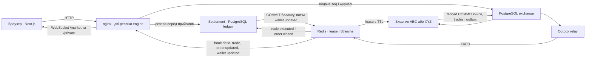

# Mini Exchange

Навчальна біржа: matching engine (NestJS, PostgreSQL, Redis), сервіс розрахунків і
веб-клієнт (Next.js). Вимоги наведено в [ЗАВДАННЯ.md](ЗАВДАННЯ.md).

## Зміст

- [Швидкий старт](#швидкий-старт)
- [Архітектура](#архітектура)
- [Модель узгодженості order book](#модель-узгодженості-order-book)
- [Вибір брокера й координатора](#вибір-брокера-й-координатора)
- [Володіння інструментом і failover](#володіння-інструментом-і-failover)
- [Розрахунок угод](#розрахунок-угод)
- [Real-time і resync](#real-time-і-resync)
- [Знайдені проблеми](#знайдені-проблеми)
- [Системні тести: concurrency і chaos](#системні-тести-concurrency-і-chaos)
- [Тести](#тести)
- [API і зміни контрактів](#api-і-зміни-контрактів)
- [Конфігурація, безпека й спостережуваність](#конфігурація-безпека-й-спостережуваність)
- [Експлуатація](#експлуатація)
- [Розробка](#розробка)
- [Обмеження й що зробили б інакше](#обмеження-й-що-зробили-б-інакше)

## Можливості

- `apps/matching-engine-service` — автентифікація, подача/скасування заявок,
  зіставлення за price-time priority, self-trade prevention, WebSocket `/market`
  (snapshot, `book.delta` з номером команди, угоди), `/private` (заявки й баланси
  власника) та застарілий `/`.
- Дві репліки engine: Redis lease з TTL і renewal, PG fencing, recovery та admin resume.
- Transactional outbox публікує події книги, угод і заявок у Redis Streams.
- Settlement резервує кошти, споживає `trade.executed` і `order.closed` із Redis Streams,
  розраховує угоди ідемпотентно, публікує `wallet.updated`, веде DLQ і звіряє ledger з engine.
- `apps/frontend` — торговий термінал із книгою, угодами, заявками й балансами наживо.

## Швидкий старт

Потрібні Docker Engine **28.0.0 або новіший** та Docker Compose **2.40 або новіший**.
На старіших Docker Engine хости того самого сегмента мережі можуть дістатися до портів,
опублікованих на `127.0.0.1`. Перевірте версію сервера командою
`docker version --format '{{.Server.Version}}'`. [Документація
Docker](https://docs.docker.com/engine/network/port-publishing/#publishing-ports)

Якщо оновлюєте стек зі збереженими даними Redis, спочатку виконайте
[перенесення даних Redis](#перенесення-даних-redis-зі-старого-тому).

```bash
docker compose up --build
```

Якщо встановлено alias `docker-compose`, можна запустити `docker-compose up --build`.
Для запуску у фоні з очікуванням усіх healthcheck використовуйте `docker compose up -d --build --wait`.

### Адреси й демо

- Термінал (frontend): http://localhost:3000
- Engine через nginx (`engine-lb`): http://localhost:3001, Swagger — http://localhost:3001/docs.
  Для діагностики окремої репліки використовуйте `docker compose exec`.
- Settlement: http://localhost:3002, Swagger — http://localhost:3002/docs
- PostgreSQL: `127.0.0.1:5433`
- Redis у мережі Compose: `redis:6379`. Для перевірки з хоста виконайте
  `docker compose exec -T redis redis-cli PING`.

Для демонстрації торгівлі виконайте [кроки з двома акаунтами](#торговий-термінал).
Для адмінського режиму увійдіть як `admin@demo.local` з `ADMIN_PASSWORD` із локального
env-прикладу engine і відкрийте `/admin/status`.

Обидва backend-сервіси повертають HTTP 200 та `{"status":"ok"}` на `GET /health`.
Це перевірка доступності HTTP-процесу. PostgreSQL і Redis мають власні healthcheck. Engine також має `/ready`: PG, застосовані
міграції, Redis і `maxmemory-policy=noeviction`. Standby може бути ready без власного lease.
Перевірка міграцій читає лише таблицю `migrations` і нічого не створює.
Redis пише AOF у том `redis-data` і працює з політикою `noeviction`. Поки Redis відтворює
AOF, невдалі healthcheck не враховуються протягом `REDIS_HEALTH_START_PERIOD` (типово `120s`).
Для більшого набору даних збільште значення, наприклад `REDIS_HEALTH_START_PERIOD=10m`, і
відповідно `--wait-timeout`.

### Зупинка й очищення

```bash
docker compose down
```

Команда зупиняє стек і зберігає томи з даними. Стандартний стек вмикає резерви. Для нового демо використовуйте чисті томи. Том starter
із заявками без резервів потребує окремого відновлення. `docker compose down -v`
видаляє томи поточного проєкту разом із заявками й балансами. Виконуйте цю команду
лише для демоданих, які можна видалити.

## Архітектура



Обидві репліки приймають HTTP і роздають WebSocket. Matching кожного інструмента має
одного writer. Redis lease забезпечує швидке перехоплення, а епоха PostgreSQL обмежує
право коміту. Redis Streams зберігає окремий потік на інструмент і consumer group
settlement. Після збою доставка повторюється. Унікальний `tradeId` і одна транзакція
settlement забезпечують один ефект у ledger.

## Модель узгодженості order book

Кожен інструмент має один журнал команд у PostgreSQL і одного writer. Звідси випливають
порядок, відсутність втрат і повторів та відновлення після збою.

1. **Порядок надходження.** Прийом видає номер `seq` інструмента в тій самій транзакції,
   що записує команду: `instruments.next_seq` збільшується під row lock. Submit і cancel
   одного інструмента беруть номер з одного лічильника, тож мають єдиний порядок.
   «Надходження» означає COMMIT видачі `seq` після резервування коштів.
2. **Один writer.** Команди застосовує лише власник lease інструмента, строго наступний
   `seq` без пропусків. Інші репліки приймають HTTP і пишуть у журнал, але книги не змінюють.
3. **Fencing.** Кожна транзакція застосування блокує `instrument_state`, перевіряє епоху
   власника й умовно просуває `last_applied_seq`. Колишній власник не закомітить, навіть
   якщо ще вважає себе власником.
4. **Персистенція.** Книга живе в пам'яті власника. Кожна команда синхронно комітить зміни
   заявок, угоди й outbox до зміни пам'яті. ТЗ допускає періодичну персистенцію, але тоді
   після збою частину прийнятого довелося б відтворювати з брокера. Синхронний коміт
   лишає прийняте в PostgreSQL, а пам'ять відновлюється з БД.
5. **Детермінізм.** Результат команди залежить лише від книги й самої команди. Пріоритет на
   однаковій ціні задає `prioritySeq`, тобто номер submit-команди.

### Прийом і застосування команд

`POST /orders` повертає `{order, trades}`. Код 201 означає застосовану команду; 202 —
заявку `pending`, якщо `ORDER_SYNC_WAIT_MS` минув раніше. Після 202 перечитайте
`GET /orders/:id` або `GET /orders?status=active`. `trades` — угоди цієї заявки.
Повтор із тим самим `Idempotency-Key` повертає 200 і поточний стан тієї самої заявки.
Заявка та її trades читаються в одному snapshot `REPEATABLE READ READ ONLY`, щоб
одночасний fill не змішав два стани в одній відповіді.
Формат ключа — 1–64 латинські літери, цифри, `_` або `-`. Ключ належить користувачу;
інше нормалізоване тіло з цим ключем дає 409 `IDEMPOTENCY_KEY_REUSED`.
Без ключа кожен запит створює нову заявку. Ключі й журнал команд не видаляються
(див. [обмеження](#обмеження-й-що-зробили-б-інакше)).

Прийом створює `order_requests`, а потім однією транзакцією збільшує `instruments.next_seq`,
вставляє команду та заявку `pending`. Row lock серіалізує прийом із різних процесів.
Помилка або дубль відкочує інкремент разом із командою, тому номерів без команд немає.
«Надходження» означає COMMIT видачі `seq`, після резервування: повільніший reserve може
отримати пізніший номер. Стандартний Compose вмикає `RESERVATIONS_ENABLED=true`
та автоматичний settlement через Redis Streams.

Worker бере строго наступний `seq`. Книга живе в пам’яті; кожна команда синхронно
комітиться до підтвердження й зміни книги. Це посилює періодичну персистенцію:
після kill прийняте лишається в PostgreSQL, а після невдалого COMMIT пам’ять
відновлюється з БД. Невідома відповідь COMMIT також потребує recovery.
Перевірка `version` не дає перезаписати неочікувано змінену заявку.
Для poison-команди зберігаються `rejected_internal`, скасована заявка з причиною
`rejected`, `book.delta` фактично змінених рівнів (порожня для відхиленого submit) й `order.closed`
із сумою release в outbox; черга продовжується.
Relay публікує збережені події в Redis Streams.

LISTEN/NOTIFY лише пришвидшує роботу: polling кожні `COMMAND_POLL_INTERVAL_MS` читає PG,
а HTTP після сигналу або таймауту читає committed стан. Втрачений NOTIFY не губить команду.
NOTIFY, що прийшов під час проходу worker, запускає ще один прохід одразу після нього, тож
команда не чекає наступного poll.
Одна заявка може мати кілька waiter для різних submit/cancel `seq`. LISTEN-клієнт
перепідключається після розриву.

Обидві репліки Compose мають `ENGINE_WORKER_ENABLED=true`. Кожна може приймати
HTTP-запити, але matching виконує лише власник lease інструмента. `ENGINE_WORKER_ENABLED=false`
вимикає matching на окремому екземплярі для діагностики. REST і початковий legacy WS snapshot
читають один committed стан PostgreSQL на owner і standby. Публічні читання книги
обмежені трьома одночасними запитами на репліку (черга до 200 і не довше 2 с, далі 503 `BOOK_BUSY`), щоб не
відбирати з’єднання в worker. PostgreSQL сортує рівні й застосовує `depth`.
Legacy namespace `/` розсилає цілі snapshots без номерів. Термінал використовує
`/market` із `seq`, delta та відновленням через `book-session.ts`.

`DELETE /orders/:id` створює не більше однієї cancel-команди. Якщо заявка вже термінальна
або попередня команда встигла її виконати, відповідь — 409 `ORDER_ALREADY_FILLED` чи
`ORDER_ALREADY_CANCELLED` з фінальним `{order}`. Cancel і submit застосовуються в одному
порядку. Cancel доступний при відмові Redis; новий submit повертає 503. Відмова PG чи
таймаут блокування також повертає 503. Ідемпотентний ключ дозволяє безпечно повторити submit.

### Зіставлення заявок

Заявки виконуються за найкращою сумісною ціною заявки, що вже в книзі.
За рівної ціни першість визначає `prioritySeq`: номер submit-команди. Часткове
виконання не змінює пріоритет. Адаптер `matchOrder` зберігає підтримку старих фікстур без номерів.
Коли наступною сумісною є заявка того самого власника, залишок нової заявки
отримує статус `cancelled`. Уже виконані угоди зберігаються у відповіді на
`POST /orders`, а `GET /orders` показує скасований статус. У `remainingQuantity`
такої заявки лишається скасований залишок, тож виконаний обсяг — це
`quantity - remainingQuantity` (заявка на 2, що виконала 1 і скасувала решту, має
`remainingQuantity` 1; якщо угод не було, то 2). Скасування через `DELETE /orders/:id`
також зберігає скасований залишок і вже виконаний обсяг.

Знімок книги для зіставлення або повністю з номерами надходження, або повністю без
них. Змішаний знімок відхиляється помилкою: порядок за номером і за часом створення
не узгоджується.

`POST /orders` приймає `price` (0.01–1 000 000, до 2 знаків після крапки) і `quantity`
(0.00000001–1 000 000, до 8 знаків) як JSON-числа або як десяткові рядки (`"100.25"`).
Значення за межами діапазону або з надлишковою точністю повертають HTTP 400. Для
JSON-чисел перевіряється запис із тіла запиту, а не округлене `number`: наприклад,
`1000000.00000000001` відхиляється, хоча JavaScript перетворив би його на `1000000`.
Експоненційний запис (`1e-8`) розгортається без округлення. Зіставлення оперує
цілими тиками та лотами, а ціни й кількості угод повертаються як десяткові рядки.

## Вибір брокера й координатора

| Задача | Вибір | Чому | Що відкинуто |
|---|---|---|---|
| Черга подій | Redis Streams | Redis уже потрібен для lease. Окремий stream на інструмент (`exchange:market:{I}`, `exchange:settlement:{I}`) зберігає порядок у його межах. Consumer group, PEL і `XAUTOCLAIM` повторюють доставку після збою. Лічильники `XINFO STREAM` дозволяють помітити обрізані записи | Kafka з партицією за інструментом дала б ті самі гарантії, але потребує окремого кластера для двох інструментів. RabbitMQ не зберігає порядок черги при повторній доставці кільком consumer і не дає replay історії |
| Власник інструмента | Redis lease + епоха в PostgreSQL | Lease з TTL і renewal швидко обирає кандидата. Правильність тримає PostgreSQL: кожен коміт перевіряє епоху власника в тій самій БД, куди пише | etcd або ZooKeeper дали б консенсусне блокування, але ще один кластер. Блокування без fencing, зокрема Redlock, не захищає від паузи процесу між перевіркою lease і записом |

Гарантії порядку:

- Порядок обробки заявок задає `seq` з PostgreSQL, а не брокер. Брокер переносить уже
  впорядковані результати.
- Outbox пишеться в транзакції застосування команди. Relay один на розгортання (advisory
  lock) і публікує рядки в порядку `id`. Lua-скрипт звіряє позицію для пари «stream,
  інструмент» і відхиляє запізнілий `XADD`, тож події інструмента йдуть у порядку `seq`.
- Доставка at-least-once. Якщо relay упав між `XADD` і позначкою публікації, запис
  повториться з тим самим `eventId`. WebSocket відкидає повтор за `eventId` і `seq`,
  settlement — за `tradeId` (первинний ключ у ledger).
- Settlement не залежить від порядку між записами: усі операції з резервом комутативні.
- Розгортання розраховане на один Redis без Cluster з AOF і `noeviction`. Втрачений хвіст
  stream відтворюється з outbox через redrive.

## Володіння інструментом і failover

| Питання | Відповідь |
|---|---|
| Хто виявляє падіння власника | Резервна репліка: вона намагається взяти lease кожні 1000 мс і отримує його, коли TTL старого власника спливає без renewal |
| Скільки триває перехоплення | Близько 5 с після SIGKILL (TTL 5 с + recovery), вимога ≤ 10 с; після SIGTERM менше 1 с. Якщо власник тихо втратив PostgreSQL, сторожовий таймер віддає lease приблизно за 30 с |
| Чи можлива втрата заявок | Ні. Прийнята заявка вже має `seq` у журналі PostgreSQL, і новий власник застосовує журнал з `last_applied_seq + 1` |
| Чи можливий дубль | Ні. Застосування і просування `last_applied_seq` — одна транзакція з перевіркою епохи; повтор HTTP з тим самим `Idempotency-Key` повертає ту саму заявку |
| Split-brain | Колишній власник може ще вважати lease своїм, але його коміт не пройде: новий власник збільшив `owner_epoch`, а кожна транзакція перевіряє епоху під row lock |

`lease:instrument:{ABC}` містить унікальний токен екземпляра. TTL — 5000 мс,
renew — 1500 мс, запас до step down — 500 мс. Власник відмовляється від lease за
монотонним дедлайном, навіть якщо запізніла відповідь renew каже «успіх». Redis-клієнт
не накопичує offline-команди; команда й початкове підключення обмежені 1000 мс.
Старий токен не може продовжити чи видалити lease нового власника.

Lease визначає кандидата. Право запису дає PostgreSQL: takeover збільшує
`owner_epoch`; кожна TX matching блокує `instrument_state`, перевіряє епоху й завершується
умовним UPDATE з тією самою епохою та попереднім `last_applied_seq`. Помилка відкочує
orders, trades і outbox разом. Пам’ять оновлюється після COMMIT. У сесіях engine:
`idle_in_transaction_session_timeout=2s`, `statement_timeout=5s`; захоплення рядка має
`lock_timeout=3s`. Призупинений усередині TX процес не блокує takeover безкінечно.

Захоплення lease не залежить від drain: poll планується до початку обходу, а завантаження
інструмента не блокує інші. Один прохід drain обмежений 1 с і 100 командами; решту забирає
наступний poll, тож resume і shutdown не чекають довгий backlog.

Орієнтир простою після crash — близько 7 с: TTL + acquire кожні 1000 мс з jitter
0–300 мс + recovery. Це діє за доступності Redis і PG резервній репліці, до 10 000
resting-заявок на інструмент та без стрибків годинника Redis. System-тест вимагає ≤ 10 с;
після SIGTERM — ≤ 2 с. Виміряно: **SIGTERM 840 мс, SIGKILL 4883 мс**; в останньому прогоні 902 і 4939 мс.
Якщо власник втрачає мережу до PG без TCP reset, запит висить, а renew у Redis триває. Тому
drain і recovery мають сторожовий таймер: без прогресу протягом 30 с власник пише
`alert=engine_worker_stalled`, відпускає lease і 5 с не намагається його повернути, а резервна
репліка забирає інструмент. Простій у цьому випадку близько 30 с, а не 7 с. Keepalive виявляє
розрив лише на сокеті без незавершених запитів. System-тест `ownership:blackhole` вимагає ≤ 45 с;
виміряно **30 366 мс**, в останньому прогоні 30 670 мс.
Запити на відрізану репліку отримують 503 або 504 і повторюються. Команда на десятки тисяч заявок
може тривати довше 30 с: кожна заявка рахується як прогрес. Intake серіалізується з halt на
рядку лічильника інструмента і не блокує `instrument_state`, тому потік заявок не зупиняє worker.
Кроки подачі й скасування, що працюють із БД, обмежені п'ятьма одночасними на репліку (черга
до 500 і не довше 5 с, далі 503 `ORDERS_BUSY`), щоб решта пулу лишалася worker. Подача має ще
одну таку саму межу на весь запит разом із HTTP-викликом резерву до settlement. Під час цього
виклику слот БД вільний, тому повільний чи недоступний settlement затримує лише нові заявки, а
скасування проходять. Відмова `ORDERS_BUSY` означає, що заявку не прийнято. Якщо вона сталася
вже після резерву, кошти звільнить сапер, а повтор із тим самим `Idempotency-Key` завершить прийом.
Якщо заявку вже прийнято, а читання результату не вдалося, відповідь — 202 і `pending`.
`takeoverMs` — `recovered_at` нової епохи мінус останній `applied_at` старої епохи;
це верхня межа простою, обидві мітки походять з одного PG.

`GET /admin/instruments` повертає власника, епоху, TTL, `lastAppliedSeq`, `maxSeq`, backlog,
best bid/ask, кількість рівнів і resting-заявок та `outboxBacklog`. `/metrics` містить
лічильники mismatch, fenced writes, помилок renew і стан halted. Лічильники належать одній
репліці. Через публічний `:3001` шлях `/metrics` повертає 404. Виконайте
`docker compose exec -T matching-engine-1 wget -qO- http://127.0.0.1:3001/metrics`
і повторіть для `matching-engine-2`. Збій Redis не ховає решту полів: `leaseTtlMs` тоді `null`. Для розбору halted:

```sql
SELECT instrument,status,owner_instance,owner_epoch,last_applied_seq,
       resting_bid_count,resting_ask_count,resting_bid_lots,resting_ask_lots
FROM instrument_state;
SELECT instrument,side,count(*),sum(remaining_quantity) * 100000000 AS lots
FROM orders WHERE status IN ('open','partially_filled') GROUP BY instrument,side;
SELECT instrument,seq,type,order_id,applied_at,result FROM order_commands ORDER BY instrument,seq;
```

Виправляйте дані лише після звірки з авторитетним журналом. Після виправлення викличте
resume й перевірте, що backlog зменшується в порядку `seq`. Автоматичного підтвердження
legacy даних немає.

### Recovery і зупинений інструмент

Recovery сортує заявки за ціною й `prioritySeq`, перевіряє загальні та окремі для bids/asks
кількість заявок і суму lots, а також відсутність перехрещення книги. Лічильники для кожної
сторони зберігаються в `instrument_state`.

Розбіжність recovery або gap довше `SEQ_GAP_ALERT_MS` ставить `instrument_state.status=halted`.
Стан переживає restart. Submit і cancel повертають 503 `INSTRUMENT_HALTED`; нові команди
не приймаються й не застосовуються. Логи містять `alert=engine_recovery_mismatch` або
`alert=engine_seq_gap`. Автоматичного resume немає. Перед відновленням необхідно
порівняти журнал, лічильники й фактичні resting-заявки.
`POST /admin/instruments/ABC/resume` з access-токеном admin передає запит поточному власнику
через NOTIFY, незалежно від репліки HTTP. Власник під fenced row lock повторює recovery.
Перед активацією також перевіряється суцільний журнал від 1 до `next_seq`: застосований
префікс до `last_applied_seq`, незастосований суфікс і узгодженість обох лічильників.
Невиправлена прогалина чи хибний `applied_at` блокують resume та подальший intake.
Збіг — 200 `{status:"active"}`, розбіжність — 409 `RECOVERY_MISMATCH`.
Непідтверджений legacy стан (`legacy_verified=false`) завжди дає 409; `force` немає.
Невідомий інструмент дає 400, відсутній власник або втрачений NOTIFY — 503.
Якщо recovery падає, зокрема коли втрачено відповідь на COMMIT, власник відпускає lease, а
наступний poll читає фактичний статус із БД. Адміністратор бачить 503 і може повторити запит.
Власник підтверджує запит одразу: без підтвердження 503 приходить через 3 с, після нього
результат чекається до 12 с (lock 3 с і перевірка журналу до 10 с). Запит журналу має
власний `statement_timeout=10s`. Recovery-транзакція також має `statement_timeout=10s` і
`idle_in_transaction_session_timeout=10s`, бо читання й сортування великої книги довше за
5 с і 2 с простою; решта сесій лишається на 5 с і 2 с. Очікування вільного з’єднання пулу — до 10 с.
Публікація NOTIFY обмежена 2 с: зависле з’єднання розривається й перепідключається. Дедлайн
підтвердження (3 с) рахується від виклику й охоплює чергу публікацій: відповідь не чекає на
publish, а прострочений запит власнику не надсилається.
Повтор перевіряє дані знову. Звичайний користувач отримує 403, без токена — 401.

Діагностика з кореня локального Compose-проєкту:

```bash
docker compose logs --no-color --tail=200 matching-engine-1 matching-engine-2
docker compose exec -T exchange-db psql -U engine -d exchange -c 'SELECT * FROM instrument_state;'
docker compose exec -T exchange-db psql -U engine -d exchange -c 'SELECT instrument,seq,type,order_id,applied_at,result FROM order_commands ORDER BY instrument,seq;'
```

Для довгого recovery healthcheck має початкове вікно 120 с і 10 спроб через 5 с. Прогін на 10 000 resting-заявках
перевіряє, що навіть десятикратний виміряний старт вкладається в це вікно. Тестові дані
не доводять такої межі для довільного обсягу: перед збільшенням навантаження виміряйте
recovery на своїй БД. Знімків книги для прискорення старту немає.

Оновлення БД із заявками попереднього engine виконуйте із зупиненим старим writer:

```bash
docker compose down --remove-orphans
docker compose up -d --build --wait --wait-timeout 240
```

Старі записи БД не є авторитетною книгою: попередній matcher міг виконати maker у пам’яті,
не оновивши його в БД. Тому імпортовані раніше записи `imported_snapshot` позначаються
`unverified_snapshot`, а інструмент отримує `legacy_verified=false` та `halted`.
Пріоритети, sequence й лічильники імпорту зберігаються лише як діагностичні дані.
Loader не публікує та не застосовує таку книгу, навіть якщо вручну змінити status на active.
Публічна глибина повертає 503 INSTRUMENT_HALTED замість достовірного на вигляд порожнього snapshot.
Потрібні авторитетний знімок старої книги та явна звірка; автоматичне підтвердження
legacy-даних і їхній resume не реалізовані. Зміна одного прапорця не є звіркою.
Нова чиста БД працює без цього обмеження. Down міграції не відновлює matching:
позначки unverified та halted зберігаються. Перед оновленням збережіть резервну копію БД.

Gap перевіряється також на хвості журналу: якщо `next_seq` уже видано, але очікуваного
рядка немає, після `SEQ_GAP_ALERT_MS` інструмент переходить у halted без нової заявки.
Команда й виданий лічильник читаються одним SQL snapshot, тому конкурентний COMMIT не
створює хибного gap. Повтор завершеного ідемпотентного запиту перевіряє hash і читає
збережений результат до Redis та перевірок нового прийому. Під час відмови Redis
accepted повертає 200, rejected — збережену 422, інше тіло — 409; новий прийом — 503.

Якщо запис applied-команди не оновився, вся TX matching відкочується; last_applied_seq не просувається.

## Розрахунок угод

### Резерви та гаманці

Стандартний стек запускається з увімкненими резервами (`RESERVATIONS_ENABLED=true`),
а settlement споживає угоди й закриття заявок з Redis Streams.

Engine резервує актив перед видачею `seq`: для купівлі це лімітна ціна × кількість у
USD, для продажу — кількість базового активу. Порядок надходження визначає коміт видачі
`seq`, тож заявка, що раніше почала резервування, може отримати пізніший номер.
За недостатнього балансу `POST /orders` повертає 422 і номер команди не видається.
Якщо результат резервування невідомий після трьох спроб, engine повертає 503.
Повторюються лише збій мережі, 5xx і 429. Інша відповідь settlement (наприклад, 401 через різні
`INTERNAL_API_TOKEN`) не повторюється: engine повертає 500 і пише в журнал
`reservation_request_refused` зі статусом. Повторіть запит з тим самим `Idempotency-Key`.
Після того як сапер почав звільнення простроченого резерву, повтор повертає 409 `REQUEST_EXPIRED`.

Кожна репліка engine підбирає прострочені запити невеликими пачками. Рядок переходить у
`releasing` до HTTP-виклику. Після збоїв release повторюється, а після підтвердження рядок
стає `expired`. Settlement застосовує звільнення один раз. Для невідомого ID зберігається
tombstone, який відхиляє запізнілий reserve. Метрика
`reservation_release_failures_total` зростає за кожної невдалої спроби, яку зафіксував
сапер. Після 10 хв понад строк резерву перевірте логи engine за
`reservation_release_stuck` і доступність settlement.

`GET /wallets` потребує access JWT і повертає лише гаманці власника токена: `[{asset, available,
reserved, version}]`, де `version` — десяткове ціле в рядку, те саме, що несе `wallet.updated`.
Резерви,
звільнення й розрахунок угоди записують збалансовані проводки та баланси однією транзакцією.
Шкали ABC і XYZ — 8 знаків, USD — 10. Початкові демобаланси з
`DEMO_INITIAL_BALANCES` проводяться один раз при першому зверненні до гаманця.
Блокування рахунків бере лише звернення, яке створює відсутні рахунки. Далі `GET /wallets`
читає закомічений стан одним запитом без блокувань і не чекає на розрахунок угоди з тими самими
рахунками.
Резерви та звільнення також публікують `wallet.updated` після коміту, коли Redis доступний.
Для актуального балансу перечитайте `GET /wallets`.

Внутрішній `POST /trades/settle` потребує `x-internal-token`. Він приймає ID угоди й обох
заявок, ID покупця й продавця, інструмент, обидва активи, ціну, кількість,
ліміт покупця та `executedAt`. Ціна й кількість передаються десятковими рядками.
Settlement звіряє інструмент і ліміти зі збереженими умовами обох резервів.
За успіху відповідь містить `status: applied` та `entryId`. Повтор тих самих даних
повертає `duplicate` з тим самим ID. Інший вміст з тим самим `tradeId` дає 409.
Розрахунок угод із stream описано у розділі [«Розрахунок і DLQ»](#розрахунок-і-dlq). Захищений
`POST /trades/settle` лишається для ручного розрахунку тим самим кодом.

### Події й доставка

Engine записує outbox у тій самій PostgreSQL-транзакції, що й зміни заявок, угоди та
`last_applied_seq`. Скасування й відхилення теж споживають `seq`.

| Stream | Події |
|---|---|
| `exchange:market:{I}` | Одна `book.delta` на команду, навіть порожня, і одна `trade.public` на угоду. Публічна угода містить ті самі поля, що й REST-стрічка, плюс інструмент. |
| `exchange:settlement:{I}` | `trade.executed` на угоду, `order.closed` за додатної суми release. |
| `exchange:user-events` | `order.updated` на кожну змінену заявку з її версією і власником. |

Redis-запис містить `eventId`, `type`, `version`, `instrument`, `seq`, `traceparent`
і `envelope`. JSON у `envelope` має версію 1, `occurredAt` з outbox, `producer` та
`payload`. `seq` — цілий рядок. `price` і `quantity` — десяткові рядки.
`quoteAmount` і `releasedAmount` — рядки цілих мінімальних одиниць відповідного
активу (10 знаків шкали для USD, 8 для базового активу).

Кожна репліка запускає relay. PostgreSQL advisory lock дозволяє публікувати лише одному
relay одночасно. Relay бере найстаріший доступний неопублікований рядок, виконує XADD,
позначає `published_at` і комітить. Lua в Redis атомарно звіряє позицію outbox для
пари «stream, інструмент» і виконує XADD. Так Redis відхиляє запізнілий запит
зі старішою позицією після того, як інша репліка просунула stream.
Одна подія на транзакцію зберігає порядок при повторі після XADD. Якщо relay упав
у цьому вікні, наступна спроба може додати
другий Redis-запис із тим самим `eventId` та `seq`. Для нових команд `book.delta`
покриває всі послідовні `seq` інструмента. Інші типи можуть пропускати або повторювати
`seq`. Рядки outbox зі старої версії relay публікує як збережено.

`OUTBOX_POLL_INTERVAL_MS` (100 мс) задає паузу при порожній черзі, зайнятому lock
або збої. Поки є backlog, relay бере наступний рядок після COMMIT.
`STREAM_MAXLEN` (1 000 000) задає приблизну межу довжини кожного stream. Якщо Redis
недоступний, неопубліковані рядки залишаються в PostgreSQL і relay підбирає їх після
відновлення. Обрізані чи втрачені записи Redis можна відтворити з outbox.
Службовий hash `exchange:outbox:positions:<DATABASE_NAME>` зберігає останні позиції.
PostgreSQL і Redis цього розгортання використовують спільну історію outbox.

Для діагностики перевірте `outboxBacklog` у `GET /admin/instruments`, помилки
`outbox_publish_failed` у логах engine та записи всередині Compose.

Якщо PostgreSQL відновлено з резервної копії окремо від Redis, нові рядки outbox отримують `id`,
менші за позиції в hash, і relay зупиняється на першому ж рядку. Ознаки: `outboxBacklog` росте,
а лог engine щоразу повторює `alert=outbox_position_rejected` з тим самим `stream` та `id`
(поодинокий такий запис — гонка двох relay, він минає сам). Зупиніть обидві репліки engine,
видаліть hash позицій і запустіть їх знову:

```bash
docker compose stop matching-engine-1 matching-engine-2
docker compose exec -T redis redis-cli DEL 'exchange:outbox:positions:exchange'
docker compose start matching-engine-1 matching-engine-2
```

`exchange` тут — значення `DATABASE_NAME`. Після запуску relay публікує неопубліковані рядки
від найстарішого. Streams при цьому ще містять події історії, якої в PostgreSQL уже немає, тож
після такого відновлення запустіть звірку.

```bash
docker compose logs matching-engine-1 matching-engine-2
docker compose exec -T redis redis-cli XRANGE 'exchange:market:{ABC}' - + COUNT 10
```

### Розрахунок і DLQ

Settlement читає `exchange:settlement:{ABC}` і `exchange:settlement:{XYZ}` через consumer group
`settlement` з ім'ям `CONSUMER_NAME`. Група створюється з початку stream, тож consumer бачить
усю історію. Цикл забирає прострочені записи через `XAUTOCLAIM` (`CONSUMER_CLAIM_IDLE_MS`) і
читає нові через `XREADGROUP`. Запис стає доступним для reclaim лише після цього простою, тож PEL
сканується одразу на старті й далі не частіше ніж раз на половину `CONSUMER_CLAIM_IDLE_MS`, а не
перед кожною пачкою. Збій запису повторюється через `CONSUMER_CLAIM_IDLE_MS`–1,5 × `CONSUMER_CLAIM_IDLE_MS`.

Запис підтверджується (`XACK`) лише після коміту транзакції ledger і публікації `wallet.updated`
для покупця й продавця в обох активах. Повторна доставка (шлях `duplicate`) теж публікує
поточний стан, тож збій між комітом і `XADD` не губить сповіщення. Термінал відкидає
`wallet.updated`, якщо `version` не більша за відому версію цього гаманця.
`order.closed` звільняє залишок резерву. `release` ідемпотентний. Запис `order.closed` так само
підтверджується лише після публікації `wallet.updated` звільненого гаманця, і повторна доставка
публікує його стан ще раз. Сповіщення HTTP-резервів лишаються best effort.

Порядок записів settlement не потрібен: усі операції з резервом комутативні.

| Збій | Поведінка |
|---|---|
| Невалідний envelope, невідома версія, дані угоди, що не проходять перевірку, інший вміст за тим самим `tradeId`, від'ємний баланс (23514) | Одразу DLQ |
| Збій PostgreSQL чи Redis (з'єднання, тайм-аут, deadlock, serialization) | Без `XACK`, повтор через reclaim. У DLQ не йде за жодної кількості доставок |
| Інша помилка (наприклад, резерв не відповідає угоді) | Повтор, після `CONSUMER_MAX_DELIVERIES` доставок DLQ |

DLQ — stream `exchange:dlq` і рядок у `settlement_failures` (`stream`, `message_id`, `trade_id`, `reason`).
Рядок пишеться першим і ідемпотентний, а `XADD` у DLQ з `XACK` виконує один Lua-скрипт.
Якщо `tradeId` не має канонічної форми UUID, поле `trade_id` у журналі дорівнює `NULL`.
Оригінальний ідентифікатор лишається в payload. Дані, які не приймає `jsonb`, зберігаються як base64.
Redis 7 прибирає з PEL записи, обрізані `XTRIM`; їх payload втрачено. Лічильник
`settlement_trimmed_pending_total` зростає, consumer продовжує, а звірка покаже угоду як `missing`.
Якщо stream видалено, цикл перестворює групу й іде далі.

`GET /admin/queue` (admin) показує довжину, `pending`, `lag` кожного stream, довжину DLQ і кількість
`settlement_failures`. `GET /metrics` settlement віддає `settlement_trades_total{result}`,
`settlement_dlq_total`, `settlement_trimmed_pending_total`, `settlement_pending`, `settlement_stream_lag`.
Стан черги збирається через `prom-client`. Лічильники процесу лишаються доступними при збої Redis.

### Звірка

```bash
curl -fsS -X POST -H "Authorization: Bearer $ADMIN_TOKEN" \
  'http://localhost:3002/admin/reconciliation?from=2026-01-01T00:00:00.000Z&to=2026-12-31T00:00:00.000Z&instrument=ABC'
docker compose exec -T settlement-service node dist/reconcile --from 2026-01-01T00:00:00.000Z
```

Токен адміністратора видає `POST /auth/login` engine. Settlement перевіряє підпис і через
внутрішній API engine перевіряє, що сесія активна. HTTP-звірку запускає `POST`; `GET` повертає 404.
Період `[from, to)` рахується за `executed_at` з точністю до мілісекунди. Без `from` і `to`
береться вся історія до зараз. Команда `reconcile` не запускає consumer. Код виходу: 0 — розбіжностей немає,
1 — є розбіжність, 2 — engine чи БД недоступні.

Settlement читає угоди engine сторінками по 1000 через внутрішній `GET /internal/trades`
і питає про стан заявок активних резервів через `POST /internal/orders/terminal`
(`x-internal-token`, лише через `engine-lb:8080`; публічний `:3001` повертає 404). Кожна сторінка
читається в `REPEATABLE READ READ ONLY`. Обидві сторони зливаються в порядку `(executed_at, trade_id)`,
тож пам'ять не залежить від кількості угод. Для кожної угоди очікувані проводки обчислюються з даних
engine й порівнюються з фактичними.

| Клас | Значення |
|---|---|
| `pending` | Немає в ledger, свіжіша за `SETTLEMENT_GRACE_MS`. Не робить звіт невдалим |
| `missing` | Немає в ledger й старша за grace |
| `failed` | Немає в ledger, є в `settlement_failures` |
| `orphan` | Є в ledger, немає в engine |
| `amount_mismatch` | Проводки відрізняються від очікуваних |
| `duplicate` | Кожна очікувана проводка записана двічі |
| `payload_conflict` | Інструмент або хеш збереженої угоди не збігається з даними engine. Із фільтром `instrument` такий запис ledger видно як `missing` в одному інструменті й `orphan` в іншому |
| `reservation_leak` | Баланс `reserved` користувача в активі не дорівнює сумі залишків активних резервів |
| `stuck_reservation` | Резерв лишається `active`, хоча заявка в engine `filled` або `cancelled` і перейшла в цей стан раніше за `SETTLEMENT_GRACE_MS`: `order.closed` не дійшов |

Звіт містить `perInstrument` (кількість, Σ кількості, Σ суми котирування з обох боків) та `perAsset`
(Σ debit, Σ credit, Σ балансів, число рахунків, чий баланс не збігається з replay проводок).
`ok` дорівнює `false` за будь-якої розбіжності, крім `pending`, або порушеного балансу активу.
`reservation_leak` і `stuck_reservation` перевіряються на момент звірки, а не за період; `instrument`
звужує лише другу. Для `stuck_reservation` settlement проходить активні резерви сторінками по 1000 за
`reservation_id` в одному snapshot і питає engine, які з їхніх заявок термінальні: до engine йдуть лише ID
активних резервів, а не вся історія заявок. Недоступний engine дає 502 (код виходу 2), а не чисту звірку.
Список `discrepancies` обмежено 1000 елементами; `counts` точні, `truncated` показує обрізання.
Звірка читає всі проводки й рахунки, тож її варто запускати за потреби, а не за таймером. Одночасно
виконується одна звірка: другий виклик HTTP-маршруту отримує 409 `RECONCILIATION_RUNNING`. Транзакція
звірки має власні ліміти (600 с на запит, 120 с простою), решта settlement лишається на 15 с і 10 с.

#### Індекси й плани запитів

На PostgreSQL 16 після `ANALYZE` перевірено по 20 000 синтетичних рядків у
`settled_trades`, `orders` і `accounts`, для гаманців — 120 000 рахунків (20 000 користувачів,
три активи, `available` і `reserved`). Planner використав відповідний індекс у
кожному запиті. Тип сканування залежить від селективності й розподілу рядків.

| Операція | Вузол `EXPLAIN (ANALYZE, BUFFERS)` | Рядків у відповіді |
|---|---|---:|
| Звірка за періодом та інструментом | `Bitmap Index Scan on settled_trades_instrument_executed_idx` | 30 |
| Звірка за періодом | `Index Scan using settled_trades_executed_idx` | 60 |
| `GET /orders?status=filled` | `Bitmap Index Scan on orders_owner_status_idx` | 50 |
| Пошук наявного рахунку під час запису в ledger | `Index Scan using accounts_user_id_asset_kind_key` | 1 |
| Гаманці користувача для `GET /wallets` | `Bitmap Index Scan on accounts_user_id_asset_kind_key` | 6 |

У своїй тестовій БД підставте період з угодами та ідентифікатор наявного користувача.
Запит заявок виконується в `exchange`, решта в `ledger`.

```sql
EXPLAIN (ANALYZE, BUFFERS)
SELECT trade_id, instrument, executed_at, payload_hash
FROM settled_trades
WHERE executed_at >= '2026-11-10 00:10+00' AND executed_at < '2026-11-10 00:11+00'
  AND instrument = 'ABC'
ORDER BY executed_at, trade_id LIMIT 1000;

EXPLAIN (ANALYZE, BUFFERS)
SELECT trade_id, instrument, executed_at, payload_hash
FROM settled_trades
WHERE executed_at >= '2026-11-10 00:10+00' AND executed_at < '2026-11-10 00:11+00'
ORDER BY executed_at, trade_id LIMIT 1000;

EXPLAIN (ANALYZE, BUFFERS)
SELECT * FROM orders
WHERE owner_id = '00000000-0000-4000-8000-000000000001' AND status = 'filled'
ORDER BY created_at DESC, id DESC LIMIT 50;

EXPLAIN (ANALYZE, BUFFERS)
SELECT id FROM accounts
WHERE user_id = '7164af7f-c1fc-8f92-2570-cdd3f20ec5e8' AND asset = 'USD' AND kind = 'available';

EXPLAIN (ANALYZE, BUFFERS)
SELECT a.user_id, a.asset, a.kind, a.balance, a.version
FROM accounts a
JOIN unnest(ARRAY['7164af7f-c1fc-8f92-2570-cdd3f20ec5e8', '7164af7f-c1fc-8f92-2570-cdd3f20ec5e8',
                  '7164af7f-c1fc-8f92-2570-cdd3f20ec5e8']::uuid[],
            ARRAY['ABC', 'USD', 'XYZ']::text[]) AS w(user_id, asset)
  ON a.user_id = w.user_id AND a.asset = w.asset
WHERE a.kind IN ('available', 'reserved');
```

### Відновлення після втрати stream

Outbox у PostgreSQL — джерело правди; stream можна відтворити. Якщо звірка показала `missing`,
повторіть публікацію подій цих угод:

```bash
curl -fsS -X POST -H "Authorization: Bearer $ADMIN_TOKEN" -H 'Content-Type: application/json' \
  -d '{"tradeIds":["<tradeId>"]}' http://localhost:3001/admin/outbox/redrive
```

Для втраченого `order.closed` (резерв скасованої чи частково виконаної заявки лишився активним)
передайте `{"orderIds":["<orderId>"]}`; можна поєднати з `tradeIds`. Поле можна пропустити,
а `null` відхиляється з HTTP 400. Engine повертає події
`trade.executed` і `order.closed` у хвіст outbox із новою позицією (до 1000 ID кожного списку за запит),
relay публікує їх знову, а settlement ідемпотентно обробляє. Зайвий redrive безпечний. Redrive чекає
на COMMIT поточної транзакції relay, а не завершується deadlock. Поки він чекає на блокування
таблиці, вставки власника стоять за ним, тому одне очікування триває до 500 мс. Redrive робить
до 6 спроб із паузою 100 мс, далі повертає помилку, і запит можна повторити. Для `failed`
спершу виправте причину з `settlement_failures`, потім повторіть redrive. `stuck_reservation` називає
`reservationId`, він дорівнює `orderId`. Що передати, залежить від стану заявки в engine:

- `cancelled` без виконання (`filledQuantity` = 0): резерв закриває `order.closed`, тож передайте `reservationId` в `orderIds`;
- `cancelled` із частковим виконанням (`filledQuantity` > 0): `order.closed` звільняє лише невиконаний залишок, а виконану
  частину закриває `trade.executed`. Якщо подію угоди втрачено, а `order.closed` вже оброблено, повтор лише за `orderIds`
  відповість `requeued: 1`, але нічого не змінить: проводка `release:<id>` уже існує, і резерв лишиться активним. Передайте
  `orderIds` разом із `tradeIds` усіх угод заявки (запит нижче);
- `filled` (залишок нуль): `order.closed` для неї не пишеться, резерв закриває `trade.executed`. Redrive за
  `orderIds` поверне `requeued: 0`. Передайте в `tradeIds` угоди заявки.

Угоди заявки знайдіть у базі engine:

```bash
docker compose exec -T exchange-db psql -U engine -d exchange -Atc \
  "SELECT trade_id FROM trades WHERE buyer_order_id = '<orderId>' OR seller_order_id = '<orderId>'"
```

Після redrive запустіть звірку ще раз: `stuck_reservation` має зникнути. Якщо ні, перевірте стан заявки й повторіть з усіма її угодами.

Redrive вибирає події за ID, а не за датою, тож угода поза періодом звірки теж знаходиться. Якщо
`requeued` усе ще нуль, події немає в outbox: перевірте, що заявка справді термінальна, і не змінюйте ledger вручну.
Витік резерву (`reservation_leak`) redrive не виправляє: знайдіть резерв за користувачем і активом, перевірте
`settlement_failures` та лог release.

## Real-time і resync

Усі namespace працюють лише через WebSocket (`transports: ['websocket']`) і не потребують sticky sessions.
Дані беруть із закомічених рядків PostgreSQL та Redis Streams: пам'ять власника інструмента WebSocket не читає.
Кожна репліка читає `exchange:market:{I}` та `exchange:user-events` однією командою `XREAD` зі збереженим `lastId`,
починаючи з хвоста stream на старті. Репліка відкидає повтор запису з однаковим `eventId`, який relay робить після збою
між XADD і позначкою публікації (пам'ятає останні 4096 ID). Клієнт усе одно відкидає delta за `seq`: після рестарту репліки
повтор міг би дійти вдруге.

Не використовуються Socket.IO Redis adapter і connection state recovery: відновлення стану робить snapshot.

### `/market` (публічний)

| Подія | Напрям | Зміст |
|---|---|---|
| `book.subscribe {instrument}` | клієнт → сервер | ack `{ok, instance, snapshot}`, де `snapshot` = `{instrument, seq, bids, asks}`; помилка `{ok:false, error}` з кодом `UNKNOWN_INSTRUMENT`, `INSTRUMENT_HALTED`, `BOOK_BUSY` (ліміт одночасних читань snapshot), `TOO_MANY_REQUESTS` (більше чотирьох підписок чи відписок одного сокета на інструмент у черзі) або `BOOK_UNAVAILABLE` |
| `book.unsubscribe {instrument}` | клієнт → сервер | ack `{ok}` |
| `book.delta` | сервер → клієнт | `{instrument, seq, changes}`; рівно одна на команду (може бути порожньою), `seq` дорівнює номеру команди |
| `trade` | сервер → клієнт | `{instrument, tradeId, seq, price, quantity, takerSide, executedAt}` |
| `book.heartbeat` | сервер → клієнт | `{instrument, seq}` кожні 2 с; `seq` = `last_applied_seq` з PostgreSQL |
| `book.resync` | сервер → клієнт | `{instrument}` після виявленого пропуску запису в market stream; термінал перечитує snapshot та останні угоди |

`changes` містить абсолютні `quantity` і `orders` рівня; `quantity: "0"` означає, що рівень зник.
Snapshot містить 50 найкращих рівнів на сторону, тож клієнт тримає саме стільки. Коли найкращий рівень
зникає, `changes` містить і рівень, що ввійшов у вікно з-за межі 50, а після кожної delta клієнт відкидає
найгірші рівні понад 50 на сторону. Рівні поза вікном у `changes` можуть траплятися: клієнт їх додає й відкидає.
Snapshot читається в `REPEATABLE READ READ ONLY`, тому будь-яка репліка віддає однаковий стан для одного `seq`.
Сервер приєднує сокет до кімнати інструмента до читання snapshot: команда, закомічена після snapshot,
публікується вже після приєднання, і клієнт не втрачає delta між snapshot і першою подією.
Delta із `seq` більшим за snapshot можуть дійти до ack, тож клієнт буферизує їх від моменту підписки.
Клієнт відкидає delta із `seq` не більше за snapshot. При пропуску `seq` або коли
heartbeat двічі поспіль випереджає останню отриману delta, термінал одразу просить
новий snapshot. Сервер обмежує одночасні читання snapshot і відповідає `BOOK_BUSY`.
`book.resync` запускає відновлення навіть тоді, коли `seq` книги вже актуальний. Одна команда може
мати окремі записи для delta й угод. Якщо під час читання приходить ще один сигнал, термінал бере
ще один snapshot перед поверненням у `live`. Історія з REST і події `trade` зливаються за `tradeId`.
Поки приходять heartbeat інструмента, термінал раз на 10 с звіряє останні 50 угод із REST
(`trade-history.ts`). Так відновлюється угода, втрачена в хвості Redis, навіть коли `seq` книги
лишився актуальним і лічильники stream не показали прогалини. Одночасно виконується одне читання
історії, очікування відповіді обмежене 3 с. Після таймауту, збою мережі, HTTP 408, 429 або 5xx heartbeat
повторює читання з паузою 2, 4, 8, далі 10 с: так збій не множить запити під спільним лімітом IP.
Інша помилка 4xx чи некоректна відповідь лишається у стрічці до наступного snapshot.
Новий snapshot починає читання історії знову.
Після невдалої підписки термінал повторює її зі зростаючою затримкою 250–2000 мс.
Socket.IO видаляє очікування ack через 3 с. Запізніла відповідь не змінює стан.
Після вичерпання спроб термінал показує помилку. Якщо на поточному з’єднанні книга ще не стала
`live`, термінал повторює запит через 10 с після кожної невдалої спроби, бо сокет може бути поза
кімнатою heartbeat.
Після невдалої повторної підписки сокет лишається в кімнаті й термінал повторює запит після
валідного heartbeat. Нове з’єднання починає підписку знову.
Протокол не містить ідентифікаторів користувачів і заявок.

Завислий `XREAD`-цикл не можна помітити за самими delta, тому heartbeat бере `seq` з PostgreSQL й
іде до будь-яких звернень до Redis, а не з останньої
розданої цією реплікою події. Репліка стежить, чи просувається вона за кожним stream (market
інструментів і події користувачів): позиція читача порівнюється з ID останнього запису, а не з
`seq`, бо угода й delta однієї команди мають однаковий `seq`.
Якщо вона відстає й не просувається довше `WS_REPLICA_MAX_LAG_MS` (за замовчуванням 5000, допустимо
1–60000; без змінної в `.env` сервіс стартує зі значенням 5000), то `/ready` повертає 503,
сокети репліки розриваються, а запит upgrade до неї отримує HTTP 503, поки вона не наздожене stream. `engine-lb` повторює такий
запит на іншій репліці (`proxy_next_upstream ... http_503`) і на `fail_timeout` виводить стару з
ротації. Для цього `/socket.io/` іде в окремий upstream `engines_ws` зі своїм станом збоїв: 503 на
upgrade не знімає репліку з ротації для REST, який на ній лишається коректним. Відмову в middleware
namespace (`REPLICA_UNAVAILABLE`) бачить лише клієнт, чия репліка зависла між upgrade і підключенням до namespace. Прямий клієнт без
балансувальника на 503 має повторити спробу з затримкою.
Перевірка йде раз на 2 с і починає відлік на першому тіку з відставанням, тож реакція займає до
`WS_REPLICA_MAX_LAG_MS` плюс чотири секунди (близько 8 с для 5000). Зупинка relay не знімає репліки:
у stream тоді немає нових записів, а клієнти самі позначають книгу `stale` за heartbeat.
Перевірка stream не залежить від PostgreSQL, а heartbeat не залежить від Redis: збій чи зависання одного не зупиняє другого.
Результат проби чинний `max(WS_REPLICA_MAX_LAG_MS, 4 с)` після останньої успішної. Якщо Redis недоступний довше (репліка ізольована від
нього), вона вважається завислою, навіть коли була наздогнала stream: `/ready` повертає 503, upgrade отримує 503, наявні сокети
розриваються. Реакція займає до цього строку плюс тік (близько 7 с для 5000).
Після першої успішної проби репліка повертається. Біля межі вікна можливі повторні
переходи між станами. Якщо недоступний лише PostgreSQL, `/ready` повертає 503
і heartbeat припиняються. Після 8 с без heartbeat термінал позначає книгу `stale`,
навіть за відкритого сокета. Після повернення heartbeat термінал бере свіжий snapshot і відновлює `live`.
Метрика `ws_replica_lag_seq{instrument}` показує різницю між `last_applied_seq` у PostgreSQL і розданим `seq`.

### `/private` (власник)

Токен передається в handshake: `io(url + '/private', { transports: ['websocket'], auth: { token }
})`. Це access-токен із тими ж перевірками,
що й для HTTP (HS256, `typ=access`, `sub` — UUID). Без токена, з refresh-токеном, простроченим чи підробленим
підключення завершується `connect_error` з повідомленням `UNAUTHORIZED`. Кімнату `user:<sub>` визначає сервер.
У `exp` токена сервер розриває сокет; клієнт бере новий access і підключається знову.
Кожна репліка раз на 3 с одним запитом звіряє `sub` і `sid` своїх сокетів з активними сесіями
й розриває сокети відкликаних: після виходу, повторного використання refresh чи нового входу.
Репліка, яка прийняла logout, значення не має: звірка читає PostgreSQL.
Коли PostgreSQL відповідає, сокет закривається на першій звірці після відкликання: до 3 с плюс
час запиту. Запит звірки має дедлайн 2 с. Після нього репліка скасовує запит і закриває його
з'єднання пулу, а наступна звірка йде за розкладом: завислий TCP не зупиняє перевірки. Якщо звірка
падає, у журналі з'являється `private_session_check_failed`, а сокети
лишаються, щоб короткий збій не розривав усіх. Сокет, сесію якого не вдалося підтвердити 10 с
(помилка, завислий запит чи черга пулу), репліка закриває на наступному тіку. Тож відкликана
сесія тримає відкритий сокет не довше 13 с за будь-якого стану БД. Монітор свіжості тут не
допомагає: збій PG не робить репліку `stale`, поки Redis stream просувається. Під час довшого
збою PG закриваються всі приватні сокети репліки, а нове підключення відхиляється з
`UNAUTHORIZED`, бо handshake теж перевіряє сесію в БД. Клієнт повторює спроби з backoff.

| Подія | Зміст |
|---|---|
| `order.updated` | `{orderId, instrument, version, status, remainingQuantity, filledQuantity, cancelReason?}` |
| `wallet.updated` | `{asset, available, reserved, version}`; settlement пише її після кожного руху коштів (резерв, угода, release) |

Приватні події не мають `seq` і під час розриву губляться. Після кожного (пере)підключення клієнт:

1. підписується на `/private` і буферизує події;
2. читає **всі** активні заявки сторінками `GET /orders?status=active&limit=100`, а наступну сторінку бере за `cursor`
   останньої отриманої заявки (див. [«Читання заявок і угод»](#читання-заявок-і-угод)), поки
   сторінка не порожня. Одного запиту мало: типовий ліміт 50,
   тож 51-ша заявка інакше загубилася б;
3. для кожної заявки, яку клієнт знає (з буфера чи з попереднього стану), але якої немає серед активних, читає
   `GET /orders/:id`: `active` не віддає `filled` і `cancelled`, тож лише цей запит покаже її кінцевий стан. Буферизована
   подія `open` не повинна відновити заявку, яка вже `filled` у базі;
4. читає `GET /wallets`.

Події з буфера й нові застосовуються лише якщо їхня `version` більша за `version` відповідного запису з REST
(заявка за `orderId`, гаманець за `asset`); гаманцеві `version` порівнюють як цілі числа, а не як рядки.
Так запізніла подія не відкотить баланс, який REST уже показав новішим. Сценарій `orders:sync` виконує ці кроки
з 60 активними заявками й заявкою, що стала `filled` між подією та читанням.

Кожна репліка читає весь stream `exchange:user-events` і віддає кожному сокету події його власника.
Якщо `STREAM_MAXLEN` обрізав записи раніше, ніж репліка їх прочитала, `XREAD` просто повертає перший наявний, і прогалину ID не показує.
Тому репліка після кожної пачки звіряє прочитане з лічильниками `XINFO STREAM` (`entries-added`,
`length`; потрібен Redis 7.0+, у Compose `redis:7`).
Коли між прочитаним і найстаршим наявним записом були записи, яких уже немає, репліка логує
`realtime_stream_gap`, ставить курсор на хвіст stream
і розриває сокети `/private` (як при `exp`: клієнт підключається знову й перечитує REST). Для прогалини
у market stream сервер надсилає `book.resync` лише в кімнату відповідного інструмента.
Якщо подію не вдалося віддати сокетам користувача (виняток при відправці), сервер логує
`private_event_failed` і розриває сокети цього користувача,
щоб клієнт перечитав REST. Перестворення stream (`DEL`, відновлення зі старої копії)
виявляється лише коли лічильники йому суперечать; збіг випадково таких самих лічильників відрізнити
неможливо. Хибна тривога можлива, коли вікно
stream зсунулося за щойно прочитану пачку; це розрив і повторне читання REST, не втрата даних. Без
Redis 7.0 перевірка вимикається. Stream без нових записів звіряється з лічильниками раз на 2 с, тож
зникнення непрочитаного (`DEL`, відновлення старішої копії) теж виявляється. Запис, який не вдалося
прочитати (наприклад, `wallet.updated` без `version`), пропускається, але вважається розривом:
`/private` закривається, а легасі-книга пушиться заново. Репліка читає всі stream однією командою
`XREAD`, тож Redis Cluster, який розкладає ключі `exchange:market:{I}` і `exchange:user-events` по
різних слотах, не підтримується: розгортання розраховане на один Redis. Читач перевіряє це на старті
(`INFO cluster`): на вузлі кластера репліка лишається не готовою, `/ready` і upgrade повертають 503,
а причина йде в журнал.

### Застарілий namespace `/`

`subscribe` повертає `book` з агрегованими `bids` і `asks` без `seq`. Після кожної зміни книги
сервер надсилає нову `book`, не частіше ніж раз на 100 мс на інструмент і лише за наявності
підписників. У starter сервер після першої книги нічого не надсилав, і клієнт не міг відрізнити її
від актуальної.
Якщо читання для розсилки не вдалося (`BOOK_BUSY`, помилка PostgreSQL), сервер повторює його через 100, 400 і 1600 мс. Коли й це
не допомогло, він розриває з'єднання клієнтів цього інструмента, і вони підключаються та підписуються знову.
Інакше за тихого ринку клієнт лишився б на застарілій книзі, а без `seq` цього не помітити.
Підписки різних сокетів, що чекають на книгу, ділять читання PostgreSQL на інструмент. Один сокет може
мати одну незавершену підписку. Повторний виклик до її завершення одразу отримує
`{ok:false, error:"Підписка вже виконується"}` в ack. Успіх підтверджує подія `book`.
Відсутність `seq` лишається обмеженням: виявити пропуск тут неможливо. Namespace deprecated, нові клієнти
використовують `/market`.

### Торговий термінал

Запустіть локальний стек з кореня репозиторію.

```bash
docker compose up -d --build --wait --wait-timeout 240
curl -fsS http://localhost:3000/api/config
```

Відкрийте `http://localhost:3000/register`. Створіть два локальні акаунти
`seller@example.test` і `buyer@example.test` в окремих профілях або звичайному й приватному
вікнах. Використайте пароль `local-trader-1234` лише для цього локального прикладу.
На порожній книзі `ABC/USD` виконайте такі дії.

1. Від продавця подайте продаж `2` за `100.00`. Книга покаже рівень продажу, а заявка
   з'явиться у вкладці «Активні». Резерв продавця збільшиться на `2 ABC`.
2. Від покупця подайте купівлю `1` за `100.00`. Заявка покупця з'явиться у «Виконані»,
   в обох вікнах з'явиться угода, а баланс покупця збільшиться на `1 ABC`.
3. Від продавця скасуйте залишок. Рівень продажу зникне, невиконаний `1 ABC`
   повернеться з резерву. Введіть ціну `100.005`, щоб побачити помилку під полем.

Коли нова заявка перетинає вашу власну, форма повідомляє, що нову заявку або її залишок
скасовано через захист від угоди із собою. Повідомлення оновлюється й після початкової
відповіді `202`, коли остаточний статус надходить через `order.updated`.

Зручності форми заявки. Клік по рівню книги підставляє його ціну й сторону: рівень продажу
відкриває купівлю, рівень купівлі відкриває продаж. Поля приймають кому як десятковий роздільник
і пробіли по краях. Під полями видно суму заявки й доступний баланс активу, який вона витрачає.
Перемикання між `ABC` і `XYZ` лишає шапку, баланси, заявки й приватне з'єднання на місці
(вони живуть у `app/exchange/layout.tsx`), а книга й угоди завантажуються заново. Історію
термінал бере після кожного (пере)підключення з `GET /orders?status=filled&limit=100` і
`GET /orders?status=all&limit=100`. «Виконані» показують до 100 останніх виконаних заявок усіх
інструментів, а «Скасовані» — скасовані серед 100 останніх заявок: бекенд не має окремого
фільтра `cancelled`, тож після понад 100 нових заявок поспіль старі скасовані зникнуть із вкладки.
Приватне з'єднання відкривається й на невідомому символі (`/exchange/FOO`), бо layout не знає
символу; сторінка при цьому показує лише «Інструмент не знайдено». Якщо сесія завершилась, будь-який запит із відповіддю `401`
переспрямовує на `/login`. Для запитів `/api` middleware оновлює access-токен за 30 с до `exp`, тож запит
не доходить до backend із токеном, що встиг прострочитись; збій такого раннього оновлення не відбирає ще
чинний токен. Сторінка сама до backend не ходить, тому оновлює лише вже прострочений токен: навігацію
браузер обриває частіше за fetch, а обрив після ротації лишає в cookie старий refresh. Якщо токен
прострочено, а refresh тимчасово не вдався (503, 429, мережа), сторінка й `/api` отримують цю помилку,
а не перехід на `/login`: новий вхід відкликав би сесію в інших вкладках і пристроях. Залишковий ризик
ротації лишається: якщо браузер обірве саме той запит, що отримав нову пару, сесія завершиться при
наступному оновленні після `REFRESH_REUSE_GRACE_MS`, і потрібен повторний вхід. Це плата за виявлення
повторного використання refresh; послаблювати його ми не стали.
Оновлення ротує refresh-токен, а нові cookie приходять із відповіддю. Тому читання, які термінал
може обірвати (історія угод, стан рахунку, `ws-token`), надсилають заголовок `x-defer-refresh`, і
middleware під час них сесію не оновлює. Якщо таке читання отримало `401`, термінал оновлює сесію
окремим `POST /api/auth/refresh` без обриву (один запит на всі одночасні читання) і повторює
читання. На `/login` він переходить лише тоді, коли й цей запит повернув `401`.
Access-токен містить `sid`. Вихід відкликає його для нових HTTP-запитів і WebSocket-handshake,
навіть якщо відповідь refresh прийшла із запізненням. Уже відкриту приватну namespace сервер
розриває не пізніше ніж через 13 с після відкликання сесії (див. [`/private`](#private-власник)); під час виходу
frontend закриває свій сокет одразу. Access-токени старого формату оновлюються через
чинний refresh-токен або повторний вхід.

Вкладки одного браузера ділять cookie. Тому кожна вкладка запам'ятовує користувача з відповіді
`POST /api/auth/ws-token` і додає його як `x-session-user` до запитів `/api/engine` та
`/api/settlement`. Якщо cookie вже належать іншому користувачеві, проксі відповідає `409`
`session_changed` (для мутацій заголовок обов'язковий), а вкладка перезавантажується. Вхід і вихід
також повідомляють інші вкладки через `localStorage`. Форми входу й заявки мають `method="post"`, а
кнопка входу неактивна до гідратації: без JavaScript пароль не потрапляє в URL. Відповідь `202` на
заявку без повного стану сприймається як прийняття: форма показує заявку як `pending` і чекає
`order.updated`. Якщо початкове читання приватного стану дає помилку, воно повторюється на тому
самому з'єднанні з паузою від 250 мс до 2 с. Так само повторюється `GET /orders/:id` для
`order.updated` невідомої заявки, тож вона з'являється без нових подій і перепідключення.
Після перепідключення за ID читаються лише заявки, чий кінцевий стан ще невідомий. Поля ціни й кількості без `maxLength` відхиляють задовге вставлення
замість того, щоб мовчки обрізати його, а нова чернетка під час запиту не очищується.

Сторінка «Стан системи» запускає звірку через `POST /api/settlement/admin/reconciliation` із перевіркою
`Origin` та користувача вкладки. Звірка може тривати хвилини: nginx на `:3000` чекає на неї
310 с (типові 60 с обривали її відповіддю `504`), а Node-клієнт frontend сам обмежує очікування 300 с.

`/orders` та `/orderbook` переспрямовують на `/exchange/ABC`. Якщо сесії немає,
сторінка переспрямує на `/login`. Демо-адмін `admin@demo.local` з паролем
`demo-admin-local-only` може відкрити `http://localhost:3000/admin/status` у локальному стеку.
Стан інструментів і черга оновлюються кожні 2 с після завершення попереднього запиту.
Панель показує результат звірки, запущеної під час відкриття сторінки.

Для відтворення перепідключення відкрийте вкладку термінала з отриманою книгою.

```bash
docker compose stop engine-lb
```

Бейдж переходить у «Перепідключення», попередня книга лишається видимою. Запустіть nginx знову.

```bash
docker compose start engine-lb
```

Клієнт переходить через «Завантаження» до «Наживо» після нового snapshot. Після
приватного handshake він перечитує заявки й баланси. Версії подій порівнюються з
версією REST. Стрічка об'єднує до 50 угод і відкидає дублікати за `tradeId`.

```bash
(cd apps/frontend && npm test)
```

| Стан | Як відтворити |
|---|---|
| `loading` | Тест reconnect утримує ack після підключення. |
| `empty` | Відкрийте `XYZ/USD` на новому стеку з порожньою книгою. |
| `live` | Тест послідовних delta застосовує snapshot 10 і delta 11 та 12. |
| `stale` | Тест пропуску подає delta 13 після snapshot 10. Попередня книга лишається видимою. |
| `error` | Тест `BOOK_BUSY` відхиляє початковий snapshot-запит і п'ять повторів з паузами 250, 500, 1000, 2000 та 2000 мс. |
| `reconnecting` | Зупиніть nginx за командою вище або запустіть тест reconnect. |

### Транспорт і точність публічної книги

Socket.IO працює лише через WebSocket. Клієнтам потрібно явно задати
`io(url, { transports: ['websocket'] })`; HTTP polling повертає 400 `Transport unknown`.
Це дозволяє балансувати з’єднання між репліками без sticky sessions. Після reconnect
клієнт повторює `subscribe`, щоб отримати committed snapshot. Frontend уже задає цей
транспорт. System-перевірка перевіряє підключення, повторне підключення та snapshot
через публічний і внутрішній listener nginx, а також явне відхилення polling.

Обсяг цінового рівня — точна сума залишків із 8 десятковими знаками у рядку.
Він може перевищувати максимальний обсяг однієї заявки: перевірка 10 000 заявок
по 1 000 000 і ще одного lot перевіряє REST та WebSocket без переповнення агрегату.

## Знайдені проблеми

Одинадцять проблем стартового коду. Кожну підтверджено тестом або командою на тезі
`starter-baseline`; коміти з відтворенням і виправленням указано в таблиці.

| Симптом | Перевірка в engine або команда на `starter-baseline` | Виправлення |
|---|---|---|
| Збірка або запуск Docker падають, а CI не знаходить lockfiles для npm-кешу | `docker compose build`, `docker compose run --rm --no-deps --build matching-engine-service`, `npm ci` у кожному пакеті | Lockfiles, налаштування збірки Nest, `varchar` для refresh-хешу, виправлення JSX і `.dockerignore`. Compose smoke в CI. `a50df97`. |
| Тест self-trade проходить навіть без захисту від власної угоди | `test/self-trade.spec.ts`, `a4a0da8` | Тест перевіряє угоди, incoming і книгу. Мутація з no-op має впасти. `82a0efc`. |
| Після часткового виконання власні bid і ask лишаються на однаковій ціні | `test/unit/regression/stp-crossed-book.spec.ts`, `fde18f7` | Угода зі стороннім maker проходить, залишок incoming скасовується. `82a0efc`, `7f92e88`. |
| Можна скасувати чужу або виконану заявку | `test/e2e/regression/cancel-access.e2e-spec.ts`, `70e626c` | Пошук за ID і власником, перевірка термінального статусу, cancel-команда в порядку `seq`. `42bb8f0`, `8f530d0`. |
| Глибина розкриває ID і власників та показує початковий обсяг | `test/e2e/regression/depth-leak.e2e-spec.ts`, `c1ea456` | HTTP і WebSocket повертають агреговані залишки за ціною. `5a327c2`. |
| Некоректні параметри заявок приймаються або дають HTTP 500 | `test/e2e/regression/order-validation.e2e-spec.ts`, `2afabbf` | Межі й точність сум, перелік інструментів, перевірка UUID і відхилення зайвих полів. `fa55a97`, `86dffa6`. |
| Паралельні заявки гублять рівні книги, повторно виконують lot або конфліктують із cancel | `test/e2e/regression/concurrent-orders.e2e-spec.ts` і `cancel-remainder.e2e-spec.ts`, `a5ab06d`, `0b246ca` | Один worker на інструмент, спільний порядок submit/cancel, збереження виконаного обсягу й залишку. `04276b9`, `8f530d0`. |
| Зачеплена resting-заявка лишається в старому стані в БД | `test/e2e/regression/resting-persistence.e2e-spec.ts`, `0c79c28` | Одна транзакція записує всі зміни заявок і trades. `7bd263f`. |
| Після рестарту книга порожня | `test/e2e/regression/book-restore.e2e-spec.ts`, `035c4eb` | Recovery читає committed resting-заявки й звіряє лічильники. `a540f76`. |
| Після падіння власника Redis lock лишається назавжди | `test/integration/redis-lock.spec.ts`, `88e28a3` | `SET NX PX`, атомарні Lua renew/release і перевірка SIGKILL власника. `5b5cc7c`. |
| Підписаний WebSocket-клієнт лишається на першій книзі | `test/e2e/regression/silent-stale.e2e-spec.ts` | Legacy `/` розсилає snapshots. `/market` додає `seq`, delta і heartbeat. `f28e46b`, `063913f`. |

## Системні тести: concurrency і chaos

З кореня репозиторію запустіть:

```bash
bash tests/system/run-fresh.sh
bash tests/system/run-baseline.sh
```

`run-fresh.sh` піднімає окремі чисті томи для кожного сценарію. Можна передати лише
потрібні сценарії, наприклад `bash tests/system/run-fresh.sh concurrency chaos:kill chaos:pause ws:resync`.
`run-baseline.sh` створює тимчасовий worktree з `starter-baseline`, застосовує build-only patch
до engine й запускає engine, PostgreSQL та Redis у приватній мережі. Обидва `RedisLockService`
запускаються зі збірок відповідних engine. Сценарії не публікують портів. Runner керує
контейнерами через Docker socket. Для діагностики скрипти друкують `ps` і журнали перед прибиранням.

Concurrency подає 400 заявок одночасно від 20 користувачів із перевіреними genesis-балансами.
Ціни й кількості відтворюються з seed `20261105`. Chaos подає той самий набір чотирма
хвилями по 100 і повторює тим самим ключем після обриву або 502/503/504. Успіх означає
400 прийнятих ключів, журнал `1..400`, збіг книги й угод з незалежним replay, збіг
розрахованих угод та проводок, нульову суму балансів ABC і USD та звірку `ok`.

У сценарії зовнішнього SIGKILL після перших 200 заявок наступні дві хвилі чекають
підтвердження `exited:137` від Docker. Старий власник має завершити рівно `seq=200`;
решта 200 заявок надходить після kill, під час failover. Затримка Docker чи читання PG
не дає навантаженню випередити збій. `cd tests/system && npm ci && npm test` перевіряє
цей бар’єр із негайним і затриманим спостереженням та відмовою Docker.

Для WebSocket runner імпортує `book-session.ts` із frontend. Він перевіряє розрив
транспорту з 50 заявками під час відключення, kill репліки, втрату останньої delta
і заморожений читач із 20 заявками. Пропуск кадру імітується перед передаванням у
клієнтський автомат. У кожному сценарії фінальні рівні й `seq` збігаються з REST.

GitHub Actions запускає пакетні перевірки на PR і push до `main` чи `solution`. Системний job
іде на PR і push до `solution`, проганяє всі сценарії цього розділу й зберігає діагностику
перед видаленням тестових томів.

### Результати до виправлення

`run-baseline.sh` запускає starter із тим самим навантаженням. Starter зберіг у PostgreSQL
20 із 20 одночасно прийнятих заявок, але показав у книзі 2. Його lease з `TTL=-1` пережив
1 130 невдалих спроб перехоплення за 60 014 мс: після падіння власника інструмент зависав.

### Результати після виправлення

Виправлений `RedisLockService` у тій самій мережі передав lease за 4 855 мс при TTL 5 000 мс.
У прогоні concurrency прийнято 400/400 заявок з першого запиту, без 422. Незалежний replay
підтвердив угоди, а settlement завершив зі звіркою `ok` і `lag=0`. У кожному chaos-сценарії
теж прийнято 400/400, книга й угоди збіглися з replay, проводок рівно по одному набору на угоду.
Повтор усіх 400 ключів повернув ті самі ID заявок без збільшення `seq`. Отже, жодна заявка
не загубилась і не оброблена двічі. Кількість угод між прогонами різна: порядок прийому
залежить від конкуренції, а replay звіряє фактичний журнал `seq`.

| Збій | `takeoverMs`, прогін 1 | Прогін 2 | Прогін 3 |
|---|---:|---:|---:|
| SIGKILL до COMMIT matching | 4 538 | 4 444 | 5 335 |
| SIGKILL після COMMIT до оновлення пам’яті | 4 137 | 5 804 | 4 835 |
| SIGKILL relay після `XADD` | 4 603 | 5 266 | 4 893 |
| Зовнішній SIGKILL на `seq=200` | 3 853 | 4 020 | 5 016 |
| Пауза власника на 8 с усередині транзакції | 5 272 | 4 471 | 4 766 |

Усі значення в межах вимоги ≤ 10 с. У сценарії падіння settlement епоха engine збереглася.
Після рестарту consumer забрав запис із PEL, повторно опублікував чотири `wallet.updated` і
зберіг один набір проводок. Під час паузи PostgreSQL завершив відкриту транзакцію старого
власника. Після втрати останньої delta клієнт перейшов у `stale` за 2 447 мс і запитав один
snapshot. При замороженому читачі перехід у `stale` зайняв 3 579 мс, після чого клієнт
відновився на іншій репліці.

### Ownership-сценарії

Runner має Docker CLI і socket для керування контейнерами свого Compose-проєкту.
Контейнери вибираються за project/service labels. PostgreSQL advisory lock не дозволяє
два ownership-сценарії одночасно на одній БД. На старті runner відновлює зупинені репліки,
тож повтор після переривання між kill і restore не потребує ручного start.

```bash
(
  set -eu
  export COMPOSE_PROJECT_NAME="exchange-system-$(openssl rand -hex 6)"
  export COMPOSE_FILE=docker-compose.yml:docker-compose.test.yml
  cleanup() {
    result=$?
    if [ "$result" -ne 0 ]; then
      docker compose ps -a || true
      docker compose logs --no-color --tail=200 || true
    fi
    docker compose --profile test down -v --remove-orphans || true
    exit "$result"
  }
  trap cleanup EXIT
  printf 'Compose project: %s\n' "$COMPOSE_PROJECT_NAME"
  docker compose build system-tests
  docker compose run --rm --no-deps system-tests sh -ec 'npm run format:check && npm run typecheck'
  SYSTEM_AUTH_RATE_LIMIT=10 SYSTEM_LOGIN_EMAIL_RATE_LIMIT=10 \
    docker compose up -d --build --wait --wait-timeout 240
  docker compose run --rm --no-deps system-tests npm run rate-limit
  docker compose up -d --wait --wait-timeout 240 matching-engine-1 matching-engine-2
  docker compose up -d --wait --force-recreate --no-deps engine-lb
  docker compose run --rm --no-deps system-tests npm run trace
  docker compose run --rm --no-deps system-tests npm run session:revocation
  docker compose run --rm system-tests npm run realtime:transport
  docker compose run --rm system-tests npm run chaos:sigterm
  docker compose run --rm system-tests npm run ownership:kill
  docker compose run --rm system-tests npm run ownership:hooks
  docker compose run --rm system-tests npm run ownership:blackhole
  docker compose run --rm system-tests npm run settlement:redrive
  docker compose run --rm system-tests npm run wallet:push
  docker compose run --rm system-tests npm run orders:sync
)
```

Сценарій `settlement:redrive` призупиняє власника й settlement, щоб угода з'явилася без розрахунку,
видаляє її stream, перевіряє `missing` у звірці й код виходу 1, робить redrive та перевіряє `ok` і код 0.
Далі скасовує заявку при призупиненому settlement, видаляє stream з її `order.closed`, перевіряє
`stuck_reservation` і код 1, робить redrive за `orderIds` та перевіряє `ok` і код 0.
Test-overlay ставить `SETTLEMENT_GRACE_MS=1000`.

Усі довгоживучі сервіси мають `restart: unless-stopped`: впала репліка повертається як резерв,
а nginx, PostgreSQL і Redis піднімаються після збою чи рестарту Docker.
Test-overlay не публікує host-портів, використовує окремі томи та `restart: "no"`.
TTL лишається production-значенням. Збережені команди перевіряються незалежним matcher;
будь-яка розбіжність, дубль чи перевищення takeover завершує runner кодом 1.
При обриві, 502/503/504 або таймауті запит повторюється з тим самим `Idempotency-Key`
до 30 с, з backoff 250–2000 мс. Nginx не повторює POST на іншу репліку.
При SIGKILL усього shell trap не виконається: стек і томи лишаться. Їх можна прибрати
через `docker compose -p НАДРУКОВАНИЙ_ПРОЄКТ -f docker-compose.yml -f docker-compose.test.yml --profile test down -v`.
Ця команда видаляє лише тестові томи вибраного проєкту.

`CHAOS_ENABLED` читається після завантаження конфігурації: значення з локального `.env`
діє так само, як змінна середовища процесу. `CHAOS_ENABLED=false` у звичайному стеку:
маршруту `/admin/chaos` немає.
Test-overlay вмикає його для seeded admin. Репліки мають `init: true`: Node не є
PID 1, тому self-SIGKILL hooks справді завершують процес; init також збирає дочірні процеси. Хуки `after_writes_before_commit`
і `after_commit_before_memory` завершують процес через SIGKILL; `stall_before_commit`
чекає `CHAOS_STALL_BEFORE_COMMIT_MS`. Інтеграційний тест таймауту сесії (`fencing.spec.ts`) відтворює
зависання сирим `pg`-з’єднанням із тими самими опціями сесії, а не хуком у воркері: після
стоп-хука власник із чинним lease сам відновився б, тож failover він не перевіряє. `fromSeq` та `requireTrades` обмежують спрацювання.

### Додаткові перевірки WebSocket

`POST /admin/chaos` з `{"point":"freeze_stream_reader"}` зупиняє читання stream на репліці, `unfreeze_stream_reader`
відновлює його (лише з `CHAOS_ENABLED=true`). Інтеграційний тест `realtime-replicas.spec.ts` заморожує читач
однієї з двох реплік і перевіряє: клієнт замороженої репліки бачить розбіжність у heartbeat, `/ready` стає 503, сокети
розірвано, нові підключення відхилено, а друга репліка весь час `live`. Той самий файл порівнює послідовності
двох клієнтів на різних репліках та 100 snapshot, зроблених під час 150 команд, з незалежним replay.

Сценарій `wallet:push` підключає покупця, продавця й стороннього користувача до `/private` через `engine-lb`.
Після угоди перші двоє отримують `wallet.updated` для base і quote з зростаючою `version`, остання подія
збігається з `GET /wallets`, а сторонній користувач не отримує нічого.

Сценарій `orders:sync` виконує процедуру синхронізації `/private` з README: 60 активних заявок читаються сторінками за курсором,
а заявка, що стала `filled` під час розриву, береться за `GET /orders/:id` і не воскресає з буфера.

## Тести

```bash
(cd apps/matching-engine-service && npm ci && npm run format:check && npm run lint:check && npm run typecheck && npm test)
(cd apps/settlement-service && npm ci && npm run format:check && npm run lint:check && npm run typecheck && npm test)
(cd apps/frontend && npm ci && npm run format:check && npm run lint && npm run typecheck && npm run build && npm test)
docker compose up -d --build --wait --wait-timeout 240
curl -fsS http://localhost:3001/health
curl -fsS http://localhost:3002/health
curl -fsS http://localhost:3000/orderbook > /dev/null
```

Тести matching engine потребують Node.js 20.12 або новішого (`util.parseEnv`).
Jest у matching engine запускає файли `*.spec.ts` поза `test/e2e/` і `test/integration/`.

| Вимога ТЗ §6 | Де перевірено |
|---|---|
| Matching: price-time, часткове виконання, self-trade prevention | `test/unit/engine.spec.ts`, `test/matcher.spec.ts`, `test/self-trade.spec.ts`; `test/unit/matching-properties.spec.ts` звіряє 500 послідовностей по 50 команд із незалежним еталоном |
| Ідемпотентний розрахунок | `settlement-service/test/integration/settlement.spec.ts` (дві конкурентні доставки однієї угоди), `test/e2e/ledger.e2e-spec.ts` (повтор і конфлікт вмісту), `test/integration/settlement-consumer.spec.ts` |
| Конкурентна подача | `test/e2e/regression/concurrent-orders.e2e-spec.ts`, `test/integration/sequenced-intake.spec.ts`, system `concurrency` на 400 заявок |
| Chaos і failover | system `chaos:kill`, `chaos:pause` і ownership-сценарії; `test/integration/fencing.spec.ts`, `single-owner.spec.ts` |
| Проблеми starter | `test/e2e/regression/`, `test/integration/redis-lock.spec.ts`, `test/self-trade.spec.ts` (див. [«Знайдені проблеми»](#знайдені-проблеми)) |
| Reconnect і resync клієнта | `apps/frontend/tests/book-session.test.ts`, `trade-history.test.ts`, `private-state.test.ts`, system `ws:resync` |

Тест starter `test/matcher.spec.ts` не змінено. `test/self-trade.spec.ts` посилено, бо він
проходив без захисту від угоди з собою; зміни наявних тестів описано нижче.

### Engine і settlement e2e

Запустіть з кореня репозиторію після `npm ci` в обох backend-пакетах. Кожен запуск
створює окремий Compose-проєкт зі своїми томами й динамічними портами на loopback.
Тестова роль PostgreSQL створює окрему БД для кожного набору, а після тестів її видаляє.
Перед запуском застосунку тестовий хелпер виконує міграції в цій БД.

```bash
(
  set -eu
  project="exchange-e2e-$(openssl rand -hex 6)"
  e2e() {
    docker compose -p "$project" -f docker-compose.yml -f docker-compose.e2e.yml "$@"
  }
  cleanup() {
    result=$?
    if [ "$result" -ne 0 ]; then
      e2e ps -a || true
      e2e logs --no-color --tail=200 || true
    fi
    e2e down -v --remove-orphans || true
    exit "$result"
  }
  trap cleanup EXIT
  printf 'Compose project: %s\n' "$project"
  e2e up -d --wait --wait-timeout 240 exchange-db redis
  e2e run --rm --no-deps postgres-bootstrap
  pg_address=$(e2e port exchange-db 5432)
  redis_address=$(e2e port redis 6379)
  export DATABASE_HOST=127.0.0.1 DATABASE_PORT=${pg_address##*:}
  export DATABASE_USER=exchange DATABASE_PASSWORD=exchange DATABASE_NAME=postgres
  export LEDGER_DATABASE_HOST=127.0.0.1 LEDGER_DATABASE_PORT=${pg_address##*:}
  export LEDGER_DATABASE_USER=exchange LEDGER_DATABASE_PASSWORD=exchange LEDGER_DATABASE_NAME=ledger
  export REDIS_HOST=127.0.0.1 REDIS_PORT=${redis_address##*:}
  export REDIS_PASSWORD=${REDIS_PASSWORD:-exchange-redis-local-only}
  (cd apps/matching-engine-service && npm run test:e2e)
  (cd apps/settlement-service && npm run test:e2e)
)
```

Після `SIGKILL` повторний запуск отримає інший проєкт і порти. Прибрати ресурси
перерваного тесту можна командою `docker compose -p ІМʼЯ_ПРОЄКТУ -f docker-compose.yml -f docker-compose.e2e.yml down -v`
з кореня репозиторію, використавши надруковану назву проєкту.

### Зміни наявних тестів

Тест міграцій engine застосовує, відкочує й повторно застосовує всі сім міграцій; перевірки
чистої схеми, constraints та індексу строку повтору release збережено.
Інтеграційний сценарій 200 HTTP-заявок запускає worker на обох репліках:
lease має обрати єдиного writer. `waitFor` отримав опційний інтервал 50 мс для TTL-тесту;
дефолтні 10 мс і всі наявні assertions збережені.

У тесті сервісу заявок перевірка STP читає внутрішній знімок книги напряму, щоб
зберегти перевірку конкретної resting-заявки після зміни публічної глибини. У
HTTP-тесті точності використано дійсний символ `ABC`. Рядок і вкладене число, які
перевіряють виділення JSON-чисел верхнього рівня, лишаються в полі `note` тестової фікстури.

Тести відхиленого submit і cancel фільтрують outbox за `seq` перевірюваної команди,
бо звичайні команди теж створюють події. Перевірки фактичної delta та release збережено.
Спільний e2e-хелпер engine вимикає реальні резерви для наявних тестів matching.
Після кожного тесту він також видаляє market-stream і stream подій користувачів: номери команд
починаються з одиниці після `TRUNCATE`, а читачі WebSocket беруть хвіст stream за точку відліку.
Тести звірки settlement підміняють `EngineOrdersClient` разом з `EngineTradesClient`: без engine
питання про термінальні заявки не має відповіді.
Тести резервів підключають HTTP-двійник і перевіряють відновлення після SIGKILL.
Інтеграційні тести вбивають relay до та після XADD і звіряють усі рядки outbox
з Redis після рестарту. Окремий сценарій запускає два relay на 1000 застосованих командах.

Тест JWT без ідентифікатора власника підписує токен із новим полем `typ`, щоб
перевірка й далі стосувалася відсутнього `sub`. Unit-тест обробки сум підміняє
репозиторій інструментів, бо каталог читається з БД.

Новий клієнт використовує `/market`. Десять попередніх тестів сесії збережено за
поведінкою. Їхня заглушка сокета підтверджує книгу через ack `book.subscribe`,
бо стару сторінку замінило переспрямування. Перевірки запускаються через `node:test`.

Тести HTTP-лексем підміняють intake, але викликають справжню нормалізацію сум.
Перевірки STP, які в starter викликали HTTP-сервіс із фейковим репозиторієм, проходять
через HTTP, worker і реальний PG у `worker-contracts.e2e-spec.ts`, з тими самими сумами
та сильнішими перевірками `filledQuantity`. Unit перевіряє нормалізацію перед прийомом.
Тест глибини перевіряє додане поле `seq`; інші assertions не послаблено.
Тест `realtime-replicas` про завислу репліку перевіряє відмову на рівні upgrade (клієнт бачить `websocket error`); відмову
namespace перевіряє окремий unit-тест `replica-guard`.

Тест 200 одночасних HTTP-запитів має окремий клієнтський timeout 15 с для повільного CI.
Кількість запитів і assertions seq, унікальності, trades та replay лишаються незмінними.

Тести auth і звірки використовують актуальний формат JWT із `sid`. Тести звірки надсилають
`POST` із тими самими параметрами й перевірками результату. Сценарії відмови Redis підміняють
операцію лічильника, яку викликає intake; вони зберігають перевірки завершеного повтору і скасування.

## API і зміни контрактів

Обидва backend-сервіси публікують OpenAPI: Swagger UI на `/docs`, JSON на `/docs-json`.
WebSocket-події описано в розділі [«Real-time і resync»](#real-time-і-resync). Нижче —
відмінності від контрактів starter.

- `POST /auth/register` і `POST /auth/login` повертають `{accessToken, refreshToken}`.
  Email порівнюється без урахування регістру ASCII: `User@x.test` і `user@x.test` — один акаунт,
  реєстрація другого варіанта повертає 409. Адресу зберігають так, як її ввели. Акаунти, що вже
  відрізняються лише регістром (створені до цієї зміни), лишаються: вхід бере точний збіг, а без
  нього до кількох таких акаунтів повертає 401.
  `POST /auth/refresh` з тілом `{"refreshToken":"..."}` повертає HTTP 200 і нову пару.
  Повтор попереднього refresh у межах `REFRESH_REUSE_GRACE_MS` (типово 10 с) повертає
  лише `{accessToken}`. Клієнт у цьому випадку зберігає поточний refresh. Повтор після
  цього вікна або використання старішого refresh відкликає сесію і повертає 401.
  Відповіді з токенами мають `Cache-Control: no-store`. `POST /auth/logout` з тим самим
  форматом тіла відкликає сесію й повертає 204.
- Engine перевіряє тип токена і підпис окремим секретом для кожного типу. Access старого формату
  можна замінити через чинний refresh. Акаунт має одну refresh-сесію:
  новий вхід замінює попередню, і refresh старого клієнта повертає 401, не зачіпаючи
  нову сесію. Вихід і відкликання завершують сесію для нових HTTP-запитів і WS-handshake.
  Уже підключену приватну namespace репліка закриває не пізніше ніж через 13 с після
  відкликання сесії або на `exp`, якщо він раніше. Деталі — у розділі [`/private`](#private-власник).
- Після міграцій engine створює admin-акаунти з `ADMIN_EMAILS`. Для локального
  запуску увійдіть на `POST /auth/login` як `admin@demo.local` з `ADMIN_PASSWORD`
  з `apps/matching-engine-service/.env.example`. Реєстрація налаштованих адрес дає
  409. Якщо адреса вже належить звичайному користувачу, engine відхиляє старт.
  Паролі хешуються поза транзакцією, тому кількість адрес не впливає на ліміт простою сесії.
  Адреси в `ADMIN_EMAILS` мають бути ASCII (IDN-домен записують у punycode), бо регістр
  порівнюють JavaScript і PostgreSQL. Повторний старт зберігає пароль seed-акаунта. Після вилучення адреси з
  `ADMIN_EMAILS` раніше видана роль зберігається до закінчення access JWT.
- `GET /instruments` публічно повертає символи, активи, тики, лоти й межі заявок. Перелік
  читається з таблиці `instruments`. Міграція додає `ABC,XYZ` з котируванням в USD.
  Тик, лот і межі кількості та ціни закріплені CHECK-обмеженнями на значення, які
  перевіряє парсер сум, тож таблиця не може оголосити інші межі.
  На старті engine звіряє весь перелік із обов’язковою змінною `INSTRUMENTS`.
  `PORT` та `INSTANCE_ID` також обов’язкові.
- `GET /instruments/ABC/book?depth=50` і сумісний `GET /orders/book?instrument=ABC` доступні
  без JWT. Відповідь містить `instrument`, десятковий рядок `seq`, `bids` і `asks`. Кожен рівень містить
  `price`, суму відкритих залишків `quantity` та кількість заявок `orders`. Ціна й
  кількість — точні десяткові рядки. `depth` задає 1–50 рівнів на сторону, типово 50.
  `seq` відповідає останній застосованій команді книги worker.
- Подія `book` на публічному WebSocket повертає ті самі агреговані `bids` і `asks`.
  Підписка `subscribe` приймає символ із переліку інструментів.
- `POST /orders` повертає 400 для порожнього чи невідомого інструмента або зайвих полів.
  Ціни й кількості приймаються як JSON-числа та десяткові рядки. Некоректна сума завжди
  повертає `message` з масивом українських повідомлень, незалежно від типу значення.
- Зайві поля тіла чи query відхиляються глобально: те саме 400 «Зайве поле …» діє для
  `/auth/register`, `/auth/login` і `DELETE /orders/:id`. У starter такі поля мовчки відкидались.
- `DELETE /orders/:id` вимагає JWT. Чужа або відсутня заявка повертає 404, закрита — 409,
  некоректний UUID — 400. Необов’язковий `?instrument` лише звіряється зі збереженим
  інструментом, незбіг повертає 400. Успішне скасування повертає 200 `{order}`; до застосування — 202 `{orderId, cancelSeq}`.
- Схема БД змінюється лише міграціями: `synchronize` TypeORM вимкнено в обох сервісах.
- `POST /trades/settle` вимагає внутрішнього токена. Основний шлях розрахунку — consumer Redis Streams.

### Читання заявок і угод

`GET /orders/:id` вимагає JWT: власна заявка — 200, чужа або відсутня — 404.
`GET /orders?status=active|filled|all&instrument=ABC&limit=50&cursor=...` повертає масив
власних заявок. Типово `all`, ліміт 50; допустимі ліміти 1–100. `active` включає `pending`,
`open` і `partially_filled`. Сортування — `createdAt DESC, id DESC`.
Курсор наступної сторінки — base64url від JSON `{"createdAt":"…","id":"…"}` останньої
отриманої заявки. Порожній масив означає кінець. Однаковий `createdAt` не створює
пропусків завдяки другій частині курсора, `id`.

`GET /instruments/ABC/trades?limit=50` публічний. Ліміт 1–100. Новіші `seq` і fill йдуть
першими. Поля: `tradeId`, `seq`, `price`, `quantity`, `takerSide`, `executedAt`;
ID ордерів і користувачів у публічній стрічці відсутні.

Курсор передає в SQL лише `createdAt` та `id`; додаткові JSON-поля не змінюють owner чи
instrument фільтри. Запит угод заявки використовує індекси обох order ID; перевірка
EXPLAIN на 20 000 trades підтверджує використання обох індексів без Seq Scan.

## Конфігурація, безпека й спостережуваність

- Engine обмежує нові заявки до 10 за секунду і 300 за хвилину на користувача. Завершений повтор
  із тим самим `Idempotency-Key` читається з PostgreSQL до Redis. Скасування не витрачає ліміт.
- Вхід і реєстрація мають спільний ліміт 10 за хвилину на IP. Вхід також має 10 спроб за
  15 хвилин на нормалізований email. Refresh під цей ліміт не потрапляє: користувачі за одним NAT
  вичерпували б його звичайними оновленнями сесії, а підписаний refresh-токен не підібрати
  перебором. Публічні читання мають 120 запитів за хвилину на IP.
  HTTP-ліміти спільні для реплік, а відповідь 429 від engine містить `Retry-After` у секундах.
- `book.subscribe` має 20 спроб за 10 с на сокет. Engine.IO розриває з'єднання при кадрі понад
  16 КіБ. nginx допускає 64 WebSocket-з'єднання на IP і 64 одночасні HTTP-запити для маршрутів
  поза заявками, читанням книги й перевірками стану.
- `/health` перевіряє доступність процесу. `/ready` перевіряє міграції PostgreSQL і Redis з
  `maxmemory-policy=noeviction`; engine додатково перевіряє lag WebSocket. Обидва сервіси
  публікують Swagger на `/docs` і `/docs-json`. `CORS_ORIGINS` задає дозволені HTTP origins.
- Pino записує структуровані журнали з `trace_id` і `span_id`. Значення заголовків із токенами,
  cookies і паролі приховані. Одна W3C-траса пов'язує заявку, matching, угоду, outbox,
  Redis Stream і проводку в ledger. За замовчуванням спани лишаються локальними. Щоб надсилати
  їх колектору, задайте `OTEL_TRACES_EXPORTER=otlp` і `OTEL_EXPORTER_OTLP_ENDPOINT` у середовищі backend.

Власні заявки й гаманці фільтруються за ідентифікатором автентифікованого користувача.
Форма, DTO і PostgreSQL перевіряють суми та межі. Frontend перевіряє `Origin` для мутацій,
передає лише дозволені маршрути й встановлює CSP. Nginx перезаписує клієнтську адресу
на публічному вході та обмежує довіру до зовнішнього TLS-проксі однією налаштованою IP.
Помилки recovery, затримки й втрати в черзі видно у `/metrics` та логах рівня error
(`level: 50` у Pino) з полем `alert`. Панель `/admin/status` показує стан інструментів,
черги й останню звірку.

Redis вимагає той самий `REDIS_PASSWORD` (щонайменше 16 символів) на сервері й усіх клієнтах.
Compose зберігає дані в наявному AOF-томі. Після зміни пароля перестворіть Redis і обидва
backend-сервіси однією командою `docker compose up -d --build --wait`, з тим самим іменем проєкту.

Приклади конфігурації лежать у `apps/matching-engine-service/.env.example`,
`apps/settlement-service/.env.example`, `apps/frontend/.env.example` і
`docker/postgres/.env.example`. Перевірки backend звіряють ключі прикладів із валідаторами.
Локальний Compose використовує демозначення. Для віддаленого запуску згенеруйте
власні секрети й паролі за розділом «Віддалене розгортання».

Змінні consumer settlement: `CONSUMER_NAME`, `CONSUMER_CLAIM_IDLE_MS`, `CONSUMER_MAX_DELIVERIES`,
`SETTLEMENT_GRACE_MS`, `ENGINE_INTERNAL_URL`. Для кількох екземплярів settlement задайте різні `CONSUMER_NAME`.

## Експлуатація

### Схеми PostgreSQL і міграції

Після готовності PostgreSQL сервіс `postgres-bootstrap` створює БД `exchange` і `ledger` та ролі
`engine` та `ledger`. Кожна роль має доступ до своєї БД. Після bootstrap запускаються
`engine-migrate` і `settlement-migrate`, а після їхнього успішного завершення — застосунки.
При збої збережіть вивід `docker compose ps -a` і
`docker compose logs postgres-bootstrap engine-migrate settlement-migrate`. Повторний
`docker compose up -d --build --wait` продовжить bootstrap на тому самому томі.
Повторний запуск застосує лише відсутні міграції. Паралельні запуски на одній БД
виконують міграції по черзі під блокуванням PostgreSQL. Очікування блокування обмежено
60 с, а один SQL-оператор міграції — 300 с. Якщо інша міграція тримає блокування довше,
`engine-migrate` завершується з помилкою `Timed out … migrations lock`, а engine не
стартує. Тоді перевірте активні сесії в `pg_stat_activity` і запустіть міграції знову.

Для запуску engine поза Compose задайте реквізити чистої PostgreSQL 16 через
`DATABASE_*` або `apps/matching-engine-service/.env`. У каталозі пакета після
`npm ci` виконайте `npm run migration:run` перед `npm run start:dev`.
`npm run migration:revert` відкочує одну міграцію. Перевіряйте відкат на окремій
тестовій БД, бо відкат початкової міграції видаляє таблиці та їхні дані.

Для settlement поза Compose задайте `LEDGER_DATABASE_*`, адресу Redis і `REDIS_PASSWORD`, власні
`INTERNAL_API_TOKEN` і `JWT_ACCESS_SECRET` та початкові демобаланси за прикладом
`apps/settlement-service/.env.example`. У каталозі settlement виконайте
`npm ci` і `npm run migration:run` перед `npm run start:dev`. У конфігурації engine
вкажіть доступний `SETTLEMENT_URL` і той самий внутрішній токен. Для доступу до
`GET /wallets` settlement має використовувати секрет access-токена від engine і звертатися
до його внутрішнього listener через `ENGINE_INTERNAL_URL`.

Стандартний стек вмикає резерви. Для нового демо використовуйте чисті томи. Том starter
із заявками без резервів потребує окремого відновлення. `docker compose down -v`
видаляє томи поточного проєкту разом із заявками й балансами. Виконуйте цю команду
лише для демоданих, які можна видалити.

Для оновлення з попереднього стеку збережіть резервну копію PostgreSQL. Зупиніть
застосунки командою `docker compose stop matching-engine-1 matching-engine-2 settlement-service`
і запустіть `docker compose up -d --build --wait` з тим самим іменем проєкту.
Bootstrap використовує чинну адміністративну роль `exchange`. Він передає таблиці
і послідовності бази `exchange` ролі `engine` і зберігає дані. Використайте поточний
пароль адміністратора. Для віддаленого стеку передайте його як `POSTGRES_PASSWORD`.

### Віддалене розгортання

Локальний Compose публікує порти `3000` і `3001` лише на `127.0.0.1`.
`.env.example` містить публічні демо-секрети JWT для цього режиму. Для доступу з інших
хостів використовуйте `docker-compose.remote.yml` з TLS-проксі на тому самому хості.
Override зберігає прив’язку портів Compose до loopback і вимагає власні `JWT_ACCESS_SECRET`, `JWT_REFRESH_SECRET`, `ADMIN_EMAILS`,
`ADMIN_PASSWORD`, `INTERNAL_API_TOKEN`, `POSTGRES_PASSWORD`, `ENGINE_DB_PASSWORD`,
`LEDGER_DB_PASSWORD`, `REDIS_PASSWORD`, `CORS_ORIGINS` та адресу WebSocket, доступну браузеру. Використовуйте окремий
Compose-проєкт із власними томами й адресою адміністратора. Так віддалений стек
отримає окремі БД та власні облікові дані. Override передає секрети реплікам,
settlement і службам запуску за їхніми ролями. Settlement лишається на loopback. Репліки engine
доступні через nginx, а їхні порти не публікуються. Публічний nginx listener `:3001` блокує
`/internal/` і `/metrics` (також `/Metrics` і `/metrics/`) та перезаписує `X-Forwarded-For`. Внутрішній `:8080` не публікується;
frontend звертається до нього через `MATCHING_ENGINE_URL=http://engine-lb:8080`.

```bash
export COMPOSE_FILE=docker-compose.yml:docker-compose.remote.yml
export JWT_ACCESS_SECRET="$(openssl rand -hex 32)"
export JWT_REFRESH_SECRET="$(openssl rand -hex 32)"
export ADMIN_EMAILS=admin@exchange.example.com
export ADMIN_PASSWORD="$(openssl rand -hex 24)"
export INTERNAL_API_TOKEN="$(openssl rand -hex 32)"
export POSTGRES_PASSWORD="$(openssl rand -hex 32)"
export ENGINE_DB_PASSWORD="$(openssl rand -hex 32)"
export LEDGER_DB_PASSWORD="$(openssl rand -hex 32)"
export REDIS_PASSWORD="$(openssl rand -hex 32)"
export CORS_ORIGINS=https://exchange.example.com
export ENGINE_PUBLIC_WS_URL=wss://exchange.example.com
export TRUSTED_TLS_PROXY_IP='<IP-адреса TLS-проксі, яку бачить nginx у Compose>'
docker compose -p mini-exchange-remote up -d --build --wait --wait-timeout 240
```

Збережіть секрети в захищеному сховищі. `INTERNAL_API_TOKEN` має містити 32–1024
видимих ASCII-символів без пробілів. Зміна JWT-секретів робить видані токени
недійсними. `ADMIN_PASSWORD` задає початковий пароль нових admin-акаунтів.
Для повторного запуску з тим самим томом використовуйте чинний `POSTGRES_PASSWORD`:
змінюйте пароль адміністратора в PostgreSQL перед оновленням змінної.

TLS-проксі передає HTTPS до `127.0.0.1:3000` і WSS upgrade до `127.0.0.1:3001`.
На обох маршрутах він зберігає публічний `Host` і перезаписує `X-Forwarded-For` IP-адресою
клієнта. `TRUSTED_TLS_PROXY_IP` — одна адреса TCP-відправника з боку nginx. Для проксі на хості
за Docker NAT це адреса шлюзу, а не публічна адреса проксі. nginx бере адресу клієнта з цього
заголовка лише для довіреного відправника. В інших з’єднаннях він бере адресу сокета.
Доступ до loopback на цьому хості є частиною довіреної межі. Override вмикає `Secure` для cookies.

Для локального запуску frontend використовує `ws://localhost:3001`. `GET /api/config`
читає `ENGINE_PUBLIC_WS_URL` у runtime. Для зміни адреси передайте нове значення через
оточення або файл `.env` біля `docker-compose.yml` і перезапустіть frontend. Локальний
Compose також приймає застаріле ім’я `NEXT_PUBLIC_WS_URL` як fallback.

### Перенесення даних Redis зі старого тому

Перед першим запуском оновленого стеку призупиніть записи в Redis і збережіть RDB зі
старого контейнера. Використовуйте ту саму назву проєкту Compose під час усієї процедури.

```bash
backup_dir=$(mktemp -d "${HOME}/redis-upgrade.XXXXXX")
(
  set -eu
  redis_container=$(docker compose ps -q redis)
  test -n "$redis_container"
  test "$(docker compose exec -T redis redis-cli --raw SAVE)" = OK
  docker inspect --format '{{range .Mounts}}{{if eq .Destination "/data"}}{{.Name}}{{end}}{{end}}' \
    "$redis_container" > "$backup_dir/source-volume"
  docker cp "$redis_container:/data/dump.rdb" "$backup_dir/dump.rdb"
  docker compose stop redis
  printf 'Redis backup: %s\n' "$backup_dir/dump.rdb"
)
```

З оновленою конфігурацією імпортуйте копію в порожній том `redis-data`. Процедура
завантажує RDB в ізольований Redis, створює AOF і переносить його в робочий каталог тому
після успішного завершення запису. [Перехід Redis із RDB на
AOF](https://redis.io/docs/latest/operate/oss_and_stack/management/persistence/#how-i-can-switch-to-aof-if-im-currently-using-dumprdb-snapshots)

```bash
sh scripts/migrate-redis-volume.sh "$backup_dir/dump.rdb" &&
  docker compose up -d --wait redis
```

Порівняйте кількість ключів за базами командою `docker compose exec -T redis redis-cli INFO keyspace`
і перевірте значення та TTL відомих ключів. Збережіть резервну копію і старий том до завершення перевірки.
`docker compose down -v` видаляє томи і підходить лише для одноразових тестових даних.

Якщо оновлення вже запустило Redis, використайте збережений `dump.rdb` або скопіюйте
його з точно ідентифікованого старого тому, змонтованого лише для читання. Для зайнятого
`redis-data` виберіть новий том через окремий файл Compose з таким вмістом.

```yaml
volumes:
  redis-data:
    name: exchange-redis-recovered
```

Після зупинки поточного Redis задайте `COMPOSE_FILE=docker-compose.yml:redis-recovery.yml`
для імпорту та подальших запусків, якщо додатковий файл має назву `redis-recovery.yml`.
Для віддаленого розгортання додайте його після `docker-compose.remote.yml`.

Скрипт імпорту блокує том на час роботи, тому другий паралельний запуск для того самого тому
завершується помилкою. Якщо попередній імпорт перервався до публікації AOF, наприклад через
`SIGKILL` або аварійну зупинку Docker, у томі лишається лише `.redis-import`. Повторний запуск
видаляє цей каталог і виконує імпорт заново.

### Резерви на історії без резервів

Резерви можна вмикати лише на історії, де кожна жива або виконана заявка має резерв.
Заявки й угоди з часів вимкнених резервів не потрапляють у ledger, тож engine з
`RESERVATIONS_ENABLED=true` відмовляється стартувати, якщо знаходить такі заявки.
Колонка `order_requests.reserved` позначає заявки, прийняті з реальним резервом.
Жива заявка без резерву: скасуйте її, коли `RESERVATIONS_ENABLED=false`. Якщо лишилися
виконані заявки без резерву, пересоздайте том БД: `docker compose down -v`. Це видаляє дані.
Якщо резерви працювали й до появи колонки `reserved` (власний запуск), заявки не мають позначки.
Коли ви певні, що кожна прийнята заявка мала резерв, позначте їх до старту engine:
`docker compose exec -T exchange-db psql -U engine -d exchange -c "UPDATE order_requests SET reserved = true WHERE status = 'accepted'"`
(пароль ролі `engine` — з `docker/postgres/.env.example`). Без цієї певності пересоздайте том.

## Розробка

**Коміти й PR.** Формат — [Conventional Commits](https://www.conventionalcommits.org/uk/v1.0.0/):
`type(scope): description`. Тип — `feat`, `fix`, `refactor`, `test`, `docs`, `build`, `ci`,
`chore`, `perf`, `style` або `revert`; scope — зі списку в `commitlint.config.cjs`. Заголовок
пишеться англійською, наказовим способом, з малої літери, без крапки, до 72 символів;
несумісна зміна позначається `!` і footer-ом `BREAKING CHANGE:`. Назва PR має той самий
формат, бо стає темою merge-коміту. PR мержиться merge-комітом, щоб пара «тест відтворює
дефект» і «виправлення» лишалася в історії окремими комітами.

```bash
npx --yes -p @commitlint/cli@19.8.1 commitlint --config commitlint.config.cjs --from origin/solution
```

**Стиль.** Форматує Prettier за єдиним `.prettierrc.json`, відступи й кінці рядків
задає `.editorconfig`. У кожному пакеті: `npm run format` виправляє файли,
`npm run format:check` лише перевіряє (так само в CI). Щоб `git blame` пропускав
одноразове форматування:

```bash
git config blame.ignoreRevsFile .git-blame-ignore-revs
```

**Перед PR** виконайте команди з розділу «Тести». CI повторює їх і додатково збирає стек
у Compose. Скрипти перевірок Compose лежать у `scripts/ci/` і запускаються локально так
само, як у CI.

## Обмеження й що зробили б інакше

- `order_commands`, `order_requests` і `outbox` ростуть із кількістю команд і подій.
  Вони потрібні для replay, ідемпотентності та redrive. Архівування за межами вікна
  звірки потребує окремої політики збереження.
- Settlement працює в одному екземплярі. Новий submit потребує його для резерву.
  Завершені повтори читаються з engine, а прийняті команди лишаються в PostgreSQL.
- Розгортання розраховане на один Redis без Cluster і Sentinel. Без Redis новий submit
  отримує 503, а після спливу lease зупиняється й застосування команд. Прийняте лишається
  в PostgreSQL і застосовується після відновлення Redis.
- Relay публікує події всіх інструментів під одним advisory lock: в інтеграційному тесті
  близько 350 подій за секунду. Для більшого потоку ми б брали lock на інструмент.
- Recovery читає всю книгу з PostgreSQL; перевірено до 10 000 resting-заявок. Для більших
  книг додали б періодичні знімки книги, щоб скоротити старт.
- Сокет `/private` відкликаної сесії закривається звіркою раз на 3 с, до 13 с. Спільний
  Socket.IO adapter між репліками дав би миттєве закриття, але це ще одна залежність.
- Compose не запускає Alertmanager. Для локальної діагностики є метрики та журнали з `alert`.
- Frontend розраховано на Linux-контейнер Compose. Серверна оптимізація зображень вимкнена.
  `npm audit` позначає версії Next.js і транзитивного `tar`. Перед публічним
  розгортанням потрібна окрема перевірка залежностей і перехід на виправлені версії.
- Видана роль admin діє до `exp` після вилучення адреси з `ADMIN_EMAILS`, якщо саму
  сесію не відкликано.
